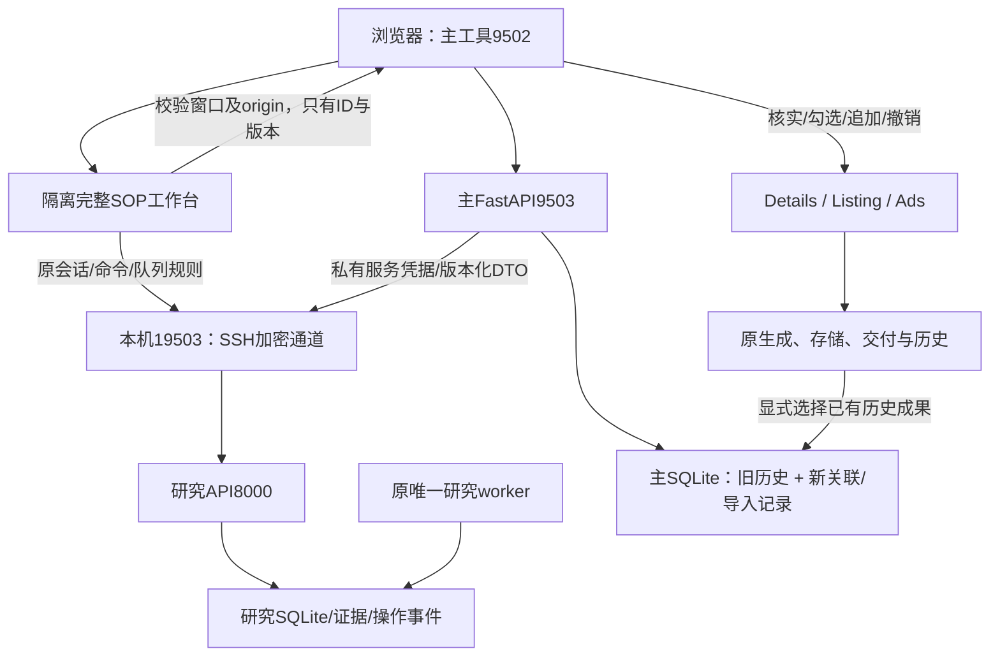

# 完整融合交付与运维

2026-10-09。用户已明确授权实施并要求继续完成。本文件是当前交付范围和运行方式的权威记录；01–05为源码评估与历史计划，06为此前阶段0–3的MVP记录。采用方案C，保留方案B的服务边界。

## 十个核心问题

1. **能融合**：已经完成统一入口、完整SOP工作台、受控接口、人工事实交接、持久档案和营销成果关联。
2. **值得融合**：研究、证据、决策与复盘沿用SOP成熟实现；生成、品牌、图片、导出与存储沿用主项目成熟实现。
3. **直接复用**：七市场字典、计费重与销量情景的纯算法；完整研究工作台通过隔离页面复用。
4. **已适配**：研究DTO、分页与任务摘要、服务认证、SSH连接、人工核实命令、操作回执、事实预览、三个营销草稿入口、持久导入与历史成果关联。
5. **重复能力有明确归属**：营销AI由主项目原路由负责；研究原始证据提取、研究翻译与自动采集继续由研究服务负责。两套Tailwind和全局JS保持页面隔离，两个SQLite保持独立。
6. **回归风险可控**：旧表、旧接口和原业务功能保留，两边完整回归通过。研究离线不会阻断主营销功能或本地计算。
7. **推荐方式已经落地**：渐进融合、主架构优先，研究作为有明确契约的领域服务。
8. **整体架构**：主FastAPI与原生JS提供营销入口；本机SSH端口19503连接研究API；完整研究界面嵌在单独origin的iframe中；研究唯一worker处理原队列。
9. **八阶段实施已交付**：0备份/基线，1纯工具，2只读契约，3人工交接，4能力边界/可选结构化适配器，5完整工作台/命令回执，6持久关联，7回归/部署/恢复。可选跨机器实时AI代理保持关闭，见范围裁决。
10. **最大风险**：竞品信息冒充自有事实、重复提交、身份变化后沿用旧证据，以及恢复时覆盖新成果。逐字段人工确认、版本/身份校验、原编号核对、独立事务和保留新记录的回滚规程共同防止这些问题。

## 实际架构



浏览器不拿研究服务Bearer凭据，也不跨origin读取研究原始state。iframe使用本机SSH通道加载原界面和原API，脚本、样式、S/$与主页面隔离。只有专用`/marketing-workbench`允许主项目四个本机origin嵌入；研究原`/`仍禁止嵌入。收起工作台或离开研究页会销毁iframe，结束其页面轮询与事件流。

## 使用方式

1. 从 `http://127.0.0.1:9502/index.html` 打开应用，进入“选品研究”。`file://`页面不会获得安全会话；不要放开`Origin:null`来绕过这一限制。
2. 展开“完整SOP工作台”，使用原关键词审核、商品识别、采集队列、证据、物流核算、评分、决策和测试复盘界面。采集、AI和同步仍由你明确发起，桥接本身不发起付费任务。
3. 在工作台选择商品，可点击“将当前商品交接到营销工具”。桥接仅传项目ID、商品ID、国家、版本、身份版本；主后端重新读取并校验实际资料。
4. 按自有商品资料逐项确认事实，填写核实来源并明确确认自有产品。AI推断、未知、失效、已合并或旧身份事实不会成为可交接声明。
5. 勾选预览中的事实，填入详情页、Listing或广告草稿。现有名称保留，事实追加，撤销仅恢复未被后续人工改动的输入。生成、上传和发布仍走原功能按钮。
6. 也可将所选事实保存为营销档案。它保存精确来源版本、国家、身份、时间、事实与证据引用；不自动改写全局品牌档案Hub。
7. 在已保存档案中选择成果类型，读取该类型最近50条历史摘要，再显式关联已有成果。服务端校验历史ID存在；旧历史原始内容、图片和数据库表不改。
8. 回到完整工作台人工记录测试与复盘。成果关联保留主营销历史的引用，研究决策与复盘保持研究服务自身状态机。

档案列表支持分页。研究离线后本地档案仍可查阅；旧档案再次交接需要重新核对来源。来源已变更/删除时保留历史档案，要求核实当前资料，不自动升级旧事实。成果引用记录关联时的历史ID，原历史后续被人工删除不会伪造或重建该成果。

提交超时不自动重发。人工事实确认使用原操作编号查回执；档案保存编号和原请求保存在当前标签页的sessionStorage，刷新后可“核对上次档案保存”或“重试原档案保存”。重试使用完全相同ID和请求；明确409/422/403后解除待核对状态，要求重新预览。模糊结果继续保留编号。

## 文件与接口

| 主项目文件 | 职责 |
|---|---|
| `backend/routes/research.py` | 本机会话、来源校验、读/命令/回执/任务摘要、档案与成果选择接口 |
| `backend/models/research.py` | 严格DTO、UUID、有限数值、aware时间、跨项目和版本约束 |
| `backend/services/research_client.py` | 固定目的地、无重定向/自动写重试、2MB响应限制、安全错误 |
| `backend/services/research_mapper.py` | 只有当前人工核实事实进入逐字段预览 |
| `backend/services/research_repository.py` | 独立新增表、BEGIN IMMEDIATE事务、导入digest幂等、成果revision冲突控制 |
| `backend/migrations/research_links_v1.py` | 显式加法迁移；应用启动不会自动运行 |
| `backend/services/structured_ai_service.py` | 可选严格schema生成器，委托原AIRouter，失败不修补/不造文案 |
| `backend/services/research_tunnel.py` / `run.py` | 只管理自己的SSH子进程，断线重连，不管理研究worker |
| `frontend/js/research.js` / `frontend/css/research.css` | 隔离工作台、可信消息、恢复、预览、草稿、档案与成果关联 |
| `frontend/index.html` / `frontend/js/app.js` | 研究入口与原导航集成 |
| `frontend/js/ads.js` | 交接事实实际进入广告输入、生成参数与草稿恢复 |

| 研究项目文件 | 职责 |
|---|---|
| `src/rabbit_hole/api/integration.py` | 私有认证、只读DTO、原USER_ACTIONS白名单命令、命令回执、有界任务摘要 |
| `src/rabbit_hole/application/integration_contracts.py` | 脱离原始state的契约、事实信任/新鲜度、来源URL规范化 |
| `src/rabbit_hole/domain/marketing.py` | 人工核实事实事件，沿用原事务/digest/版本机制 |
| `src/rabbit_hole/api/workbench.py` | 仅新增专用嵌入入口，原API会话/跨站防护保留 |
| `frontend/services/marketing_bridge.js` / `frontend/build.mjs` | 可信父窗口握手、只发送ID与版本，原工作台页面复用 |
| `src/rabbit_hole/integrations/marketing_ai_adapter.py` | 可选依赖注入式假设生成契约，不含凭据或隐藏重试 |

主接口前缀`/api/research/v1`：`session`、`markets`、`math/*`、`projects`、`projects/{id}`、`report`、`actions`、`commands`与`commands/{id}`、`confirm-fact`、`confirmations/{id}`、`preview`、`imports`、`imports/{id}`、`artifact-choices`、`imports/{id}/artifacts`。研究私有前缀`/internal/integration/v1`。服务不把provider配置、完整事件和原始证据正文透传到摘要。

## 阶段4范围裁决：保留用途差异

共享能力的统一入口已通过“研究事实→主营销草稿→原callAI/AIRouter”实现。`StructuredGenerator.generate(schema, system_instruction, untrusted_data)`以及研究侧`generate_hypotheses(generator, title, market)`提供严格、无隐藏重试的可选调用契约，fixture验证合法输出、非法JSON/额外字段失败、单次委托和不可信数据边界。

**没有启用跨机器实时AI代理，也没有把它接到现有研究付费调用点。** 研究的Responses提取、原始HTML/selector/hash证据与研究中文翻译具有不同输出和证据政策，强制替换会增加回归和重复计费风险。此部分归类E，保留研究provider、预算、版本和原重试规则。主营销provider设置仍是原主SQLite配置。今后若启用可选适配器，需要单独为研究调用签名、预算、操作幂等、取消与超时语义提供完整在线协议；本次不宣称已接通。不同用途的抓取/翻译配置也保持各自作用域，避免共享密钥和误改语言政策。

## 数据与部署

主库增加三张表：`research_schema`（revision=1）、`research_links`、`research_import_events`。与旧SQLAlchemy metadata分离，旧`init_db()`不会自动建这些表。两个业务库不搬运、不合并、不分布式双写。保存档案时远端HTTP先完成，再在主本地短事务内原子保存link与event；因此档案明确代表读取时的版本，不承诺跨库事务一致性。

同import_id、同digest返回原记录，即使研究服务离线或来源更新；不同digest返回409。成果关联检查旧历史ID和选择时的生成时间，防止删除后编号复用导致误关联；按link revision检测并发，重复同引用幂等。旧历史模型/结构不改，品牌Hub不被静默覆盖。

部署前新增私有备份：

- 主：`~/.local/share/ai-ecommerce-merge/backups/20261009-complete-main`。
- 研究：`/Users/xcp/rabbit-hole-migration-backups/merge-complete-20261009`。

含SQLite online backup、源码/Git bundle、证据/私有配置、独立恢复副本；另保存前端dist制品，主服务配置也独立以600权限备份。初始阶段0备份仍保留。配置与凭据不提交，构建产物、业务库、生成文件、测试日志也不提交。

显式迁移命令，必须先备份，并使用保留`.venv`路径的解释器：

```bash
.venv/bin/python backend/migrations/research_links_v1.py --database backend/history.db
.venv/bin/python run.py
```

主服务配置仍在`~/.local/share/ai-ecommerce-merge/research.json`，研究在`/Users/xcp/rabbit-hole-data/integration.json`；缺配置禁用集成。研究私有命令入口另受`allow_commands`开关限制，确认受`allow_confirmations`限制。原研究worker保持原实例；未启第二consumer、Docker兼容worker或旧PG迁移。

## 验证与实际限制

隔离环境：主完整后端702通过、1跳过，前端496通过；研究完整后端1151通过、4跳过，Node10通过，Ruff/Mypy通过（79源文件）。两边使用独立测试源码、临时SQLite、文件/凭据fixture；没有调用真实付费服务或写入合成生产业务记录。

新增重点验证：显式/幂等加法迁移，旧metadata隔离，四线程同操作一次提交，冲突409，备份恢复，来源失效拒绝，离线重复操作核对，原历史不改，成果选择不返回payload，消息origin/窗口拒绝，离开页面销毁iframe，刷新后原编号重试恢复，独立页CSP继续禁止嵌入，localhost别名导航兼容但跨站API仍拒绝。

实际部署只读验收：项目列表、任务摘要、本地档案和专用嵌入页均200；本地尚无测试造出的业务档案，`Origin:null`拒绝403，研究独立页CSP仍禁止嵌入。浏览器1920×1080验证127.0.0.1及localhost入口工作台可用、无横向溢出，商品ID交接进入主预览，未核实事实保持不可交接；离开研究页iframe被销毁。

只终止本次run.py拥有的SSH子进程，研究列表短暂503，本地档案、计算与原`/config`均200，连接自动恢复；没有重放写操作或影响另一条既有SSH连接。10次只读项目请求保守p95为223.4ms（小数据集1项目，不能代表大规模负载）。完整灾难恢复和原主性能p95增幅SLA未测，不作达标声明。

旧15张主业务表、14张研究表及原静态资产/证据/provider内容与阶段0摘要一致；只排除研究自身正常更新的`runtime_health`心跳。新增三张主关联表后再做online backup及独立恢复，比对18表逻辑内容/integrity/FK通过，单数据库复制/校验约0.20秒，不能当作整套服务RTO。研究worker仍为原PID88736。

真实AI、采集、翻译、同步、上传、发布与广告投放未作为本次生产验收执行；原本未连接/需要订阅授权的第三方渠道继续显示原状态。隔离测试通过不等于这些外部链已生产验证。独立审查产出了上述两项恢复/兼容问题并修复；审查工具随后达到其用量上限，不能称已完成无保留的独立全分支审查。

## 回滚与恢复

1. 先关闭主research配置中的`enabled`，关闭研究`allow_commands`/`allow_confirmations`，收起嵌入工作台。主旧工具仍按原流程运行。
2. 回退本次明确的源代码制品，使用此前MVP或初始Git bundle；不要执行`git reset --hard`或清空工作树，不覆盖无关修改。研究只按原LaunchAgent重启API，保留唯一worker；主由原run.py管理进程。
3. **保留新增表和已经成功的导入/关联记录**。旧代码忽略它们，禁止为回退DROP表。研究events、动作结果与成功资产也不删除。
4. 数据恢复只在确需恢复时进行：先再备份当前新数据，停止相应写入/唯一worker，恢复对应SQLite在线备份及配套证据/版本/签名key/provider vault，校验integrity/FK/hash，在隔离副本重放备份后合法事件，再由原服务所有者恢复。不得用旧PG或旧DB覆盖新有效数据。
5. 恢复副本已经验证；没有部署定时备份，也没有测量整套服务的灾难RTO/RPO，原计划RTO≤2小时/RPO≤24小时仍是运维目标，不能当作已达成SLA。
