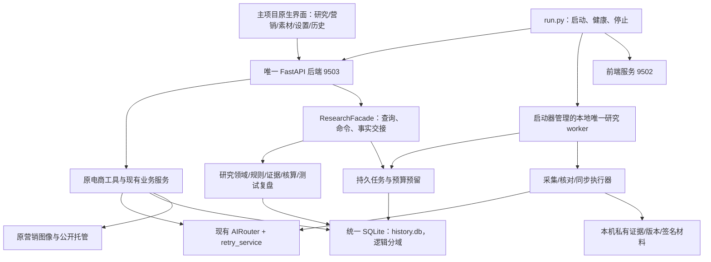

# 完整归并架构方案：一个项目、一个部署、一套入口与数据

日期：2026-10-09。状态：**架构方案已于2026-10-09由用户回复“确认”批准；实施计划见10，尚未开始执行。**

主项目基线：`3af17755c1e1038df362329529a6e76a1be8c2cd`；研究项目基线：`b749491c29fce8ac5bdad613f1ef569cb6df186b`。

本方案调整此前的终态：07 文档交付的是远端服务集成；这次要求的是 SOP 完整进入主项目，退出远端运行依赖。此前成果保留并作为迁移桥梁，不再将 iframe、SSH 隧道或远端接口集成认定为完整归并。

## 1. 目标与完成定义

用户明确要求完整融合到一起、先出完整方案。本方案采用以下设计假设：以当前 Mac 上的 AI E-commerce Tools 为唯一代码仓库和部署项目；保留主项目技术栈与原有能力；迁入 SOP 已实现功能、历史研究、证据和恢复能力；最终不需要远端电脑在线。

“完整”必须同时满足以下条件，缺一项只能称过渡阶段：

1. SOP 业务源码及测试进入主仓库；日常维护无需另一个源码目录或仓库。
2. 一次启动管理主 API、前端与本地研究 worker，使用同一 Python 环境；不另起 SOP API 服务。
3. 研究操作全部进入主侧栏的原生研究视图；没有 iframe、外部 SOP 页面或跨窗口交接。
4. 主业务、研究、任务、审计、导入及关联记录最终存入同一个本地 SQLite 数据库。逻辑模型保持分域，不能混成一张通用历史表。
5. 私有研究证据、版本与签名材料归统一的本机数据根目录管理；与公开营销图像仍保持访问和清理策略隔离。
6. AI 的提供商、绑定与重试由主项目现有体系负责；研究结构化结果与引文规则保留，浏览器和 worker 都不绕过路由直连 AI。
7. 设置、状态和任务查看入口统一，保留采集、阿里云翻译、飞书等各自凭据和预算语义。
8. 原研究数据及主历史完整可读；导入档案仍可回溯到原项目、商品、版本和证据。
9. 在停止远端研究服务且不依赖 SSH 的环境中，所有已实现本地功能与模拟外部契约测试通过。
10. 数据切换期间只有一个有效研究任务执行者，不重复采集、计费、同步或上传。

完整融合不意味着强制只有一个操作系统进程。浏览器采集与长任务仍由**同一项目管理的 worker 子进程**执行，避免拖垮主 API；这不再是另一个项目或独立部署。外部供应商与平台授权依赖不会因为归并而消失。

## 2. 本轮源码核验：事实与限制

下文 `M/` 代表本机主项目根目录；`R/` 代表远端 `/Users/xcp/rabbit-hole`。引用均为当前源码，不沿用旧项目文件名推断。

| 核验事实 | 实际依据 | 对归并的影响 |
|---|---|---|
| 主项目 Python 3.12.14；研究当前环境 Python 3.14.8，但声明支持 >=3.12 | 主 `.venv` 实际版本；R/pyproject.toml `requires-python` | 首选保留主 3.12；研究在 3.12 的全量测试和 Chromium 运行必须补验，不能以版本声明代替验证 |
| 两端当前 FastAPI 0.141.1、Pydantic 2.13.5、SQLAlchemy 2.0.52、HTTPX 0.28.1 一致 | 两端环境 `importlib.metadata.version` 只读查询 | 无已发现的这四项运行版本冲突；其余依赖仍需解算与测试 |
| 主依赖声明未锁版本，研究声明有范围限制 | M/backend/requirements.txt；R/pyproject.toml | 不能直接拼接依赖文件；需保存主现有环境快照并建立验证后的合并锁定清单 |
| 研究原生启动要求 SQLite + files | R/src/rabbit_hole/runtime/native.py:37–49 | 当前部署已不以 PG/MinIO 为必要条件，旧评估相关结论不能直接作为本次阻碍 |
| 研究有 SQLite 方言、UTC 转换、BEGIN IMMEDIATE、WAL、进程文件锁 | R/src/rabbit_hole/persistence/sql.py:21–159 | 可保留并适配到主库，不能只搬表而丢事务与 worker 所有权 |
| 研究元数据扫描识别 14 个表名，未与主模型表名发现直接重名 | R/persistence/database.py、projects.py、migrate_local.py；application/actions.py、sync.py；monitoring.py；integrations/provider_jobs.py；M/backend/db.py、migrations/research_links_v1.py | 预计可新增原名表；正式迁移须以实际两库 schema 清单、索引/约束和模型注册差异为准。主已有 18 表见07历史验收，本轮没有重新查询生产库计数 |
| 两端事务策略不同 | M/backend/db.py:18–34；R/persistence/sql.py:39–67 | 需验证多个同步/异步连接共享文件时的写锁与持久性，不能一边 NORMAL 一边 FULL 就宣称统一可靠 |
| 研究现有 worker 独立，SQLite 分支持有进程锁，动作有 lease/attempt fence | R/runtime/workbench_worker.py:44–83；R/application/runner.py:96–229；R/application/actions.py:59–60 | 迁入本地后保留独立 worker 与尝试围栏；远端和本地副本的文件锁不能互相排斥，必须另有切换屏障 |
| 研究原生页面有全局 S、$、全局函数、轮询和根路径 API | R/frontend/services/state.js:5–6；api.js:15–24；bootstrap.js:1–2 | 不能把拼接后的整段脚本塞入主 HTML；需变成有挂载/卸载生命周期的研究模块 |
| 主 Tailwind 3，研究 Tailwind 4 | 两端 frontend/package.json | 保留主 Tailwind 3；研究样式改为局部 CSS/主设计令牌，不能同时加载两套全局 preflight |
| 研究结构化抽取使用 Responses.parse，核对使用 Chat Completions JSON | R/extraction.py:495–544；R/application/verification_jobs.py:122–155 | 当前主 StructuredGenerator 不能直接覆盖所有研究 AI 场景；必须补类型/协议/引文契约 |
| 研究直接 AI 调用、提供商文件、预算、翻译均有独立逻辑 | R/integrations/project_direction.py；ai_settings.py；provider_budget.py；ad_translation.py；M/backend/services/ai_router.py、retry_service.py | 统一配置/调用与预算不是简单改 base_url；阿里翻译不应被静默替换成主文本翻译 |
| 主启动时 init_db，static 启动清理有24小时 TTL | M/backend/main.py:226–238；storage_cleanup_service.py | 新研究 schema 必须显式迁移；证据不得存进或被清理器遍历营销 static |
| 当前研究联通依赖固定地址 HTTP Client 与 SSH，原生工作台仍 iframe | M/backend/services/research_client.py:39–93；research_tunnel.py；frontend/js/research.js:317 起 | 新终态替换为内部 Facade 和原生 UI，旧 Client 只作迁移期可回退适配器 |
| 本机缺研究运行包 | 本机只读 find_spec：aiosqlite/openai/playwright/boto3/pydantic_settings/prometheus_client/alembic/psycopg 未发现 | 不能声称已有环境可运行迁入研究；依赖安装、浏览器安装仅在后续获准执行时进行 |

源码包含 79 个研究 Python 文件。数量与已交付测试计数只能代表盘点范围；本轮未重跑两端完整测试、未做供应商连通测试、未迁移数据、未读取或输出密钥。

**需要在实施阶段验证的事项**：3.12 全量兼容、macOS 浏览器二进制/权限、实际库 schema 与对象体积、外部在途任务数量、浏览器本地草稿迁移、各付费模型的结构化支持、单库写入性能、绝对路径/签名材料迁移及恢复时限。旧文档测试结果不等于这些新问题已解决。

## 3. 三种真正归并的路线

| 路线 | 最终形态 | 优点 | 缺点 | 裁决 |
|---|---|---|---|---|
| A：同仓同机，保留两个 API/两库 | 一个仓库与启动器，两个本机服务及数据库，页面逐步合并 | 搬迁较快、初期风险较低、摆脱远端 | 两套生命周期/设置，跨库业务仍不原子；不满足本方案的同 API/同库终态 | 只允许作为过渡，不能宣告完整完成 |
| B：以主栈为核心的模块化单体 | 一个仓库、一个 API、一个数据库、原生主 UI、受控 worker | 满足全部完成定义；保留原主栈；研究领域逻辑可复用；运维与入口统一 | UI、事务、AI和数据迁移适配工作较多 | **推荐**，按阶段过渡到这个终态 |
| C：统一改造为全新框架/服务平台 | 双方大规模重写、换前端/持久层/任务平台 | 可设计全新扩展体系 | 牺牲主已稳定实现，难验证历史兼容，成本和故障范围最大 | 不推荐；无源码证据说明必须换栈 |

选择 B 的理由：两端实际 Web 和模型依赖一致、SOP 已有 SQLite/files 适配，可以在保留研究规则的同时完成本地化及同库化。A降低搬迁风险但仍不是用户想要的完整终态；C则缺少值得全面重写的收益依据。

## 4. 推荐终态与目录



保留现有 9502/9503 地址与启动习惯。9502 与9503是两个浏览器 origin，研究 API 的 origin 白名单必须明确包含两个主地址的127.0.0.1/localhost变体；不能搬原 SOP 的“origin必须等于 API Host”规则后导致主页面403。研究写操作继续需要会话token和命令幂等。

建议目录（以下新增路径是设计，不是已存在文件）：

```text
AI E-commerce Tools/
├── run.py                              # 原入口，管理本地研究 worker
├── backend/
│   ├── main.py / db.py                  # 原入口/模型，保留既有端点
│   ├── routes/research.py               # 兼容现有 /api/research/v1
│   ├── routes/research_workbench.py     # 新完整研究业务 API
│   ├── routes/integration_settings.py  # 研究采集/翻译/飞书设置
│   ├── modules/research/
│   │   └── rabbit_hole/                 # 迁入现有包，保留内部 import 名
│   │       ├── domain/ application/ persistence/
│   │       ├── integrations/            # 平台采集和翻译保留，AI改注入
│   │       └── runtime/                # 本地 worker；旧 API启动不激活
│   ├── services/research_facade.py      # 内部调用，替代网络 ResearchClient
│   ├── services/research_runtime.py     # 显式初始化/关闭业务依赖
│   ├── services/research_ai_adapter.py # 主 AIRouter -> 研究强类型契约
│   ├── services/integration_settings_service.py
│   ├── migrations/full_merge_v1.py     # 显式 schema/离线数据归并入口
│   └── tests/research/                 # 迁入测试及新增归并回归
├── frontend/
│   ├── index.html / js/app.js          # 原主壳、原工具保留
│   ├── js/research.js                  # 现有交接与计算兼容
│   ├── js/research-workbench/
│   │   ├── index.js                   # mount/unmount、模块状态
│   │   ├── api.js / state.js
│   │   ├── pages/ components/         # 原SOP页面逐项模块化
│   │   └── settings.js / history.js
│   ├── css/research-workbench.css      # 限定研究根容器，无全局reset
│   └── tests/research-workbench/       # 研究流程与主UI共页回归
├── scripts/full_merge/                # 盘点/快照/校验/切换/恢复工具
├── docs/merge-assessment/
└── .venv/                             # 唯一项目 Python 环境
```

将研究包保留名 `rabbit_hole` 可降低79文件内部import改写风险，但它物理上属于主仓库。统一启动器为 API 和 worker 传入同样的模块搜索路径，禁止运行时依赖远端源码路径、用户其他 checkout 或未声明的 editable install。API与worker均显式传入同一个SQLITE_DB_PATH及研究database_url；worker内AIRouter的主db导入也必须解析为这一文件，不能按工作目录新建第二个history.db。

私有运行数据建议根目录：`~/.local/share/ai-ecommerce-tools/`；其中 `research/evidence/`、`research/keys/`、`research/browser-profiles/`、`research/locks/` 分别管理。主 `backend/history.db` 本轮保留原位置，避免无收益地迁动已有主数据；统一路径解析器显式记录它。一个数据管理入口不要求将私有证据暴露在项目 Git 或静态 HTTP 根目录。原研究session_lock默认在数据库父目录创建.locks，迁入后须适配为显式私有lock_root，API和worker共用同一根；不能照搬后在backend目录遗留未忽略的锁文件。

## 5. 功能归属与全部覆盖

| 能力 | 终态处理 | 关键迁入源码/主适配点 |
|---|---|---|
| 项目、新建方向、国家、关键词审核/路径 | 主研究视图，沿用研究命令及版本 | R/domain/project.py、integrations/project_direction.py；frontend/pages/projects.js、project-forms.js、exploration.js |
| Meta/Trends及现有其他来源、采集预算、云任务、来源可行性提示 | 本地 worker 与原采集适配器；缺授权保持未配置 | R/application/runner.py、integrations/collectors/、provider_budget.py；api/workbench.py sources |
| 商品识别/相关性核对、原文广告、商品页与媒体读取 | 原规则保留，主原生商品页与受控媒体 API | R/extraction.py、application/verification_jobs.py、integrations/media_download.py；frontend/pages/product.js |
| 证据原件、hash、引用、版本、过期和身份围栏 | 私有版本库及主受控证据预览 | R/domain/evidence.py、persistence/evidence_store.py、local_objects.py |
| 初筛、渠道证据、竞品、经济核算、评分、决策 | 沿用研究资格/Unknown规则；主机会评分仍独立存在 | R/domain/、scoring.py；frontend/pages/triage.js、focused-exploration.js、product.js |
| 测试计划、真实结果、复盘、报告导出 | 主研究流程与营销成果关联，禁止伪造投放结果 | R/domain/project.py、frontend/pages/reports.js；M/research_repository.py |
| 任务进度、停止、明确重试、日志、预算、恢复 | 唯一 worker + 原 lease/fence，统一状态入口 | R/application/actions.py、runner.py、integrations/provider_jobs.py、runtime/workbench_worker.py |
| 阿里广告中文阅读翻译 | 保留专用语义/缓存/SDK，通过统一设置入口配置 | R/integrations/ad_translation.py；主文本/图片翻译不替换 |
| 飞书预览、人工同步、outbox与结果核对 | 保留原外部写入屏障，迁入本地执行 | R/application/sync.py、integrations/feishu.py |
| 原 phase-1 CLI/旧任务与legacy报表 | 源码及既有数据兼容迁入，不启动第二worker；逐job_kind盘点 | R/cli.py、worker.py、pipeline.py、runtime/legacy.py、persistence/legacy_jobs.py；未运行路径标记兼容，不宣称已弃用 |
| 主竞品分析、Listing、广告、详情、翻译、重绘、消除、托管、Launch Kit | 全部原位保留；只增加研究事实、来源与成果关联 | M/backend现有服务及frontend/js各原模块 |
| 研究事实交接/营销档案 | 内部服务读取最新研究状态，不再跨机；旧快照/导入ID兼容 | M/services/research_mapper.py、research_repository.py、routes/research.py |
| AI、设置、历史和日志 | 用户入口统一、用途分域；所有LLM走主路由；研究审计仍持久 | M/ai_router.py、retry_service.py、settings.js、history_manager.js；研究settings/logs适配 |

同一供应商的不同采集实现不是天然重复：主竞品 Firecrawl 解析与研究商品原文取证需保持不同限额/输入边界。两种评分不合成一个分数；私有证据不自动去水印/重绘/公开上传；研究审计不能被普通历史删除一并清除。

正式实施第0阶段生成逐路由、命令action、job_kind、页面、配置项与测试的迁移矩阵，每项都有迁入位置和测试。上述功能表是设计覆盖清单，不替代机器盘点；发现原实现没有接通的来源继续明确标为未配置/待实现，而不是伪装已迁完。

## 6. 后端与内部接口

新增 `ResearchFacade` 使用迁入的 WorkbenchStore/应用服务；路由只处理 HTTP DTO、guard和异常映射，不把整个原 SOP app mount 到主 app。主生命周期显式初始化研究 engine、store、证据 reader、同步/平台客户端，并在关闭时清理资源。研究初始化失败时原工具继续可用，研究显示错误；禁止导入模块时启动 worker 或付费探测。

`/api/research/v1` 已有 DTO 和档案端点保留；新原生工作台使用 `/api/research/workbench/v1`，映射原 `/workbench/api` 功能。原路径只在迁移期提供受控兼容，不成为另一个独立应用。`research_client.py` 的业务调用在内部适配完成后替换为 Facade；副作用语义继续保留404/409/422与结果未知，不能内部调用后自动重复命令。

单库只为**显式共用同一个连接/事务**的业务提供原子性。研究状态确认和新档案写入需要一致时，由 async UnitOfWork 将两者纳入一次短事务；现有 ResearchRepository 的独立 sqlite3连接不能直接嵌入。原营销history端点无须全面改异步，长期AI/采集请求不能持有SQLite写事务等待网络。

## 7. 单数据库与证据迁移

### 7.1 模型决策

保留主15张原业务表、已有3张关联表及数据格式；研究原表名先保留，不批量重命名 JSON 内嵌 ID。研究14个模型表包含 `workbench_*`、`runtime_*`、`daily_usage`、`collector_cache`、`job_checkpoints`、`feishu_outbox` 及来源迁移版本表；实际目标表数由schema盘点决定，不能简单承诺18+14恰好32（新的迁移元数据/设置表可能另增）。

主 Base 与研究 metadata 不强行合并为一个 ORM Base。同一个 DB 文件可有不同模型集合，注册/迁移通过显式受控入口。原 `alembic_version` 不参与主schema版本判定：来源版本记入专用迁移账本，目标研究schema版本独立记录，兼容原模型前明确验证，不让两套迁移程序竞争。

统一所有写连接的 WAL/FK/busy_timeout，归并后的主库采用经测试的 FULL 持久性策略；对主原性能影响设基线和验收门槛。保持短事务和bounded并发，不用无限重试掩盖写锁问题。

### 7.2 搬迁流程（只作为后续执行设计）

1. 先在备份副本演练。主/研究在线SQLite backup，Git bundle及源码清单，证据全部版本/manifest、keys、配置、浏览器相关状态纳入私有备份；不把运行中WAL数据库普通复制当有效备份。
2. 对真实切换建立维护屏障：阻止新的研究命令，暂停/停止远端唯一worker，记录全部在途 action、attempt、lease、云runID及sync结果未知项。停止本地试验worker；远端主API相关写入口关闭。单机fcntl锁只管本机，不能靠它避免跨机双执行。
3. 在屏障后取最终源/目标快照，记录业务逻辑行数、规范化内容hash、UTC/UUID/JSON类型、约束、对象每个VersionId/hash。截取后源数据不得继续写入。
4. 先向主库副本显式创建研究schema，按依赖插入源数据。UUID保持原ID，普通历史主键不动，确认事实不升级为新可信状态；复制事件、命令digest、budget使用和结果缓存。索引、FK、unique、空值、时区逐项验证；错误失败即保留原库。
5. 私有文件用暂存目录复制全部版本并校验；保留 object key/VersionId和签名key。路径差异由受控数据根映射解决，禁止批量改历史原文/hash/已签署payload。无法映射的旧路径要登记并拒绝读，不做任意文件透传。
6. 未完成外部任务先查询已有runID/回执，在迁入状态中等待核对；不能把全部running直接改ready。结果未知的非幂等操作阻断自动重试；无外部副作用、可恢复任务也须在新所有者/attempt围栏下恢复。
7. 校验 FK/integrity、业务内容、引用、对象hash/签名验证、快照来源和锁归属，生成可机读迁移报告。失败不能启动worker。以同文件系统可恢复替换及已验证备份切换到候选库，保持主库路径不变；处理连接关闭/WAL/checkpoint，避免运行中替换。
8. 本地研究先只读上线，确认无远端依赖；再由操作者启用唯一worker并开放命令。远端保持冻结副本用于恢复，不能继续作为另一个可写研究系统。

首次演练后重新估算停机窗口。当前磁盘空闲约106.5 GiB，但源证据/浏览器/库的完整迁移体积尚未盘点；必须满足“当前数据+候选库+可恢复备份+预留空间”再执行，不凭空保证容量够。

### 7.3 回滚边界

尚未开放本地写入：停止本地进程，恢复切换前完整主库和证据根，恢复源worker唯一归属即可。

已开放本地写入：**不能直接把远端旧副本重新开写**。先冻结本地并备份新增有效数据，以迁移账本与事件核对增量，输出反向迁移/原库兼容恢复报告；完成DB、证据、外部回执一致校验后再交回所有权。优先回滚代码并保留新增表/数据，禁止DROP研究表、覆盖新记录或重放结果未知的外部写入。

## 8. AI、配置、预算与重试统一

AI设置用户只使用主提供商/能力绑定页面。研究默认用 `text` 绑定，保持主 `text/image` 原语义；如确有研究模型独立选择需求，通过主设置增加受验证的 operation override，禁止第二份 ai.json 在后台继续生效。

新增 ResearchAIAdapter 保持研究输入与输出契约：schema、未经信任的source文本、长度/token限制、引文source_id/content_hash/source_quote、模型版本及缓存键。现有 StructuredGenerator 有32000字节输入、1500 token上限，不能直接套到7000 token核对流程。为每类关键词/方向/核对/抽取请求设置明确上限；不截断有效证据后默默给出确认。

Responses.parse与主 normalized response 的差异由此适配器处理。优先把主路由结果严格解析为原Pydantic schema，并继续原引文及身份校验；如果某研究动作确需供应商专有Responses能力，应在主后端adapter内部实现受能力矩阵约束的operation，而不是恢复worker直连或强行使用不支持的模型。不支持时显示“当前模型不支持此操作”，允许更换主绑定；不伪造JSON或自动替换事实。

主 retry_service 负责AI的唯一网络重试；SDK关闭内部重试。研究runner只负责任务lease/人工重试/预算预留，不另包一层AI请求重试。研究次数与项目预算继续记录，预算预留以 action_id+attempt+operation 对应，网络重试不能无依据重复预留；实际供应商多请求消耗需独立记录。超时结果未知禁止自动切提供商；引文校验失败不变成已确认事实。

Apify/SerpApi/Firecrawl、阿里翻译、飞书配置通过主“研究与集成”设置页管理，后端IntegrationSettingsService作为唯一新读写入口。AI凭据迁入主现有provider模型；非AI集成凭据使用单独IntegrationSetting模型，按供应商与用途区分，默认不合并同名不同key。旧文件仅私有只读归档。初次迁移产生脱敏冲突报告，由明确策略选择，不能覆盖主已保存provider、默认绑定或Firecrawl密钥。

保留原阿里云翻译模式、TTL/缓存和关闭SDK自动重试；统一设置不意味着统一模型或偷偷改翻译供应商。飞书同步/Apify启动等外部副作用保留原人工触发与回执，不因归并自动补跑。

## 9. 原生 UI、设置与历史

主 index/app 壳与原工具保持。研究页面迁成 ES module：`mount(root, context)`、`unmount()`、组件与page显式import/export；状态在研究实例闭包中，去掉全局 S/$ 污染。卸载终止轮询/SSE/AbortController，保留服务器已成功状态；切换、刷新和超时恢复仍复用原 command_id/digest草稿机制。

原项目/关键词/队列/商品多步骤/报告/设置页面逐项迁入，样式限定 `.research-workbench`；重用主按钮、弹窗、输入及颜色令牌。研究Tailwind4产物不直接全页加载；以源码样式和页面类名盘点，转换为主Tailwind3兼容类或局部CSS，验证暗色/响应式/表格/对话框和原详情工作台无回归。

研究事实交接改内部事件/选中商品上下文，仍由服务器重新读取当前状态和预览确认；不以浏览器传来的一段商品对象作为真相。取消postMessage/iframe后仍保留已有导入快照与撤销规则。

浏览器草稿属于原研究origin的localStorage/sessionStorage，不在SQLite备份里；新origin不能直接读取。切换前提供由用户主动导出的有版本草稿包，再由主入口校验导入，过期version先核对服务器；token/key不导出。若未导出，只能说明旧标签页草稿未迁，不能声称全状态无损。

统一历史抽屉增加研究活动/研究报告/营销档案分类，查询应用服务。业务审计保持不可经普通“删除营销历史”清除；原“重置所有草稿”不得清空研究项目、已确认事实、队列或证据。统一日志入口展示主进程SSE与研究持久任务日志，并保留类型/生命周期区别。worker直接使用AIRouter时，原内存日志属于worker进程，不能自动出现在主SSE；为研究动作写入脱敏的持久事件/关联ID，由主查询或流式转发，验证背压与消息大小，禁止为了转发日志复制secret或原prompt。

## 10. 运行、依赖与安全

run.py 继续9502/9503并管理本地研究worker的启动/健康/停止，缺迁移报告或worker重复归属拒绝研究写入；worker故障只降级研究，主功能继续。退出只终止当前启动器拥有的子进程，不扫杀Python/SSH。旧research_tunnel默认退出启动链，远端地址/Bearer不再影响正常运行。

依赖方案：保留本机Python3.12和当前主版本，新增研究必须的运行库并冻结验证结果；依赖解算与安装在后续执行阶段。PG/MinIO兼容包若迁入源码仍直接import就需要声明，不能因“不使用PG”直接删psycopg/boto3造成导入崩溃；将可选import拆分有对应测试后才可从默认部署去除。旧CLI如保留需另列可选extras，但不能产生另一套默认运行环境。

Chromium需在本机安装经验证版本或使用已验证系统浏览器；不能把远端macOS/Python3.14 venv和浏览器目录直接复制当本机环境。锁文件、依赖快照和版本清单进入仓库，浏览器binary、profiles、credentials、数据及产物继续忽略。

监听仍仅本机；统一研究guard允许原主前后端来源并拒绝null/外站/任意Host；无须为本地归并新增公网上线、RBAC或放宽CORS。证据受token/项目归属校验返回，签名key/服务凭据不下发浏览器。私有根目录路径检查、原件版本/不可变hash、SSRF规则、日志脱敏保留。旧研究允许的LAN地址不能无意把主项目监听范围扩大。

## 11. 分阶段路线、验收与回滚

阶段是推荐次序和可执行边界，正式逐任务实施计划在本方案获审后编写。每阶段先在隔离副本实施；外部链默认stub，真实付费操作另作明确验收，不用生产数据构造测试。

| 阶段 | 具体交付及文件 | 依赖/验收 | 回滚与估算 |
|---|---|---|---|
| 0：新基线与切换设计 | scripts/full_merge inventory/backup/verify；逐action/路由/表/asset/secret/草稿矩阵；两端快照 | 核验备份恢复、源码hash、库logical hash、所有证据版本和唯一worker；记录原性能/任务状态 | 不改业务；保留原部署；3–4人日 |
| 1：研究源码归仓及同环境验证 | backend/modules/research/rabbit_hole；backend/tests/research；统一依赖锁和测试fixture | 依赖0；Python3.12研究全套及主套件通过；包导入不创建生产DB/调用网络；无远端搜索路径 | 新模块不注册、不激活，主原运行不受影响；4–6人日 |
| 2：本地持久层与worker演练 | research_runtime、worker启动管理、测试隔离数据根 | 依赖1；研究库副本/files在本机执行；双worker拒绝、停止/崩溃/lease恢复正确；无付费操作 | 关闭新worker，仅保留测试副本；4–6人日 |
| 3：内部 API 与短事务 | research_facade、research_workbench路由、main显式生命周期、v1兼容 | 依赖2；全路由契约/来源guard/命令幂等/冲突；断开远端后查询和模拟命令可用；长请求无持锁 | 模块开关回到现有远端Client；不能混用两个写者；4–6人日 |
| 4：原生完整研究 UI | js/research-workbench pages/components、局部CSS、index/app/settings/history | 依赖3；原SOP所有现有页面/命令可达；无iframe/global污染；主所有原视图回归；挂载/卸载/草稿恢复 | feature开关回原研究入口；研究服务器数据不删；8–12人日 |
| 5：AI及集成配置归一 | research_ai_adapter、IntegrationSettingsService/schema、原AI调用点注入 | 依赖3；研究schema/引文/缓存/预算保持；唯一retry、结果未知阻断、masked secret、blank保留、配置冲突；无worker直连LLM | 隔离环境退回旧adapter；生产切换后保存新设置，回退需导出兼容映射；5–8人日 |
| 6：同库及真实资产迁移演练 | full_merge_v1、migration ledger、对象复制/校验/恢复、UnitOfWork | 依赖3/5；主原表内容保持，研究ID/事件/预算/objects完整，类型转换验证；锁压力/快照一致/恢复验证 | 所有操作仍针对候选副本，原运行不变；5–8人日 |
| 7：冻结切换与本地唯一上线 | 最终快照、单库替换、私有数据根、草稿导入、source ownership屏障 | 依赖4/6；停止远端worker并冻结写入，先本机只读校验，再启唯一worker；已有runID只核对不重发 | 开写前整套快照回退；开写后按7.3保留并核对增量；2–4人日加实测停机窗口 |
| 8：完整验收和退出旧运行链 | 归并验收报告、新release manifest、运行/备份/恢复手册；run退出隧道/外部API/iframe路径 | 依赖7；远端服务停止且SSH禁用条件下主/研究均工作；隔离全套、故障注入、旧数据完整、备份恢复；真实外部链单列待验 | 保留冻结远端备份；不删除源码/数据以“清理”；维护期回滚遵循增量规则；3–5人日 |

估算总计约38–59人日，属源码基础上的工程推断，包含前端全量迁入、测试和两库到单库演练；不含第三方开通、新平台开发、人工证据核对、审批等待和超大资产传输时间，不是承诺交付日期。第0/1阶段后用实际迁移矩阵和测试结果重新估算。

## 12. 必须补充的验证清单

- 主原后端/前端全套及研究迁入全套，在统一Python3.12、隔离数据库/目录运行。现有两套测试fixture须先消除环境变量/metadata/pytest导入污染，不能让测试接触生产provider和TTL目录。
- 研究路由逐项契约：新建/命令/预算/停止/重试/媒体/报告/翻译/飞书preview/sync；工作台轮询和SSE恢复；缺授权显示旧行为。
- SQLite：主同步history与研究async并发写、BEGIN IMMEDIATE/timeout、FK/UTC/UUID/JSON、事件唯一性、同操作幂等、业务/档案同事务故障注入、启动migration拒绝条件。
- worker：两个进程争锁、跨机器所有权屏障、突然退出、取消中的SDK调用、旧attempt提交、未知云run状态、不重放sync/图像生成/上传。
- AI：同主binding生效、各schema上限、原文quote/hash校验、注入文本、证据缺失、invalid JSON、模型不支持、Retry-After、budget预留、SDK不重试、超时未知、secret脱敏。
- 数据：恢复演练验证所有旧业务表/研究项目events/actions/outbox/cache和证据全部版本；签名验证、历史绝对路径、缺对象、损坏hash、磁盘不足、迁移中断后再次执行不重复插入。
- 浏览器：在主同页操作所有研究页面，原详情/PDP/上传/翻译/设置无CSS/全局函数冲突；窄窗和桌面，切换页销毁轮询，刷新保持command_id，旧origin草稿显式迁移；无iframe/postMessage依赖。
- 退出远端：实际停止源研究API/worker并断开SSH条件下，主研究/营销/历史能使用；供应商调用只用fake transport验证，真实调用能力未测项明确登记。

性能门槛先采集原基线，再在同数据规模下比较：建议主非AI本地接口p95增幅不超过20%，命令冲突不产生重复事件，bounded压力测试无未处理database locked；这是设计验收门槛，尚无本轮测量证明达标。观察期建议至少7个实际使用日，免费/付费链覆盖分别记录；观察期并不许可无授权的自动付费探测。

## 13. 风险与解决措施

| 风险 | 等级 | 必须采取的措施 |
|---|---|---|
| 两机器并行worker重复计费/同步 | 高 | 写入口冻结、远端所有权退出、保留runID、单独核对未知状态；本机锁不能代替跨机屏障 |
| 覆盖主数据/丢失研究证据或签名 | 高 | 两端在线备份+所有版本对象、候选库演练、逐行/对象hash、签名验证、真实切换后增量回滚 |
| 研究AI结构化/引文退化为营销推断 | 高 | 原schema与引用验证保留，逐动作适配，禁止无事实fallback，provider不支持则明确阻断 |
| 单SQLite写锁影响原主工具 | 高 | 短事务、同库测试、无网络持锁、受限并发、性能门槛；不达标先优化，不能以再留远端宣告完成 |
| 两套前端全局变量/样式相互破坏 | 高 | ESmodule生命周期、局部CSS、同页原功能回归；不直接复制拼接产物 |
| 3.14运行代码在3.12不兼容/浏览器依赖 | 中高 | 锁定主环境，研究完整3.12验证，源码或依赖局部适配；失败时更新方案，禁止直接升级整个主栈 |
| 旧绝对路径/时区/UUID/签名引用变化 | 高 | 内容保留、数据根映射、UTC/类型测试、旧记录fixture；不以bulk替换事件内容简化 |
| 凭据覆盖、公开证据、TTL误删 | 高 | private根、分域key、masked配置、权限和清理边界测试、旧secret只私有归档 |
| 旧origin草稿遗失 | 中 | 主动版本化导出/导入，核对旧command状态，token/key不迁到草稿包 |
| 新代码集中后维护量和故障域扩大 | 中 | 研究包/Facade边界，显式生命周期，worker隔离，完整路由矩阵和统一测试；不把研究逻辑散入main |
| 外部供应商因授权/费用/平台变化不可用 | 中高 | 状态保持未配置/未知，模拟契约与真实验收分开，保留人工证据；归并不保证外部开通 |

## 14. 审核结论与下一步

可以完整归并，建议以主项目为核心实施**模块化单体 + 同库 + 本地唯一worker + 原生UI**。这比把两个文件夹并排放进一个目录更彻底，也比全面重写主技术栈更稳妥。

本轮仅创建本方案，没有新增运行依赖、搬迁源码/证据、合库、改业务代码、配置或停止远端服务。用户已确认本架构范围；已使用 Superpowers writing-plans 编写[10-完整归并实施计划.md](10-完整归并实施计划.md)，包含逐任务步骤与测试命令，待其审核和执行方式选择后开始执行。当前远端集成保持可用，不当作新方案已完成。

审核重点：同一个数据库是否符合预期；是否接受本项目管理独立worker子进程；研究原UI完整迁为主原生视图；已有外部集成保留而未开通能力不新增。上述四项是本方案设计决定，用户如有不同偏好应先修改方案，不在执行时临时改终态。
