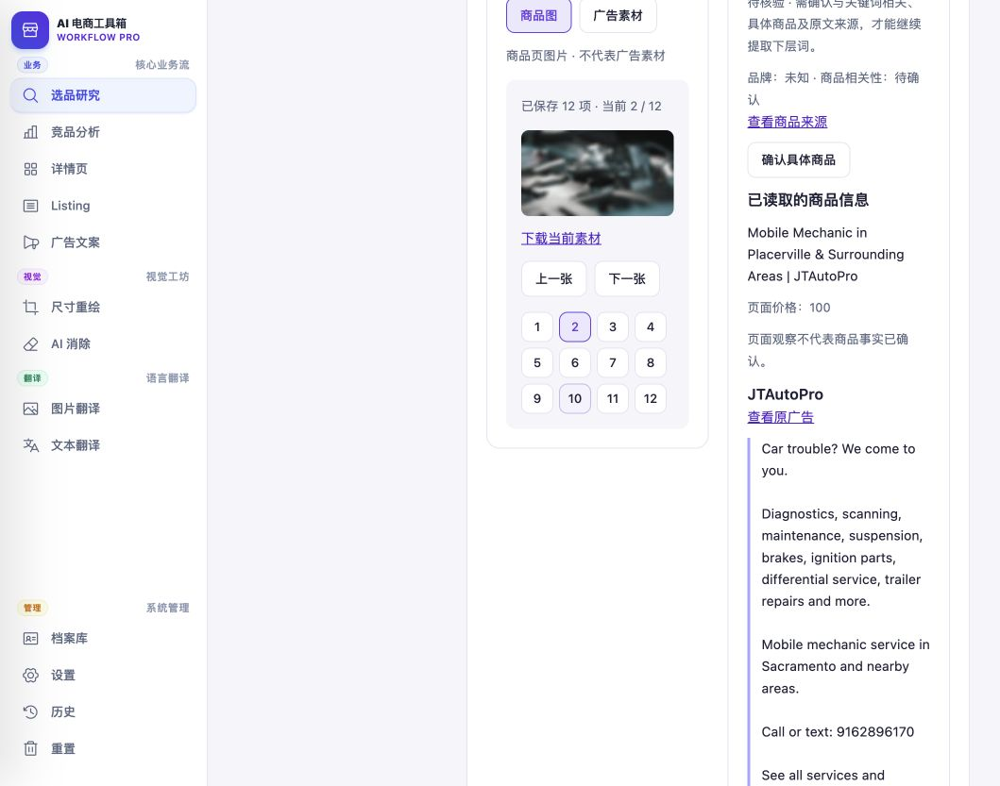

# 图库反复加载修复与验收

<!-- project-doc-status:start -->
> **文档状态同步：2026-10-26 · 分轮审查与验收记录**
> 保留现场问题、截图、测试数量及未验证项；后续修复不抹去原问题记录，本轮同步没有重做该文档的原验收。
> 当前入口与验证范围：[项目当前状态](<../../项目当前状态.md>)；[2026-10-26流程修复与边界](<../2026-10-26-sop-flow-repair/验收记录.md>)。
<!-- project-doc-status:end -->

## 问题与处理

原实现每次切换都销毁预览、释放媒体地址并重新读取素材，研究资料重绘也会触发相同过程。现改为研究工作台会话内的媒体缓存、在途请求合并、相邻商品图片预取和已解码图片节点复用。

- 上一张继续显示，下一张解码成功后替换；失败明确提示当前仍是上一张。
- 广告与商品来源切换先清理旧画面，避免把商品图冒充广告素材。
- 提供上一张、下一张和左右方向键；数字选择仍可使用。
- 缓存按项目、关键词、商品/广告、素材版本及图片序号隔离。上限 32 项 / 64 MB，淘汰未使用项，正在显示的素材保持有效；退出研究工作台释放。
- 失败项不会在每次重绘时重复请求，可显式重试。
- 浏览器整页刷新、离开研究工作台或缓存淘汰后可能重新读取。首次未预取的素材仍取决于来源响应速度。

## 实际浏览器验收

项目：美国火花塞市场；关键词："ignition parts"；线索：JTAutoPro。

1. 商品图首次显示第 1 张，并预取第 2 张，网络仅出现序号 0、1 的素材读取。
2. 下一张再上一张：第 2、1 张正常显示；仅新增第 3 张的预取请求，没有重复下载第 1、2 张。
3. 第 3 → 1 → 2 → 3 张快速切换：图片正常显示；仅新增第 4 张预取，没有重复下载已读取图片。
4. 广告 → 商品图 → 刷新研究资料：新增素材下载请求为 0，缓存可跨研究页重绘复用。
5. 第 3 张图片 complete=true、naturalWidth=47，确实解码完成；源图本身是页面图标。缓存修复不等于商品图筛选或具体商品核验，不能把这条维修服务线索当作已确认电商 SKU。
6. 此条广告来源返回 HTTP 403：页面明确提示来源失效/访问受限，并保留重试和原来源入口；未使用商品图代替广告。这是来源可用性限制，本轮未重新采集。

实测只读取已有资料与媒体，没有启动搜索、付费 AI 或修改业务数据。

## 自动验证

- 完整前端：684 项通过，0 失败。
- 修改的三个 JavaScript 模块语法检查通过。
- git diff --check 通过。
- 新增媒体回归覆盖缓存复用、并发合并、相邻预取、失败保留、竞态、来源隔离、边界导航及资源释放。

核心实现：frontend/js/research-workbench/services/media-cache.mjs、components/ad-copy.mjs、index.mjs；样式：frontend/css/research-workbench.css。

