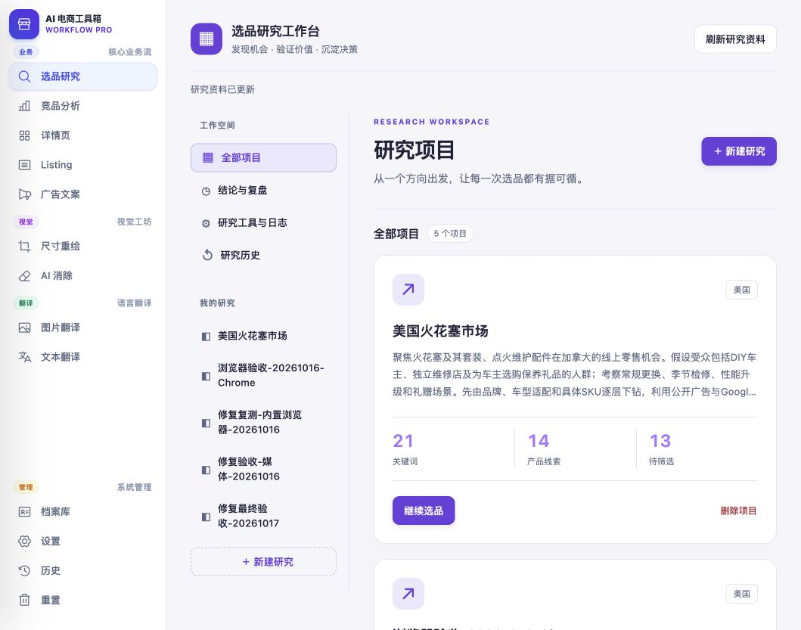
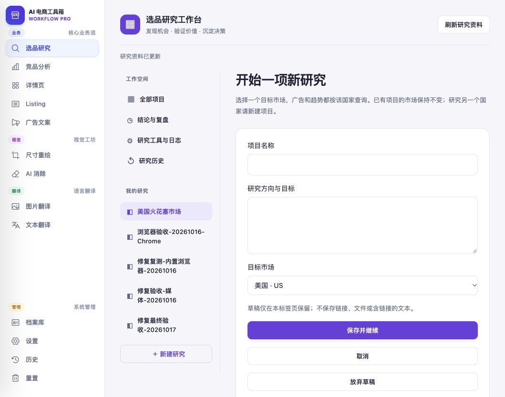
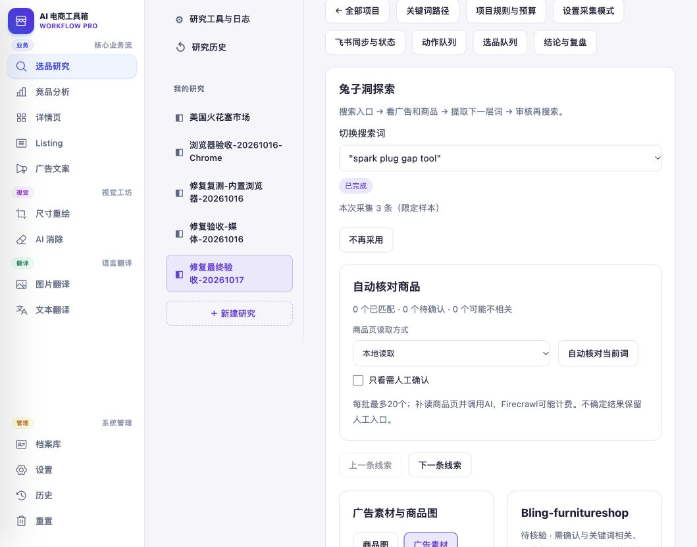
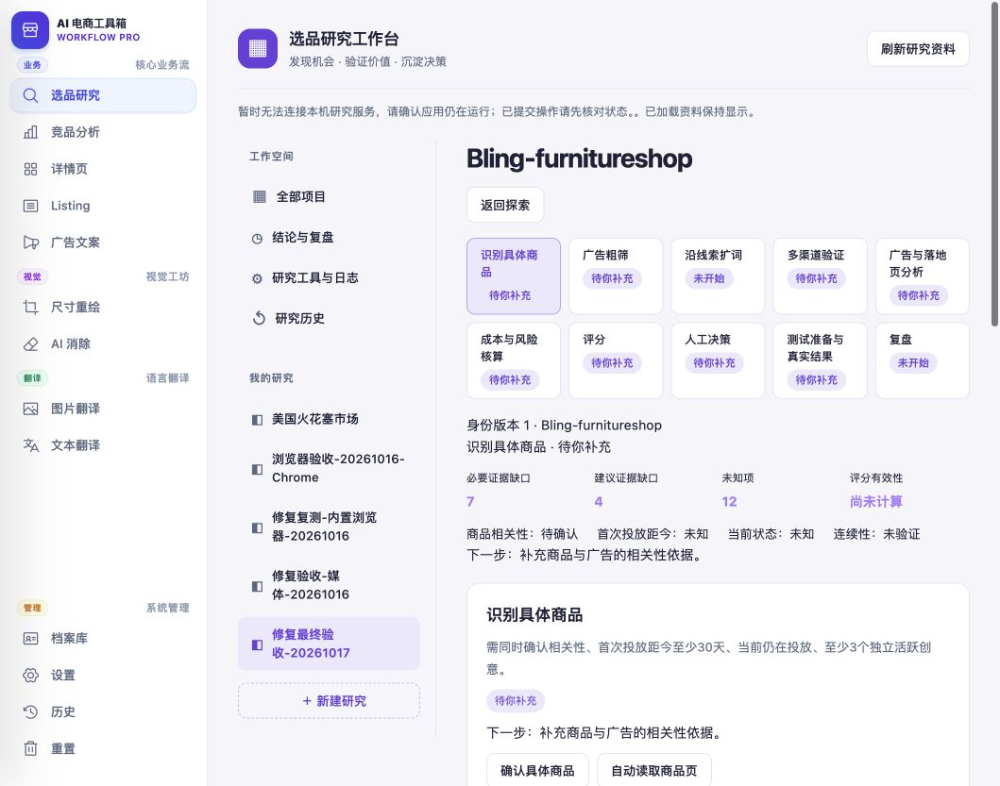
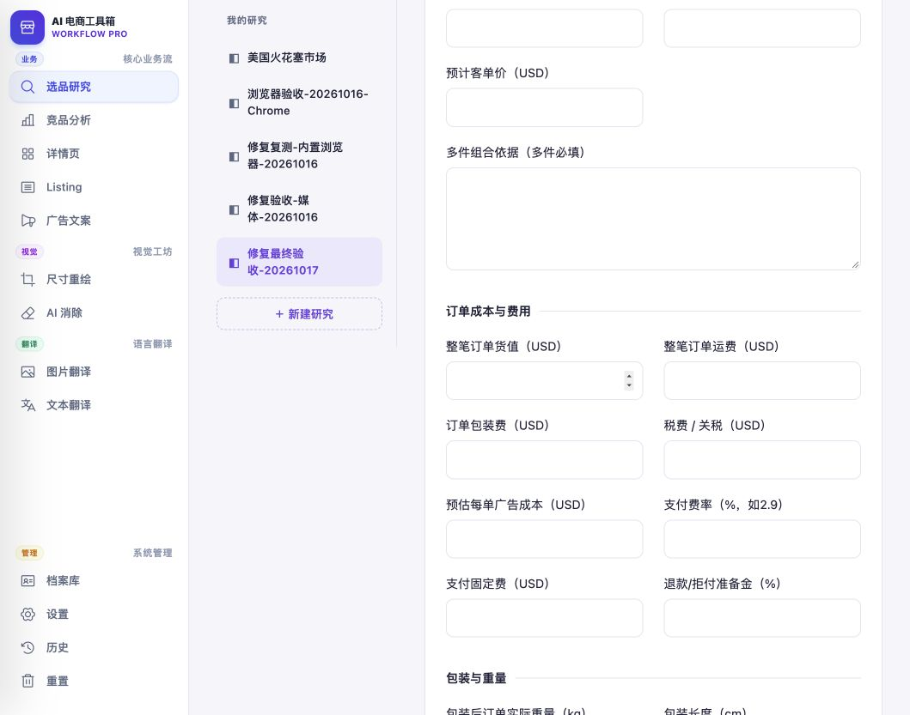
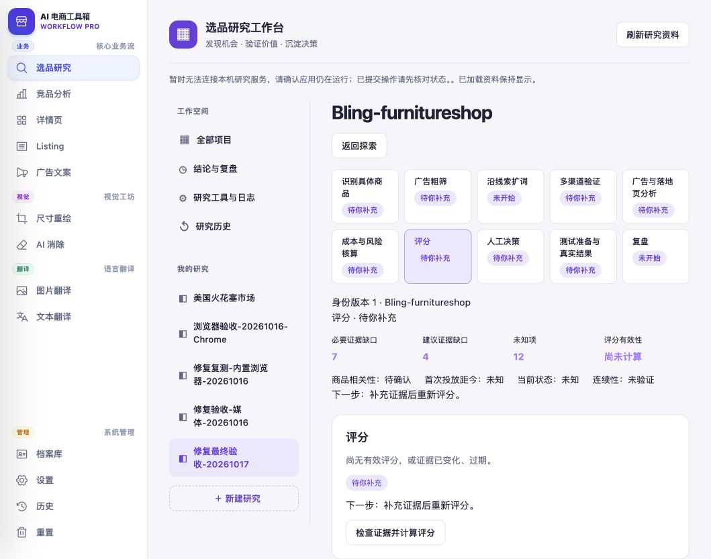
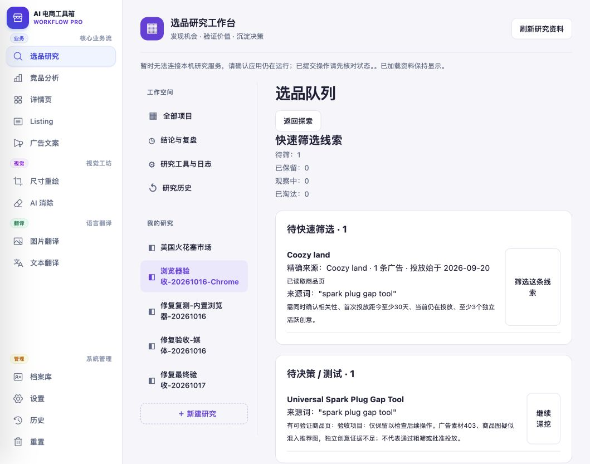
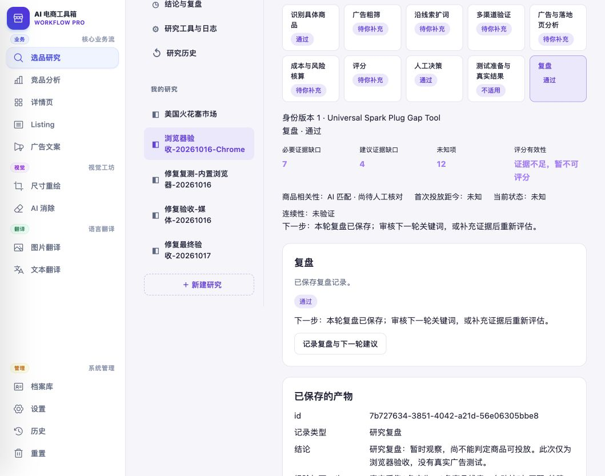
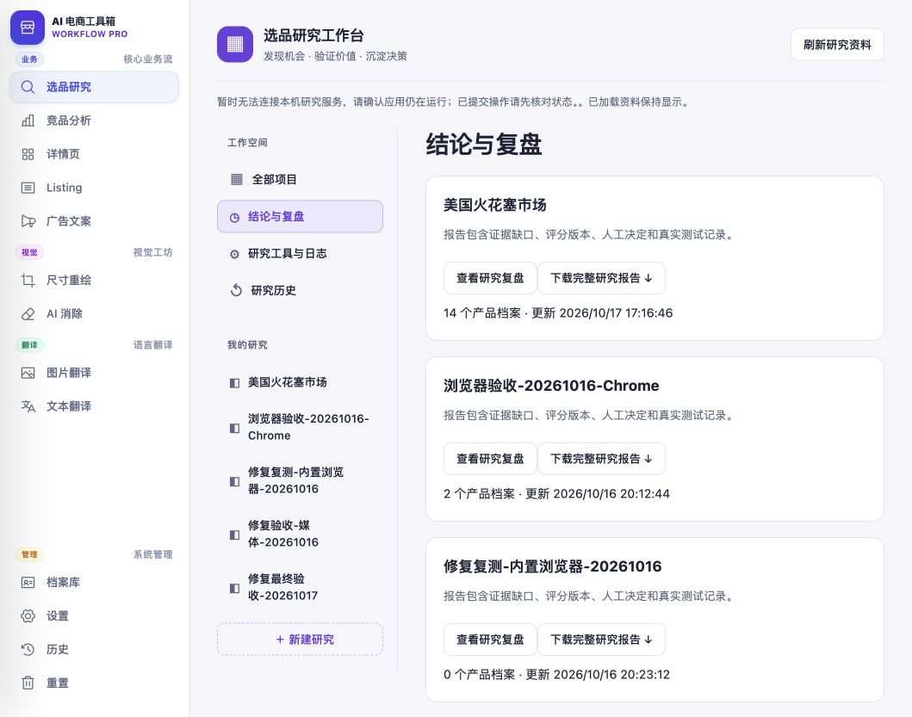
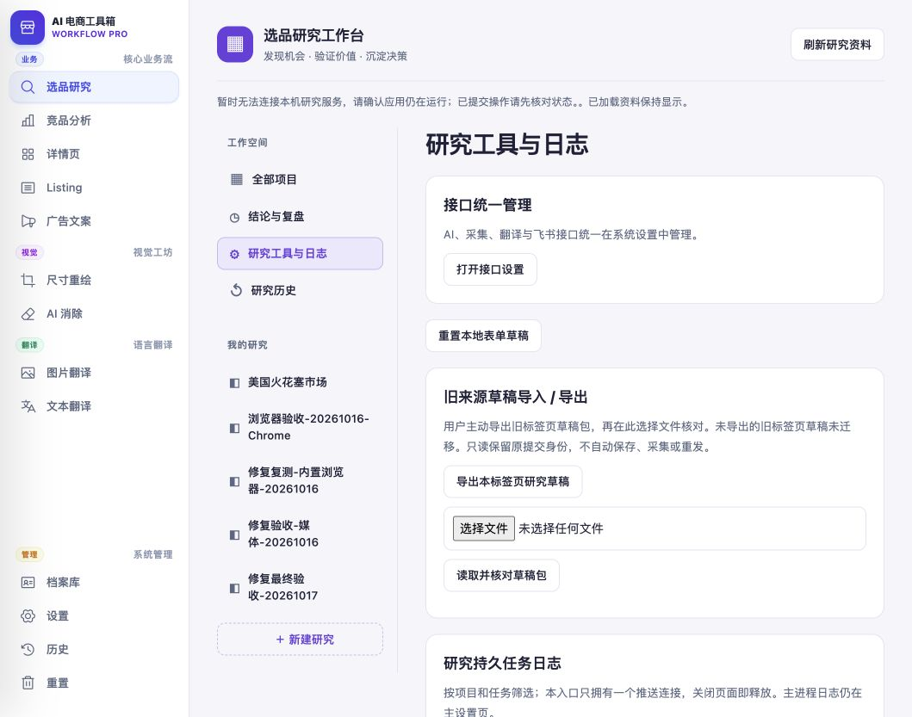

# 选品研究：任务体验分析与改进方案

<!-- project-doc-status:start -->
> **文档状态同步：2026-10-26 · 分轮审查与验收记录**
> 保留现场问题、截图、测试数量及未验证项；后续修复不抹去原问题记录，本轮同步没有重做该文档的原验收。
> 当前入口与验证范围：[项目当前状态](<../../项目当前状态.md>)；[2026-10-26流程修复与边界](<../2026-10-26-sop-flow-repair/验收记录.md>)。
<!-- project-doc-status:end -->

日期：2026-10-18。范围：真实用户如何理解、开始、推进、恢复和完成选品。本轮只新增分析文档与截图，没有修改业务代码、保存业务表单、发起外部采集、AI 调用、投放或飞书写入。

## 1. 核心判断

当前系统已经有来源绑定、人工核实、成本证据、评分门槛、决策与复盘等重要能力，但主要按内部阶段和工具组织界面。用户必须先理解系统的阶段、对象和状态，才能完成业务任务。

应把主体验改为“围绕候选商品推进研究”：系统负责整理已有信息、执行已授权的连续任务、指出阻塞；用户负责选择研究方向、确认关键事实、补真实报价和作决定。不能用减少证据要求来换取操作变少。

以下发现是专家走查，不是新用户访谈结果；困惑和收益属于有页面依据的推断，仍需首次使用者验证。

## 2. 本轮实际走查与证据

使用内置浏览器当前本地应用，保留原项目。新建表单只打开后取消；成本表单未输入、未保存。通过现有独立验收项目查看真实采集资料，以及已经保存的观察决定和复盘。没有重新执行完整采集、评分、测试闭环，不将已有记录称为本轮执行成功。

| 步骤 | 用户要解决的问题 | 本轮页面事实 | 判断 |
|---|---|---|---|
| 1 项目入口 | 这能帮我完成什么？从哪开始？ | 有新建入口、关键词/线索/待筛选数量，没有明确交付结果和当前阻塞摘要 | 入口可发现，任务价值和恢复点不足 |
| 2 新建研究 | 我该填方向还是商品？ | 名称、研究方向、市场；没有按“有方向/已有商品”分流，也没有具体输入示例 | 用户需自己组织研究说明 |
| 3 探索 | 搜索之后做什么？ | 搜索词、自动核对、素材、商品、扩词、关键词批次和产品档案共处长页；另有队列、规则等入口 | 能力完整，需记住工具顺序 |
| 4 商品档案 | 先做哪一件事？ | 十个阶段并列；7个必要缺口、4个建议缺口、12个未知项；重复出现下一步文字 | 有引导，但数字没有直接转成可做任务 |
| 5 成本 | 这单到底能不能赚钱？ | 售价、件数、客单价、费用、包装、报价、风险长表；新记录三类风险均默认“低” | 计算和事实输入没有充分分开；默认低存在误确认风险 |
| 6 评分 | 为何暂不能判断？ | 尚无有效评分，下一步是补证据再评分；没有就地列出对应补充操作 | 用户仍要回到各阶段找缺项 |
| 7 队列 | 哪个商品值得继续花时间？ | 有待筛选、待决策/测试、当前深挖；同一商品可同时出现在队列和焦点卡 | 状态层次和优先级不够明确 |
| 8 复盘 | 保存后意味着选品成功了吗？ | “人工决策 通过”“复盘 通过”，但实际决定是观察、证据不足、没有真实投放 | “流程已完成”和“商品通过筛选”容易混淆 |
| 9 结果入口 | 哪些选、哪些不选、为什么？ | 首屏为项目卡、查看复盘、下载报告 | 结论需要继续查找，不能直接比较候选商品 |
| 10 日志 | 失败影响什么，我如何继续？ | 入口还包括接口与旧草稿；任务选项为 trends/verify 等加 UUID；说明包含推送连接、主进程 | 面向维护者，业务恢复路径弱 |

### 截图证据

截图为本轮保存并查看的原始浏览器视口。长页面只代表画面中的区域，表单其余字段由本轮 DOM 核对；没有用截图推断不可见的后端状态。

1. 项目入口：
2. 新建研究：
3. 探索与自动核对：
4. 商品十阶段与缺口：
5. 成本表单中段：
6. 评分阻塞：
7. 选品队列：
8. 已保存研究复盘：
9. 结论入口：
10. 工具与日志入口：

### 实际遇到的可用性问题

切换项目时页面出现“暂时无法连接本机研究服务”，素材也出现重试读取；已加载资料仍可浏览。此后顶部错误持续显示。只能确认浏览器请求失败与旧资料保留，不能据此断言服务停机。当前体验还缺少“哪次读取失败、哪些资料是旧的、哪些操作仍能用”的范围说明。文案出现双句号。

原项目卡显示美国市场，但研究说明写加拿大。这是既有数据矛盾，本轮未修改。应提示用户核对实际查询国家，不能从方向描述自动改市场或默认重新采集。

## 3. 推荐主流程：四段任务，保留十阶段规则

### 第一段：找到候选商品

首次进入明确说明：“输入方向或商品链接，系统帮你找公开广告、核对商品、整理需求与成本证据，形成是否值得测试的建议；不会自动投放。”

提供两个起点：

- 有研究方向：填方向、目标国家，名称可自动建议并允许修改。已有受众、场景为可选补充，例子按输入类型展示。
- 已有具体商品：填商品链接、目标国家，先读取和确认商品。来源未关联广告时标注缺口，不能制造来源词或绕过粗筛。

开始前只检查当前任务需要的能力。生成词需要文本 AI；公开浏览器搜索不能被无关图片模型、飞书或其他可选服务配置阻挡。具体可用性以现有执行器契约为准，不能仅凭是否有 API Key 判成功。

系统整理搜索词建议，让用户一次选择并明确“确认这些词并开始搜索”的范围。保留搜索词人工审核记录，不能因为按钮合并而取消审核。

### 第二段：判断是否值得深挖

中心围绕当前商品：具体名称、商品图、精确绑定的来源广告、来源文案、读取时间和与关键词的关系。卖家名称另列，商品尚未识别时直说“待确认商品”，不要把广告主当成已识别产品。

用户的主要操作是“保留继续研究 / 暂时观察 / 排除”。保留仅表示投入研究时间，不代表粗筛通过；排除和观察保留来源及理由。重复素材可辅助聚合，但不同广告 ID 不自动算独立创意，不同卖家不能自动合并实物和经济数据。

系统先显示当前最关键的一项阻塞，例如“已关联2条广告，仍需核实是否为不同创意；本项目要求3个独立活跃创意”。不足不是商品失败；没有采到不等于没有市场。

### 第三段：补证据与算利润

把已有十阶段整理为可展开的任务组，仍调用现有业务命令与门槛：

| 用户任务组 | 对应现有阶段 |
|---|---|
| 找到并核实候选商品 | identification、coarse，以及项目搜索/快速筛选 |
| 判断需求和竞争 | expansion、channels、funnel |
| 核算收益与风险 | economics、score |
| 决定下一步并验证 | decision、test、review |

它不是强制顺序向导：有报价可先填成本，有明确风险可提前观察或淘汰；扩词是继续找机会的分支，不该让用户误以为每个商品都必须无限扩词才能结束。具体必填仍由现有规则判定。

缺口卡按“会阻止决策 / 建议补强”分层，显示缺什么、为什么影响判断、已有来源、最短补充入口。避免把7个缺口和12个未知简单相加成19个任务；多项缺口可能被同一证据解决。

成本分三层：

1. 用户提供售价、数量、真实报价、运费、税费、费率等事实或明确假设，单位与币种就地展示。
2. 系统算订单收入、费用汇总、按既有公式计算的贡献毛利；计算口径与是否含广告费同时说明。折扣、捆绑、运费收入等不同口径允许覆盖，不能强制售价×件数等于所有订单收入。
3. 输出敏感性问题：“若获客成本增加，利润是否仍达到项目门槛？”没有有效报价时只能标为情景测算，不显示可投放结论。

风险默认“待核实”，要求明确选择并保留依据；认证“不适用”须有依据，不能用未勾选表示已排除认证要求。这涉及前后端契约和兼容性，不应只改控件标签。

### 第四段：作决定，随后验证

结论首屏回答：

- 当前人工决定：未决定 / 进入测试 / 备选 / 观察 / 淘汰。
- 系统依据：主要支持因素、主要反对因素、阻断门槛。
- 可信程度：哪些是来源观察、人工确认、估算或已过期。优先列具体事实，不另造无依据“置信分”。
- 下一步：谁来补什么，补完会影响哪项判断；当前不值得继续时说明原因。
- 更新时间、适用市场、商品身份与证据版本；证据变化后的旧结论仍保留并标为需复核。

“保存观察决定”显示“已记录：观察”，复盘显示“已保存”，不要统一显示“通过”。真实测试与研究复盘分开；无投放结果可结束本轮研究，不虚构成功率。测试候选不等于已批准预算或实际发布。

## 4. 自动化边界与失败恢复

| 连续操作 | 可减少的操作 | 必须停下的地方 |
|---|---|---|
| 确认搜索词→搜索→归并精确来源→展示线索 | 用户不再手动开队列、刷新、找结果 | 用户未审核、预算不足、来源受限、结果未确定 |
| 读取商品→核对广告相关性→形成待确认摘要 | 已有有效快照复用；把结果回到原商品 | AI 不确定或失败、实物/变体不明确；不得冒充人工确认 |
| 选择需补的渠道→收集支持自动读取的证据→生成缺口清单 | 合并已配置、已授权、受额度限制的读取 | 无自动能力的来源转人工；验证码/限制不绕过；豁免不能改成正常完成 |
| 成本输入→派生计算→检查是否可评分 | 不重复填系统能计算的值，不重复打开页面 | 未确认事实保持未知；自动评分写入须有既有授权与版本校验 |
| 任务完成→刷新当前商品→更新下一步 | 不要求手动刷新/返回页面 | 不改变选中的商品、草稿、滚动位置；不切走正在编辑的用户 |

连续操作必须由可恢复的任务编排管理，不在浏览器堆多个请求充当自动化：记录项目、商品身份、输入版本、步骤、已成功产物、预算消耗和命令身份；同一任务重复点击不新增执行；重启后先对账，成功项不重跑。现有执行器支持程度需在实施前核验。

任务反馈用“已完成2/4项，下一项等待商品确认”，不要把阶段数量当耗时百分比。部分失败保留成功结果。失败说明包含影响范围、原因分类、已有成果、一个直接恢复入口。普通用户默认看业务摘要，原始日志与 UUID 留在详情。

只对明确可安全重试的读取应用有界重试。已提交但结果不明的生成、写入等请求显示“正在核对是否完成”，不能换新命令重发，不能重复计费。需要新增付费调用时，显示调用种类、数量上限和取消边界；不能承诺取消会撤销已经提交的费用。

## 5. 业务语言替换

| 当前表达 | 建议表达 | 必须保留的区别 |
|---|---|---|
| 兔子洞探索 | 沿商品线索继续找机会 | 说明从广告/商品原文提词，仍需审核 |
| 动作队列 | 研究任务 | 排队、执行、等确认、失败、结果未知分开 |
| 身份版本 | 商品信息已更新；旧资料需复核 | 技术版本留详情，不能隐藏失效原因 |
| 必要证据缺口7 | 还需核实这些事项，才能判断是否进入测试 | 显示具体事项与入口 |
| identification通过 | AI匹配 / 人工已确认 | 两者不可合并 |
| decision/review通过 | 已记录决定 / 已保存复盘 | 不表示通过商品门槛 |
| trends · UUID | 需求趋势核对 · 商品/搜索词 · 时间 | ID只放诊断详情 |
| Firecrawl、本地HTTP | 默认使用当前读取方式；其他方式放更多选项 | 调用费用、限制和失败原因仍可查看 |

## 6. 三种改进方式

| 方式 | 优点 | 局限 |
|---|---|---|
| 仅改文案和按钮提示 | 小范围、容易验证 | 页面切换和顺序记忆仍在 |
| 推荐：任务导向工作台，逐步加入受控编排 | 保留业务模型；先解决理解，再减少真实操作 | 需处理版本、草稿与任务恢复，不能一次只改前端 |
| 全自动黑盒选品 | 表面操作最少 | 真实报价、实物确认、独立创意和测试结果无法可靠自动补齐，容易制造错误确定性；不推荐 |

## 7. 建议实施顺序与验收

以下为估算，单位为熟悉代码的工程师工作日，不包含供应商报价、真实广告测试等待时间。实施前应把每批范围细化并确认，不在本轮开始改代码。

| 批次 | 范围与文件入口 | 预计 | 验收与回退 |
|---|---|---|---|
| 1 先消除误解 | projects.mjs、product.mjs、triage.mjs、reports.mjs、settings.mjs；风险契约对应domain/project.py | 2–4日 | 明确用途、风险不默认低、记录完成不显示商品通过；旧数据不改写；回退呈现改动，新增字段兼容旧记录 |
| 2 统一任务与上下文 | index.mjs、focused-exploration.mjs、product.mjs、forms.mjs、services/snapshot.mjs | 4–7日 | 一个主任务、具体缺口入口、结果回原位置；跨商品草稿隔离、版本冲突不覆盖；分批开关退回旧入口 |
| 3 受控连续执行 | services/actions.mjs、pages/actions.mjs、services/commands.mjs及后端任务执行器 | 5–10日，先核验执行器 | 仅授权范围串联，部分成功可恢复，重复点击/断线/重启不重复调用；关闭新编排，保留现有单任务操作与已成功结果 |
| 4 决策与真实场景验证 | reports.mjs、product.mjs、领域评分/测试投影 | 3–5日 | 商品对比可解释、失效证据有提示、无真实测试不显示成功；回退新摘要视图，原报告和证据仍可用 |

自动化依赖第1批术语与状态契约明确、第2批上下文不串扰；不得先合并按钮再补幂等和恢复。全程保留现有门槛、来源、规则版本、历史和营销工具交接能力，不全面替换技术栈。

### 衡量是否真的好用

- 先记录当前基线，再用相同任务对比；本轮没有测量点击数、任务耗时或成功率，不能承诺提升百分比。
- 邀请至少3名首次使用者，不讲解操作，在一分钟内说明产品能做什么、找到正确起点；至少2人独立完成，失败须回看原因。
- 常规任务：从方向到第一组候选；已有商品直接研究；筛出不相关广告；报价不全时作观察决定。记录有效点击、无效跳转、重复填写、求助次数。
- 恢复任务：采集部分失败、网络断开、保存结果未知、关闭再打开、报价过期、商品链接换SKU、市场方向不一致。
- 自动化底线：同一逻辑命令副作用最多一次；失败不清空成功产物；来源/市场/商品身份不串；未知不变0或低风险；无证据不通过现有门槛。
- 键盘和无障碍：主任务可定位、禁用原因可读、动态结果可被辅助技术获知，页面切换焦点和表单错误有明确落点。本轮未做完整键盘、读屏、对比度和手机测试，不宣称合规。

## 8. 源码依据与待验证事项

路径均相对项目根目录：

- `frontend/js/research-workbench/pages/projects.mjs:2`：项目入口、计数、新建、继续和删除。
- `frontend/js/research-workbench/pages/product.mjs:7`：十阶段和nextProductStep；`:73`附近证据健康信息；`:222`具体商品确认；`:223`绑定广告预填但独立性不自动确认；`:240`成本与风险表单。
- `frontend/js/research-workbench/pages/triage.mjs:98`：队列分组与跳转；`:97`焦点商品。
- `frontend/js/research-workbench/pages/reports.mjs:3`：结果入口、项目统计与报告下载。
- `frontend/js/research-workbench/settings.mjs:33`：日志入口和维护者说明；`:42`技术任务名称加ID。
- `frontend/js/research-workbench/services/commands.mjs:30`：提交身份、内容指纹和不确定状态。
- `backend/modules/research/rabbit_hole/domain/project.py:559`附近：阶段刷新、AI匹配与粗筛区分；`:2654`成本命令；`:2817`最终评分门槛；`:3109`决策限制；`:3142`测试计划；`:3434`复盘条件。

待验证：真实新用户的主要使用频率和目标市场；不同费用的业务口径；编排执行器对重启、去重、限额的完整支持；不同来源支持的自动采集范围；内置浏览器请求失败根因；历史风险值是否经人确认。不能把默认低风险的现象扩展成“所有已存风险均错误”，也不能无确认批量清洗历史数据。

优先交付应是“知道从哪开始、现在卡在哪里、接下来只需做什么、最终凭什么选或不选”，之后才是样式调整。
