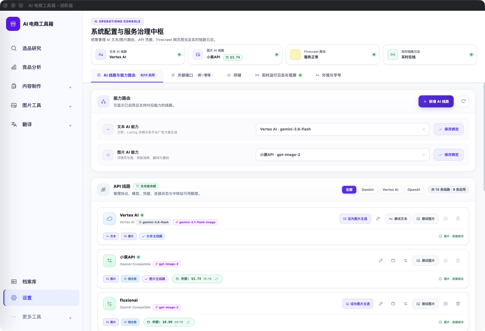

# 新增 AI 线路：并入卡片标题栏

<!-- project-doc-status:start -->
> **文档状态同步：2026-10-26 · 分轮审查与验收记录**
> 保留现场问题、截图、测试数量及未验证项；后续修复不抹去原问题记录，本轮同步没有重做该文档的原验收。
> 当前入口与验证范围：[项目当前状态](<../../项目当前状态.md>)；[2026-10-26流程修复与边界](<../2026-10-26-sop-flow-repair/验收记录.md>)。
<!-- project-doc-status:end -->

2026-10-24。按用户截图指定位置，将 `frontend/index.html` 的 `settingsAiActions` 从AI面板顶部独占一行，移入“能力路由”卡片标题栏，与原刷新按钮并排。移除原空行布局，使用既有 flex/间距样式。仍只在AI模型分区内显示，保留唯一 `openProviderEditor()` 原处理器。

源码与安装HTML解析确认：按钮唯一，属于AI面板、能力路由卡片标题栏。11项设置/存储导航专项通过，无新增依赖/配置/后端/API修改，未触发真实外部调用。

已更新自用Mac客户端，保留安装HTML既有差异。客户DMG未重建。回滚应用位于本机私有 `~/.local/share/ai-ecommerce-desktop/closeout/20261024-ai-add-button-inline/previous.app`，源码前快照为同目录 `index-before.html`；正常退出后恢复应用，源码只回退本轮HTML差异，不恢复数据库。上一轮独占行方案由本轮替代。

实际客户端已确认标题栏右侧新增与刷新并排，无独占按钮行；点击可打开原新增编辑器，未输入或保存账号，关闭后回到原页面。9502实际HTML与安装HTML一致，签名检查通过。

