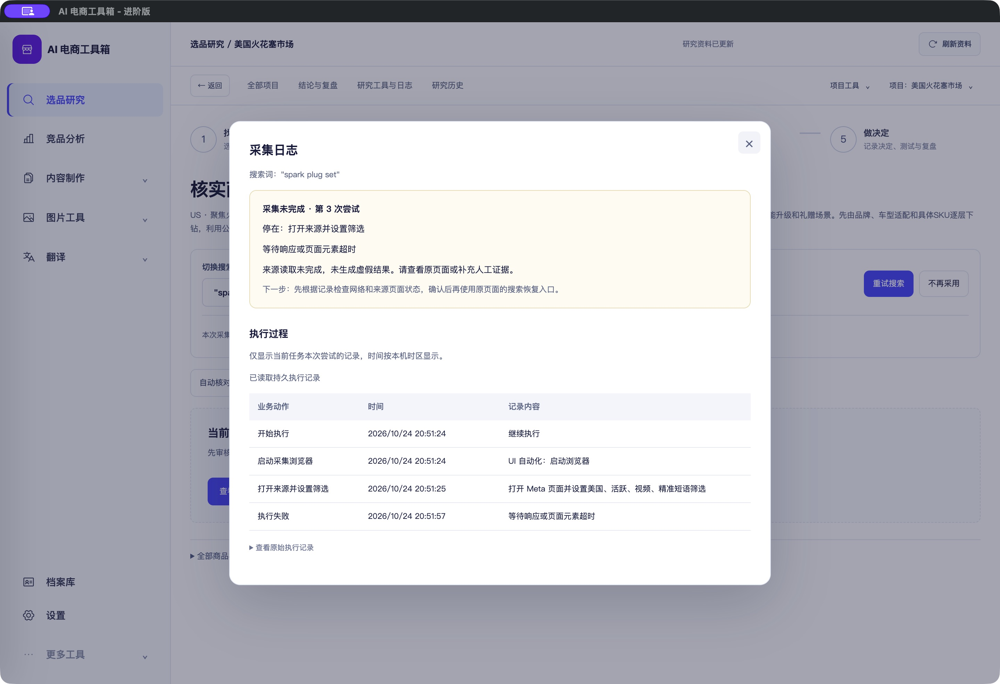

# 当前词采集日志窗口 · 2026-10-24

<!-- project-doc-status:start -->
> **文档状态同步：2026-10-26 · 分轮审查与验收记录**
> 保留现场问题、截图、测试数量及未验证项；后续修复不抹去原问题记录，本轮同步没有重做该文档的原验收。
> 当前入口与验证范围：[项目当前状态](<../../项目当前状态.md>)；[2026-10-26流程修复与边界](<../2026-10-26-sop-flow-repair/验收记录.md>)。
<!-- project-doc-status:end -->

## 用户需求与实现

在“本次采集未完成 · 不算零结果”旁增加“查看采集日志”。点击在当前页打开日志弹窗，底下页面不重新挂载，不跳到任务工具页，不触发搜索或重试。

窗口展示当前词最近一次 scan 任务的状态、尝试次数、失败阶段、后端已记录诊断/说明、下一步建议，以及本次尝试的持久执行日志。时间按本机时区显示；原始记录折叠保留。无任务或不完整绑定时不读取全项目日志，不制造原因。日志暂不可读时保留已有失败摘要。主设置日志与此任务持久日志的原有机制不变。

## 数据与约束

- 权威任务来自 `keywordActions[word.id]`，不依赖最近20条任务列表，因此较早任务仍可查看。
- 同时校验任务ID、scan类型、keyword_id和整数attempt，所有日志请求带project/action过滤；前端再次过滤action_id及attempt。
- 重试共用任务ID时隔离每次尝试；同一任务从排队attempt0开始执行attempt1，窗口原地更新摘要并重置游标读取新attempt，避免把排队快照永久固定。
- 日志游标推进到所有已读取记录，展示只保留当前attempt、最多500条；关闭和导航/卸载释放SSE与轮询，旧请求返回不会恢复已关闭窗口。
- 沿用后端受控诊断和持久日志，不添加原始异常、密钥或外部响应。新增展示使用textContent。
- 这里是记录原因的入口，不代表已修复来源超时；诊断不能确定具体原因时继续标为未知。

## 代码范围

- `frontend/js/research-workbench/components/collection-logs.mjs`：新只读弹窗，摘要与attempt更新、焦点和清理。
- `frontend/js/research-workbench/components/live-logs.mjs`：复用现有持久查询/SSE，新增可选attempt过滤、免滚动、业务阶段与本机时间格式；任务工具页默认行为保留。
- `frontend/js/research-workbench/pages/focused-exploration.mjs`：当前词状态旁的入口。
- `frontend/js/research-workbench/index.mjs`：持有弹窗，刷新原地更新，导航/卸载关闭，延期原页重画。
- `frontend/css/research-polish.css`：状态行、780px日志窗口、摘要及日志表格的限定样式。
- `frontend/index.html`：CSS缓存标识更新。
- `frontend/tests/research-workbench/collection-logs.test.mjs`：6项回归。

不改后端、数据模型、费用确认、业务门槛、真实重试逻辑或客户安装包。

## 测试与审查

本轮最终完整前端 **813通过、0失败、0跳过**；桌面 **15通过、0失败、0跳过**。四个变更MJS语法检查及差异空白检查通过。命令：

```text
node --test frontend/tests/*.test.js frontend/tests/research-workbench/*.test.mjs
node --test desktop/tests/*.test.cjs
```

新测试先观察没有日志入口时失败，再实现通过；补充排队启动转换和时间格式测试分别观察失败后通过。覆盖当前词/attempt绑定、只读无POST、缺失任务禁止无过滤读取、错误保留、后台刷新、取消/卸载清理、迟到响应、ready0→running1→blocked原地更新、可读本机时间。独立审查发现“固定attempt导致排队窗口看不到启动日志”，修正并复查通过，无剩余Important问题。

## 实际界面验收

已更新自用 `/Users/xiachengpeng/Applications/AI E-commerce Tools.app`，打开原有“美国火花塞市场”→“核实商品”→“查看采集日志”。读取现有 `spark plug set` 第3次尝试的4条持久记录：开始、启动浏览器、打开来源并设置筛选、失败。记录停在筛选阶段，诊断为“等待响应或页面元素超时”。这能证明最后观察到的失败，不足以断言是网络、来源限制或页面结构中的哪一项。

原生窗口截图为2880×1972（2倍密度）；Esc关闭后焦点返回“查看采集日志”。只读取原有任务，未点击“重试搜索”或提交收费操作。



[入口](captures/native-entry.png) · [1024窗口/20字号隔离验收](captures/browser-1024-20.png)

隔离验收在9518使用实际源码与明确模拟记录，所有写入拒绝；1024×900/20字号时弹窗左122、右902、高约711，无横向溢出。控制台无error/warn。模拟日志不作为真实采集成功证据。初版截图保留为迭代记录，最终以 `native-log-final.png` 为准。

## 安装与回滚

安装前正常退出客户端；候选及安装后 ad hoc 签名严格校验通过，资源校验通过；五个修改业务资源的源码、已安装文件、9502实际返回内容逐字节一致。保留自用客户端入口差异，仅修改已安装HTML的CSS版本。

备份位于本机私有目录 `/Users/xiachengpeng/.local/share/ai-ecommerce-desktop/closeout/20261024-collection-logs/`：`source-before/`为本轮前源码，`previous.app`为本轮前客户端；`before-time-format.app`为中间版本，不应代替本轮前备份。另保存日志和资源摘要。需要回滚时正常退出，用本轮前源码/previous.app恢复；不恢复或迁移数据库。

没有重建客户DMG，没有新增Apple开发者签名或公证，没有重跑后端全套或真实付费采集/AI/上传/飞书链路。验收范围为日志入口与真实已保存记录的只读展示。
