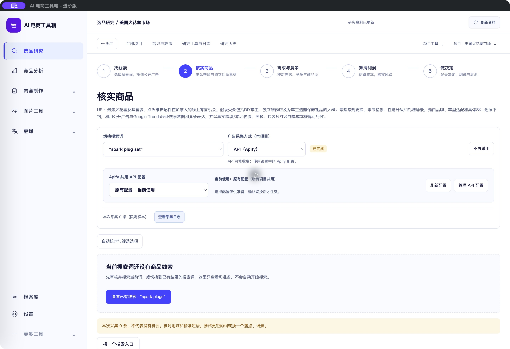

# 广告采集方式与多 API 配置 · 2026-10-24

<!-- project-doc-status:start -->
> **文档状态同步：2026-10-26 · 分轮审查与验收记录**
> 保留现场问题、截图、测试数量及未验证项；后续修复不抹去原问题记录，本轮同步没有重做该文档的原验收。
> 当前入口与验证范围：[项目当前状态](<../../项目当前状态.md>)；[2026-10-26流程修复与边界](<../2026-10-26-sop-flow-repair/验收记录.md>)。
<!-- project-doc-status:end -->

## 功能与操作

核实商品页的搜索词旁新增“广告采集方式（本项目）”：浏览器采集 / API（Apify）。使用现有项目 `configure_collection` 命令，保留 Trends 模式；切换只保存方式，不自动创建采集任务。失败后仍需用户点击搜索并在原页弹窗确认。确认窗口明确显示本次方式与API费用提示；方式在确认后变化时拒绝提交，要求重新核对。

选择API后展示“Apify 共用 API 配置”，复用主设置里已命名的多账号列表，显示当前使用账号。选择其他账号只展开准备区，点击“确认切换共用配置”才使用原有activate接口启用；不自动重试、轮换账号或启动采集。未配置完整的账号不可选择。新增/编辑密钥继续在主设置完成，当前页不复制凭据编辑器；“管理API配置”跳到唯一设置入口。

**两种设置的作用范围不同：**采集方式是本项目Meta广告设置；API账号是现有全工具箱共用的激活配置，切换会影响所有项目后续API调用，包括未结束任务的查询。这里不是每个任务独立绑定账号的新架构。确认区明确提示先完成相关任务；本项目存在运行、排队或需要继续查询/人工核对的API任务时禁用账号切换快捷入口。其他项目的任务仍需用户先核对；此快捷入口未实现跨项目运行锁。不能用该功能替代对运行中云任务账号的核对。

## 保留的业务约束

- 切换方式保留当前词、来源、旧结果、日志与Trends设置，不改变已排队任务原有采集方式。
- 当前词排队/运行时不允许切换方式，任务投影缺失但词标为queued/running时同样保守禁用。
- 保存配置期间阻止打开收费操作确认；失败恢复当前已知方式并提示刷新核对，不在回复不确定时自动重发。
- 共用账号激活携带当前active版本及目标profile版本；并发变化沿用后端拒绝机制。失败提示未确认成功，须刷新核对，不能把本地恢复显示当作服务端一定未切换。
- 只保留账号id、名称、完整性标记及版本；不渲染密钥，不调用reveal，不把凭据DTO存入业务状态。GET列表和详情均为本机只读，未探测收费服务。
- 后端采集、恢复、预算、费用确认及任务去重逻辑不修改；不将Apify替换为不兼容的其他服务。

## 代码范围

- 新 `frontend/js/research-workbench/components/collection-mode.mjs`：项目采集方式下拉框及共用API账号选择快捷入口。
- `frontend/js/research-workbench/pages/focused-exploration.mjs`：挂载上述控件。
- `frontend/js/research-workbench/index.mjs`：复用命令的可选保留位置能力、保存期间阻止确认。
- `frontend/js/research-workbench/components/action-confirmation.mjs`：显示方式/费用，校验确认后方式变化。
- `frontend/css/research-polish.css` 与 `frontend/index.html`：限定样式和CSS版本。
- 新 `collection-mode.test.mjs`（6项）、`collection-profiles.test.mjs`（5项）。

## 验证

最终完整前端 **824通过、0失败、0跳过**；桌面 **15通过**。新增控件先观察失败再实现通过。覆盖保存Meta/保留Trends/保留滚动、失败恢复、运行和投影缺失锁定、保存中禁止确认、确认后模式漂移、多个命名账号、未配置账号禁用、选中不激活、显式版本保护激活、失败与任务锁定、离开页面后不继续激活、重复点击不重复POST。

现有后端隔离SQLite回归：`test_provider_jobs.py`和`test_scan_recovery.py` **28通过**，包括方式冻结、新任务区分、API缺密钥不回退浏览器及恢复；`test_integration_profiles.py` **6通过**，覆盖现有多配置/版本/会话保护。没有重跑后端全套。最初直接运行研究测试因导入路径缺失未收集，补齐明确PYTHONPATH与临时SQLite环境后上述命令通过；测试不使用用户数据库和真实账号。

```text
node --test frontend/tests/*.test.js frontend/tests/research-workbench/*.test.mjs
node --test desktop/tests/*.test.cjs
PYTHONPATH=backend:backend/modules/research RABBIT_HOLE_TEST_SQLITE=1 .venv/bin/python -m pytest backend/tests/research/test_provider_jobs.py backend/tests/research/test_scan_recovery.py -q -o asyncio_mode=auto
PYTHONPATH=backend:backend/modules/research .venv/bin/python -m pytest backend/tests/test_integration_profiles.py -q
```

四个变更MJS语法检查及git差异空白检查通过。独立审查无Important问题；按建议增加投影缺失锁定、卸载和并发点击回归。

## 浏览器与原生客户端

隔离页面9519加载实际源码，仅允许在内存模拟 `configure_collection` 与账号activate，真实业务写入及付费任务拒绝。验证浏览器→API切换、保存后展示账号、多账号选择/确认、API费用弹窗/取消；1024×900、20字号无页面横向溢出，账号区域约694px宽；控制台无error/warn。模拟账号/调用不作为真实采集验收。

实际自用客户端已显示下拉框、当前共用配置名称、刷新/管理入口及日志。验收过程中原有项目的当前词已由用户操作转为API且显示采集完成0条，更新保留此最新状态。本轮代理没有主动提交真实搜索或切换生产API账号，不能将用户操作结果冒充代理收费验收。客户端只显示现有账号；多账号切换用明确模拟账号验证，不向用户账号添加验收配置。



[多个模拟账号与大字号](captures/multiple-accounts-1024-20.png) · [切换影响确认](captures/account-switch-warning-isolated.png) · [API收费确认](captures/api-confirmation-isolated.png)

## 安装与回滚

已更新 `/Users/xiachengpeng/Applications/AI E-commerce Tools.app`，只覆盖本轮前端资源及已安装HTML的CSS版本，保留自用版入口差异。候选及安装后签名严格校验、资源验证通过；源码、已安装、9502实际返回的五个业务资源逐字节一致。使用ad hoc签名，未新增Apple开发者公证。

私有备份 `/Users/xiachengpeng/.local/share/ai-ecommerce-desktop/closeout/20261024-collection-mode/`：`source-before/`为本轮前源码，`previous.app`为本轮前客户端，`before-profiles.app`为中间版本。另有测试日志、隔离工具和资源摘要。回滚正常退出后恢复本轮前文件/客户端，不恢复数据库，以保留用户本轮操作产生的新结果。新增组件在回滚时可留为未引用文件；不要因回滚删除用户数据。

客户DMG未重建，后端代码、数据库模式、依赖及生产凭据未改变。采集方式/共用账号真实切换由用户明确操作；本轮代理只做前端、隔离模拟和已有记录读取。
