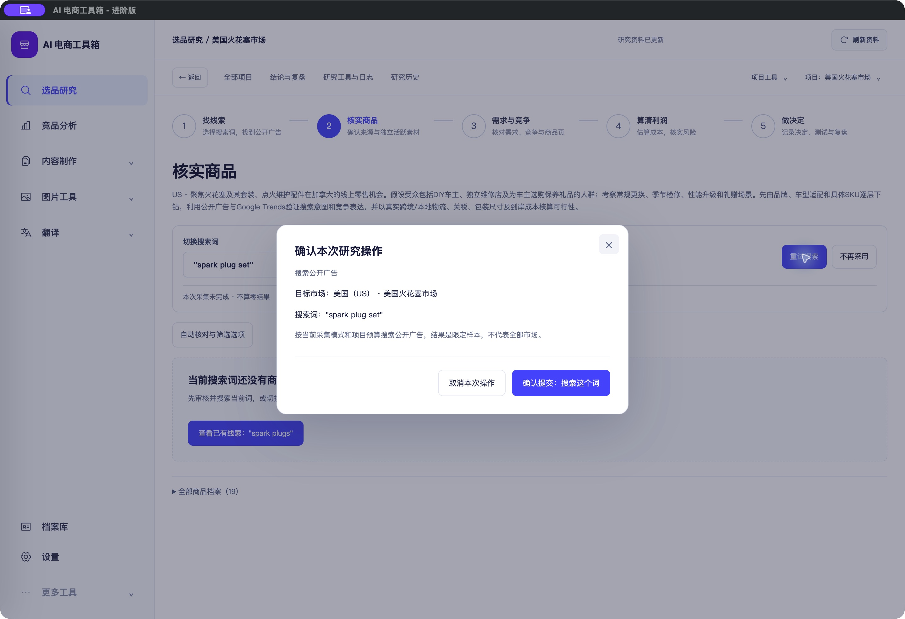

# 研究操作原页确认弹窗 · 2026-10-24

<!-- project-doc-status:start -->
> **文档状态同步：2026-10-26 · 分轮审查与验收记录**
> 保留现场问题、截图、测试数量及未验证项；后续修复不抹去原问题记录，本轮同步没有重做该文档的原验收。
> 当前入口与验证范围：[项目当前状态](<../../项目当前状态.md>)；[2026-10-26流程修复与边界](<../2026-10-26-sop-flow-repair/验收记录.md>)。
<!-- project-doc-status:end -->

## 问题与处理

用户点击“重试搜索”后，原实现会重新挂载当前页面、在内容顶部插入确认卡并滚动到顶部，产生页面跳转感。现在确认内容使用原生模态弹窗展示，底下的页面保持挂载，不再为了显示确认重画或滚动。市场、搜索词、范围和费用提示，以及原来的提交接口和单次提交保护继续保留。

本轮覆盖经 `showQueue` 发起的搜索、批量扫描、AI建议、扩词、商品读取/核对和 Trends 确认。任务工具页已有的直接任务重试逻辑未改动。

- 取消、关闭按钮和 Esc 不提交任务，回到原按钮并保留页面位置。
- 提交中禁用取消/关闭，避免请求已发出但用户误以为已取消。
- 后台刷新不重建已打开的弹窗，也不丢失 Trends 输入。
- 错误显示在弹窗内；导航和离开工作台会清理弹窗，重新进入不会恢复旧确认。
- 不改后台门槛、数据库、采集模式或重试策略。

## 涉及文件

- `frontend/js/research-workbench/index.mjs`：独立确认生命周期、延后背景重画及退出清理。
- `frontend/js/research-workbench/components/action-confirmation.mjs`：复用原确认内容，新增原生 dialog 与焦点、取消、忙碌和局部错误处理。
- `frontend/css/research-polish.css`：限定于工作台的弹窗布局及窄窗口适配。
- `frontend/index.html`：只更新本轮 CSS 版本标识。
- `frontend/tests/research-workbench/confirmation-dialog.test.mjs`：新增5项行为回归。
- `frontend/tests/research-workbench/rewalk-fixes.test.mjs`：将原确认卡断言更新到弹窗，保留请求与回执断言。

## 自动验证

2026-10-24重新执行：

```text
node --test frontend/tests/*.test.js frontend/tests/research-workbench/*.test.mjs
807 passed / 0 failed / 0 skipped

node --test desktop/tests/*.test.cjs
15 passed / 0 failed / 0 skipped
```

新增测试先观察旧实现下缺少 dialog 的失败，再修复通过。测试包括原页面节点/滚动保留、Esc取消、单次提交与请求参数、提交中防取消、错误就地显示、刷新/卸载清理。改变的两个 MJS 语法检查通过。独立只读审查未发现需修复的问题。

## 界面验证

隔离场景使用真实工作台源码，所有写入拦截：

- 1280视口/16字号：打开后标题位置与滚动位置相同；原生 `:modal` 成立；取消与 Esc 返回原按钮。
- 1024视口/20字号：弹窗宽560、高约382，左右边界232/792，无横向溢出。
- 初次量测处于页面入场动画，标题位置相差13px；等动画稳定后重复打开，前后均为214.59375px。不是确认重新挂载造成的移动。
- 实际 Mac 客户端：原有“美国火花塞市场”→核实商品→重试搜索，打开居中确认、取消、焦点回到“重试搜索”，原词保持 `spark plug set`。未点击最终确认。



[原页面](captures/native-before.png) · [取消后](captures/native-after-cancel.png) · [隔离浏览器](captures/browser-dialog.png) · [1024大字号](captures/browser-dialog-1024-20.png)

## 安装、边界与回滚

已更新本机 `/Users/xiachengpeng/Applications/AI E-commerce Tools.app`。只叠加本轮工作台资源和已安装 HTML 的 CSS 查询版本；保留自用版原有入口差异。安装前后 ad hoc 签名严格校验通过，打包资源验证通过；源文件、已安装文件、9502实际返回文件逐字节一致。

私人备份：`/Users/xiachengpeng/.local/share/ai-ecommerce-desktop/closeout/20261024-confirmation-dialog/`，包含 `source-before/`、`previous.app`、测试日志及资源摘要。回滚时正常退出客户端，恢复本轮源文件或将 `previous.app` 恢复到安装位置；不回滚用户数据库。本轮没有重建客户 DMG，没有 Apple Developer 签名/公证，也未执行真实收费搜索、AI、采集、上传或飞书写入；后端全套测试未重跑。

验收结果：本轮确认交互通过；不等于真实外部任务成功验证。
