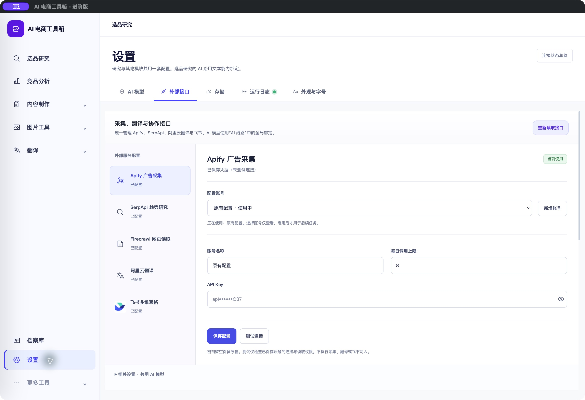
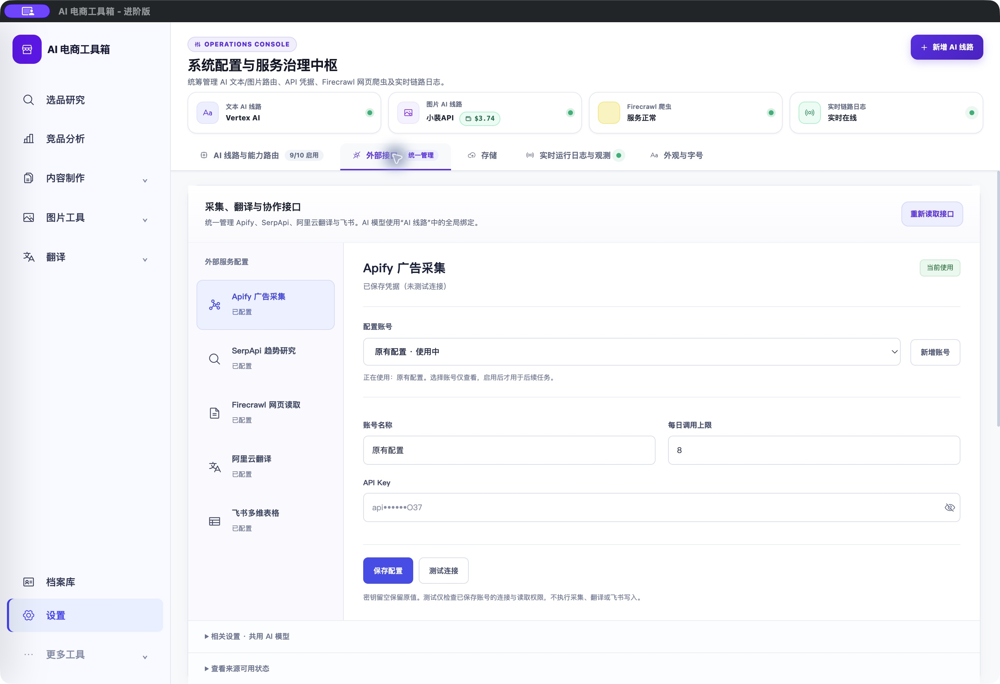
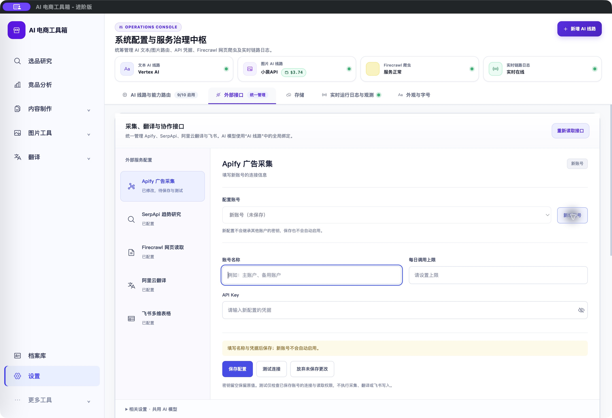
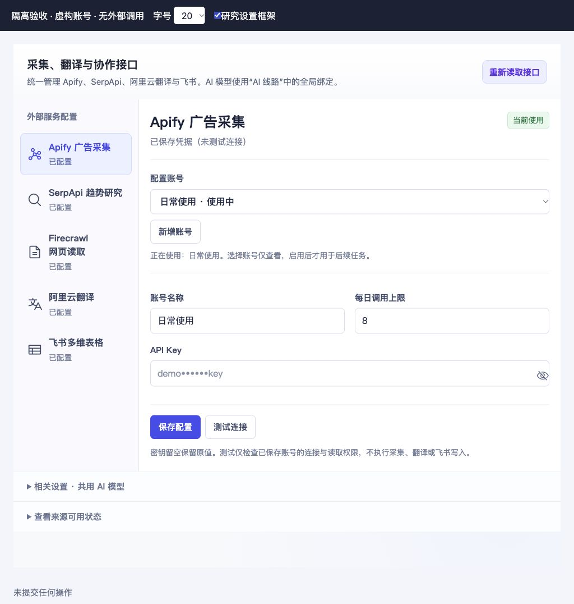
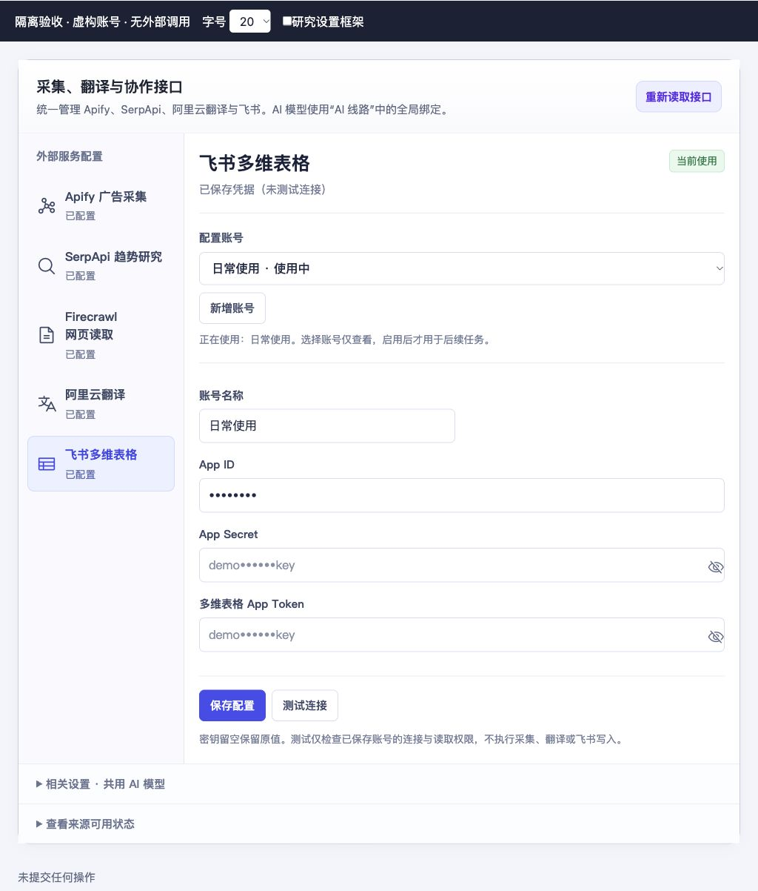

# 外部接口：服务列表与多账号编辑体验

<!-- project-doc-status:start -->
> **文档状态同步：2026-10-26 · 分轮审查与验收记录**
> 保留现场问题、截图、测试数量及未验证项；后续修复不抹去原问题记录，本轮同步没有重做该文档的原验收。
> 当前入口与验证范围：[项目当前状态](<../../项目当前状态.md>)；[2026-10-26流程修复与边界](<../2026-10-26-sop-flow-repair/验收记录.md>)。
<!-- project-doc-status:end -->

日期：2026-10-24。用户要求直接改善布局和操作习惯。本轮沿用“按推荐直接执行”的偏好，保留现有业务接口，修改前备份在本机私有目录。

## 现状问题与采用方案

原服务栏接近页面一半宽，右侧“已保存配置”和凭据又嵌套多层卡片；保存、测试、新增和启用分散，研究框架还把保存按钮移动到页面公共底部。用户难以区分查看账号与正在使用账号，简单配置需要上下查找。

采用紧凑服务列表＋右侧账号表单：服务栏固定224px，窄窗口改为可折行入口；同一账号依次展示标题/状态、账号选择与新增、名称/额度及凭据、保存/测试/放弃操作、结果反馈。辅助说明默认收起。未采用新页面或多层折叠，避免额外跳转。

## 实现范围

- `frontend/js/research-workbench/components/integration-editor.mjs`：复用原多账号 API、版本校验和密钥行为；新增标题状态、表单分组、统一操作栏、未保存提示；仅有修改时显示放弃按钮。新建账号清空旧凭据和选择项、聚焦名称；空名称在提交前提示。当前账号不再重复显示启用操作，启用完成后保持禁用，避免共享按钮恢复逻辑重新解锁。
- `frontend/js/research-workbench/settings.mjs`：服务列表保持原编辑器实例，切换只改变显示与高亮、隐藏完整密钥，保留未保存输入；取消将保存按钮移出编辑器的逻辑。Firecrawl沿用原DOM和用途选择器，统一放入服务列表，卸载时恢复原位置。
- `frontend/js/settings_research.mjs`：移除重复的大块留空密钥提示，失败提示仍可见。
- `frontend/css/settings.css`：仅外部接口工作区范围内重排；统一普通/研究框架，保留全局字号偏好。Firecrawl嵌套表单取消多余底色和边框，用途标签不再挤成竖行。
- `frontend/index.html`：仅更新 settings.css 缓存标识到 `20261024-account-layout`。

“新增账号”是保存现有服务的一组命名凭据，不会创建第三方平台账户。选择账号仅查看，必须点击“启用此账号”才切换共用账号；保存备用账号不会自动启用。留空密钥保留已保存值，完整密钥仍按需读取，切换服务/页面隐藏和卸载时收起或清除。没有引入自动切换账号或自动采集。

## 自动验证

- 新增回归在旧实现下失败，覆盖操作栏、脏状态取消、新建与名称校验、当前账号标识、只读选择、启用完成防重复；更新原公共底部保存测试，使其验证当前编辑器内保存，服务切换后输入保留。
- 完整前端 **833通过、0失败、0跳过**：`node --test frontend/tests/*.test.js frontend/tests/research-workbench/*.test.mjs`。
- 桌面 **15通过、0失败、0跳过**：`node --test desktop/tests/*.test.cjs`。
- 三个修改的 mjs 语法检查和 `git diff --check` 通过。
- 源码/安装资源/9502实际响应的4个脚本及样式字节一致，应用签名和资源校验通过。

## UI验证与边界

实际Mac客户端：普通设置和从选品研究进入的设置均展示新版布局；新建账号为空、不显示旧账号名称，焦点进入名称；放弃后恢复原账号且不保存。原账号与脱敏密钥仍在。客户端未点击真实保存、测试、启用或揭示密钥。

隔离页面使用虚构多账号与模拟API：选择备用只GET，显式启用后标识改变；新增并保存后保持备用，测试反馈、密钥显隐正常；测试研究框架及1024px/20字号，未见横向溢出或按钮裁切。飞书多字段及Firecrawl用途编辑器可用。模拟测试不证明第三方服务真实连通；本轮未重跑后端全套测试，未发起收费采集或远程写入。

### 实际客户端

### 隔离窄窗口/大字号

## 安装与回滚

已更新 `/Users/xiachengpeng/Applications/AI E-commerce Tools.app`；仅替换本轮4个前端资源和CSS缓存标识，保留安装HTML中的本地图标及自用引导差异。客户旧DMG未重建。

本机私有备份：`/Users/xiachengpeng/.local/share/ai-ecommerce-desktop/closeout/20261024-integrations-layout/`。`previous.app` 是本轮更新前应用，`source-before/` 是修改前源码，内含测试日志、隔离验收页及 `resource-verification.json`。回滚先正常退出并等待服务端口释放，再恢复应用；源码只恢复本轮差异，不覆盖后续或无关改动。不要恢复旧数据库，用户数据目录未变。
