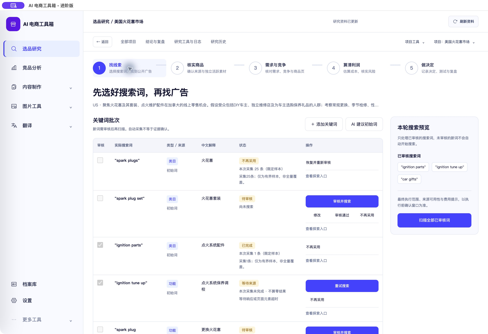
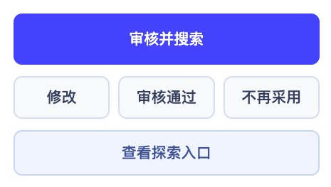

# 关键词表格排版调整

<!-- project-doc-status:start -->
> **文档状态同步：2026-10-26 · 分轮审查与验收记录**
> 保留现场问题、截图、测试数量及未验证项；后续修复不抹去原问题记录，本轮同步没有重做该文档的原验收。
> 当前入口与验证范围：[项目当前状态](<../../项目当前状态.md>)；[2026-10-26流程修复与边界](<../2026-10-26-sop-flow-repair/验收记录.md>)。
<!-- project-doc-status:end -->

日期：2026-10-24。用户指出操作列按钮随意换行、整行过高。本轮已更新源码及本机自用 Mac 客户端。

## 布局

- 每行主操作（审核并搜索、搜索或重试）置于最前，单独占一行。修改、审核通过、不再采用按固定三列排列，去除重复的厚重按钮边框；查看探索入口为下方独立文字操作。
- 六列表格按固定比例分配宽度，关键词、状态和说明顶部对齐；添加关键词/AI建议移动到批次标题右侧。
- 已审核搜索词改为紧凑标签；宽屏保留右侧预览，1350px以下预览位于表格上方；1024px下重新分配列宽，让操作列完整可见，大字号表头允许自然换行。
- 保留所有文字、状态、按钮、原有事件对象、审批及费用确认。只移动已有扫描按钮，没有创建第二套处理逻辑；主按钮在DOM中也排在前面，键盘顺序与显示顺序一致。编辑抽屉的只读列表保留原版式。

## 验证

- 完整前端802项、桌面15项通过，两个修改ES模块语法检查和 `git diff --check`通过。
- 1440、1280、1024三种宽度，16px、20px两档字号，共六组量测：页面无横向溢出，表格本身无需横向滚动，全部行操作按钮无文字裁切。
- 隔离验收使用实际源码，业务写入拦截。修改→取消、查看探索入口→返回、批量扫描→原有确认窗口→取消均通过；没有确认提交、审批、采集或收费AI。控制台error/warn为空。
- 已安装客户端进入真实项目和找线索页面，核对了主次操作位置、完整表格及预览。三个资源与9502服务逐字节一致，index包含新版本样式引用。候选与最终app签名校验、桌面资源校验通过。
- 未改后端、数据库、来源过滤、预算或工作流门槛。客户旧DMG未重建，不构成正式签名/公证验收。

## 效果

[修改前1280](captures/before-1280.png)、[修改后1440](captures/after-1440.png)、[修改后1280](captures/after-1280.png)、[1024大字号](captures/after-1024-20.png)。浏览器截图为禁止写入的私有夹具，最终配色和业务数据以原生截图为准。

## 文件与回滚

本轮仅修改 `frontend/css/research-polish.css`、`frontend/js/research-workbench/pages/exploration.mjs`、`frontend/js/research-workbench/components/presentation.mjs`，以及 `frontend/index.html` 的CSS缓存版本。

安装位置：`/Users/xiachengpeng/Applications/AI E-commerce Tools.app`。私有备份与日志：`~/.local/share/ai-ecommerce-desktop/closeout/20261024-keyword-layout/`；其中 `source-before/` 为本轮前源码，`previous.app` 为本轮前应用，`resource-verification.json`、`layout-metrics.json`为资源和尺寸比对。

回滚时先正常退出，再只还原本轮文件或旧app，校验启动；不要恢复旧数据库，不删除研究记录、设置或成功结果。原有其他未提交改动未回退。

## 同日按钮外观补充

按用户截图为次要操作加入浅灰底、细边框和圆角，查看入口采用浅蓝底完整按钮；补上悬停、键盘焦点和禁用外观，主操作保留蓝色。仅调整CSS及缓存版本，不改事件/业务逻辑。隔离页确认五个操作的底色、边框及文字无裁切，安装包资源/签名校验通过。本次没有新增测试或重跑收费业务，802/15属于上轮完整测试记录。回滚备份在 `closeout/20261024-keyword-buttons/`，含源码与 `previous.app`；不用恢复数据库。

完整原生截图： [native-buttons-final](captures/native-buttons-final.png)。
