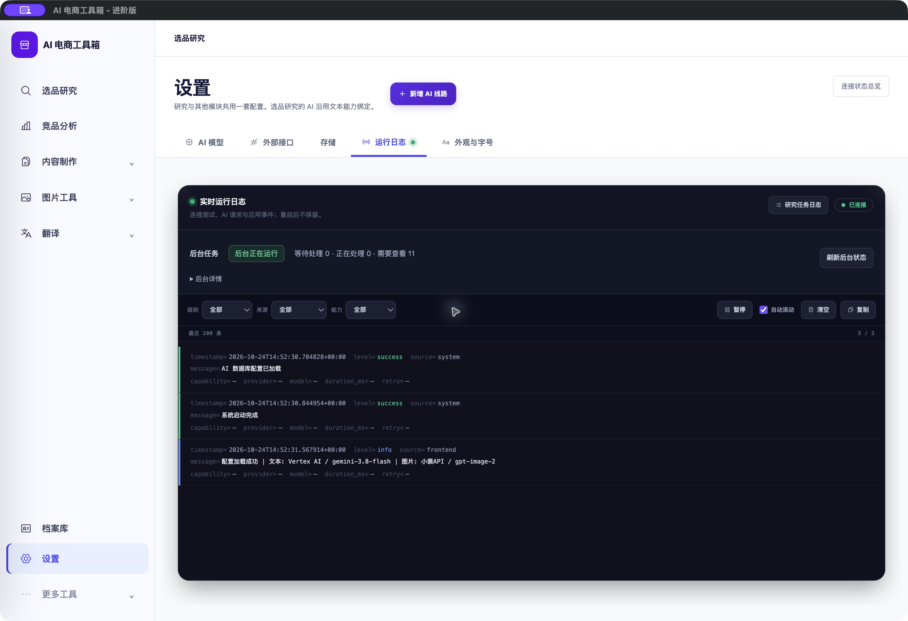

# 统一运行日志卡片 · 2026-10-24

<!-- project-doc-status:start -->
> **文档状态同步：2026-10-26 · 分轮审查与验收记录**
> 保留现场问题、截图、测试数量及未验证项；后续修复不抹去原问题记录，本轮同步没有重做该文档的原验收。
> 当前入口与验证范围：[项目当前状态](<../../项目当前状态.md>)；[2026-10-26流程修复与边界](<../2026-10-26-sop-flow-repair/验收记录.md>)。
<!-- project-doc-status:end -->

## 布局调整

用户原页依次出现后台状态白卡、持久日志白卡、实时日志深色卡，层级重复。现在只保留一张“实时运行日志”卡片：

1. 顶部保留日志连接状态，并将“研究任务日志”作为右侧快捷入口。
2. 卡片内紧凑状态条显示后台运行状态和等待/处理中/需查看数量，保留刷新按钮。
3. “后台详情”只有一层折叠，默认收起，按需查看飞书轮询、调用授权和观测时间。
4. 异常原因与状态读取失败提示不隐藏在详情中，直接显示在状态条下方。
5. 下方仍是原日志筛选、暂停/继续、自动滚动、清空、复制及事件列表。

状态观测与应用事件在视觉上合并，但未把后台状态伪造成应用日志事件。任务持久记录仍按研究项目查询，设置实时日志仍只保留当前后台进程的内存记录，不承诺重启后保留。

## 代码与行为边界

- `frontend/index.html`：将原 `settingsResearchWorkerStatus` 挂载点移入 `settingsLogPanel`，移除两张独立卡片，将原持久日志按钮移到控制台标题栏；保留连接、筛选和日志元素ID及原处理函数。
- `frontend/js/research-workbench/components/worker-status.mjs`：紧凑行、单层原生details、可见告警；原GET `/runtime-status`、15秒只读轮询和生命周期释放不变。
- `frontend/css/settings.css`：控制台内深色状态条、折叠内容、告警及窄窗口布局；不改变其他设置分区。
- `frontend/tests/settings_log_layout.test.js`、`frontend/tests/research-workbench/worker-status.test.mjs`：新增3项回归（结构、刷新保持展开、告警与未知数值）。

没有修改settings日志SSE/过滤逻辑、后台worker、队列、调用授权、飞书策略或数据库。暂停按钮仍只暂停日志展示，不暂停后台任务。

## 验证

新增断言先在旧结构下观察失败，再实现通过。最终完整前端 **827通过、0失败、0跳过**；桌面 **15通过**。变更MJS语法检查及 `git diff --check` 通过。

```text
node --test frontend/tests/*.test.js frontend/tests/research-workbench/*.test.mjs
node --test desktop/tests/*.test.cjs
```

测试证明仅有一张控制台、worker挂载点位于卡片内部、持久入口与原日志ID保留；详情默认收起，刷新不重建details；后台未知数量不会填成0，警告在折叠区之外；迟到状态不会在离开设置后渲染。

实际Mac客户端：进入设置→运行日志，确认卡片合并、运行/队列数量可读、连接正常；展开后台详情后手动刷新仍保持展开；日志暂停变为“继续”且后台仍显示运行，恢复后回到实时日志，最后收起详情。没有清除业务记录或触发采集。更新前观测排队0、处理中0，再正常退出更新客户端。



[修改前](captures/native-before.png) · [后台详情展开](captures/native-details.png) · [1024窗口/20字号隔离验收](captures/browser-1024-20.png)

原生截图2880×1972、2倍密度。隔离页面9520使用实际HTML/CSS/worker组件及明确模拟状态，不加载真实队列：1024×900/20字号，控制台约688px宽、状态区域约110px高，无页面横向溢出；日志控制自动换行，无重叠；控制台未见error/warn。模拟页面只验布局与状态组件，不代替真实SSE行为验证。

## 安装、边界与回滚

已更新 `/Users/xiachengpeng/Applications/AI E-commerce Tools.app`。仅覆盖本轮CSS、worker组件及安装HTML中的日志片段和CSS版本；保留自用版入口差异。候选及安装后ad hoc签名严格校验、资源验证通过；源码/安装/9502返回的CSS和MJS逐字节一致，安装HTML同样只有一张日志卡片。

私有备份 `/Users/xiachengpeng/.local/share/ai-ecommerce-desktop/closeout/20261024-logs-unification/`：`source-before/`、`previous.app`、测试日志、隔离验收工具、资源摘要。回滚时正常退出并恢复本轮前源码或客户端，不恢复用户数据库。

本轮未重跑后端全套或收费调用链路，未更改后台启停/授权，未提交AI、采集或飞书写入；客户DMG未重建，没有新增Apple公证。
