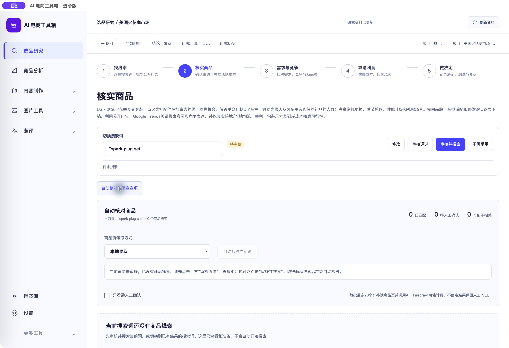

# 选品研究逐页 UI 检查与修复

<!-- project-doc-status:start -->
> **文档状态同步：2026-10-26 · 分轮审查与验收记录**
> 保留现场问题、截图、测试数量及未验证项；后续修复不抹去原问题记录，本轮同步没有重做该文档的原验收。
> 当前入口与验证范围：[项目当前状态](<../../项目当前状态.md>)；[2026-10-26流程修复与边界](<../2026-10-26-sop-flow-repair/验收记录.md>)。
<!-- project-doc-status:end -->

日期：2026-10-24。结果：本轮发现的布局和阅读问题已修复并更新本机 Mac 客户端。检查覆盖 24 个实际页面/状态，不等同于重新完成历史 24 张设计稿的逐像素验收，也不代表收费业务全链路重验。

## 主要问题、原因与处理

| 问题 | 等级 | 证据与原因 | 本轮处理 |
| --- | --- | --- | --- |
| 自动核对面板拥挤，读取方式标签拆行，提示和筛选混排 | P1 | [原生修改前](captures/00-native-before.png)；旧面板把标题、控件、提示作为同层 flex 项 | 状态头、读取方式与按钮、就近禁用原因、筛选与费用说明分别布局；保留执行确认和前置条件 |
| 搜索词工具栏悬在标题右侧，长方向文字与操作区争夺空间 | P2 | `research-design.css` 旧绝对定位规则；原生修改前截图 | 正常文档流中的独立工具栏，选择词、审核动作及搜索状态各有位置 |
| 核对区域切换筛选后重新折叠 | P2 | 原生 `details` 的 toggle 导致重绘后丢失展开值 | 按项目与搜索词保存本次会话展开状态；活动任务仍可自动展开 |
| 需人工确认筛选为空时，回退显示广告卡片，容易误解筛选结果 | P2 | `focused-exploration.mjs` 旧空分支混用广告列表 | 明确显示筛选为空，提供“显示全部商品”；无结果时提供已有线索入口，仅切换已保存的搜索词 |
| 表单、渠道、表格、次级按钮有大量 10–11px 字号 | P2 | 修改前 24 页截图及旧样式 | 表单标签/输入 14px、说明 12px、常用按钮 38–42px；跟随全局字号设置，其他模块不放大 |
| 利润页固定 38px 费用行与较大控件冲突，窄窗口标题过早换行 | P2 | 1024/20px 检查；旧费用轨道高度、标题右侧 310px 留白 | 费用行自动增高；1100px 以下表单/辅助说明上下排列，移除已无用途的标题留白 |
| 需求证据、漏斗表单窄窗口拥挤，主从列表多层滚动 | P2 | 修改前截图及旧网格/固定视口高度 | 漏斗 5 列改 3/2/1 列；需求区提前上下排列；取消主工作区固定高度，保留候选列表局部滚动 |
| 工具和项目规则显示业务第一步进度，容易误导 | P2 | 配置页使用通用 journey | 工具、规则、采集模式不显示业务进度；商品阶段选择明确标注“选择商品 · 阶段名” |

本轮没有发现仍需阻止交付的 P0/P1/P2 问题。保留蓝白风格、共享侧栏和所有证据门槛；没有通过隐藏原功能来减少操作。

## 逐页检查结果

下表均已实际渲染并保存前后截图，1280px/默认16px阅读检查通过；另逐页检查1024px/20px，24页均无整页横向溢出。长表格保留局部横向滚动。状态“通过”指本轮界面范围，未点击保存、搜索、采集、AI、同步等业务写入。

| 序号 | 页面/状态 | 处理和结果 | 修改后证据 |
| --- | --- | --- | --- |
| 1 | 项目首页 | 保留两个起点、项目和继续入口；层级检查通过 | [截图](captures/01-after-projects.png) |
| 2 | 新建研究 | 标签、输入、说明和提交区统一；窄窗口上下排列，通过 | [截图](captures/02-after-new_project.png) |
| 3 | 找线索/关键词 | 审核列不再拆字，操作区有最小宽度，阅读通过 | [截图](captures/03-after-keywords.png) |
| 4 | 核实商品/探索 | 工具栏、核对面板、无结果及筛选空状态修复，通过 | [截图](captures/after-leads-expanded.png) |
| 5 | 选品队列 | 筛选标签、操作按钮和详情文字统一，通过 | [截图](captures/05-after-triage.png) |
| 6 | 确认具体商品 | 来源并排比较及相关性下拉保留，表单可读性通过 | [截图](captures/06-after-identification.png) |
| 7 | 素材粗筛 | 创意卡片、人工复核和保存位置保留，控件尺寸通过 | [截图](captures/07-after-coarse.png) |
| 8 | 线索扩展 | 原文、词表和编辑入口保留，窄窗口重排通过 | [截图](captures/08-after-expansion.png) |
| 9 | 需求与竞争 | 渠道卡片增大、窄窗口上下排列，通过 | [截图](captures/09-after-channels.png) |
| 10 | 广告与漏斗 | 字号及3/2/1列重排，通过 | [截图](captures/10-after-funnel.png) |
| 11 | 算清利润 | 费用行自适应、大字号不挤压，通过 | [截图](captures/11-after-economics.png) |
| 12 | 评分与证据 | 证据缺口及补充入口保留，窄窗口单列，通过 | [截图](captures/12-after-score.png) |
| 13 | 做决定 | 保留不可测试等业务提示及人工决定，表单通过 | [截图](captures/13-after-decision.png) |
| 14 | 测试计划 | 输入及预览布局通过；隔离夹具仅用于展示版式 | [截图](captures/14-after-test.png) |
| 15 | 真实测试结果 | 来源、时间、支出和转化字段保留，未知仍为未知，通过 | [截图](captures/15-after-test_results.png) |
| 16 | 复盘 | 结论与摘要保留，字号与窄窗口布局通过 | [截图](captures/16-after-review.png) |
| 17 | 结论与报告 | 列表及详情保留，按钮与表格可读性通过 | [截图](captures/17-after-reports.png) |
| 18 | 任务日志 | 筛选及空状态通过；未启动任务 | [截图](captures/18-after-actions.png) |
| 19 | 来源路径 | 来源追溯布局保留，通过 | [截图](captures/19-after-paths.png) |
| 20 | 项目规则 | 控件字号、上下重排、无误导步骤条，通过 | [截图](captures/20-after-configure_rules.png) |
| 21 | 飞书同步预览 | 摘要和缺口阅读检查通过；未执行同步 | [截图](captures/21-after-sync.png) |
| 22 | 研究历史 | 筛选和空状态通过；未新增历史记录 | [截图](captures/22-after-history.png) |
| 23 | 研究工具与草稿 | 导入、导出及日志入口保留；去除业务进度，通过 | [截图](captures/23-after-settings.png) |
| 24 | 采集模式 | 两来源选择及保存入口保留；去除业务进度，通过 | [截图](captures/24-after-configure_collection.png) |

修改前文件按 `01-before-projects.png` 至 `24-before-configure_collection.png` 保留在 captures。修改前探索页的展开核对面板以 `00-native-before.png` 为准；`before-leads-expanded.png` 实际已折叠，不能用作展开态证据。

## 验证方法和实际结果

- 先保存真实客户端问题截图及隔离页截图，再调整。隔离页使用真实页面模块和产品样式，所有业务写入403阻断，素材请求不访问远端；测试计划的 pending 状态只为观察版式。夹具侧栏和配色受隔离环境影响，正式效果以原生截图为准。
- 完整前端 **802/802**，桌面 **15/15**；5个修改的ES模块语法检查通过；`git diff --check`通过。新增4个回归先失败后通过，覆盖禁用原因关系、筛选空状态、已有词只读入口及挂载后的展开保留。
- 1280/16px的24页截图逐一核对；1024/20px逐页量测无整页溢出，并检查7个重点页面的完整截图。复查中修复费用轨道和标题留白，再保存最终截图。[大字号利润页](captures/narrow20-economics.png)、[需求页](captures/narrow20-channels.png)、[漏斗页](captures/narrow20-funnel.png)。
- 隔离页面最终检查无控制台 error/warn。没有使用整页截图以外的浏览器裁剪模式；总览图仅是离线缩略排版。
- 独立代码复核检查生命周期、来源/筛选绑定、只读导航、原控件保留及CSS作用域；未发现Critical/Important。其后发现的窄窗口标题留白Minor已修复并截图核对。
- 原生Mac：正常启动，原9个研究项目仍在；进入真实火花塞项目，展开面板、切换并恢复人工筛选后仍展开；第1步返回关键词正常；第3/4/5步均显示正确的商品选择页与阶段标题；工作台返回恢复原页。未审批搜索词、保存表单或启动任务。
- 候选包及最终已安装包 ad-hoc 签名校验、桌面资源校验通过。6个新增/修改资源与本机9502服务逐字节一致，安装页包含新CSS。签名验证不等同于Apple公证。

## 已安装效果

## 文件和作用范围

新增 `frontend/css/research-polish.css`、`frontend/tests/research-workbench/ui-readability.test.mjs`。调整 `index.html` 样式引用、`research-workbench/index.mjs`作用域、`pages/verification.mjs`、`pages/focused-exploration.mjs`、`components/presentation.mjs`、`pages/stage-selection.mjs`。

样式仅命中原生研究根 `.rw-workflow-ui`。保留统一设置凭据编辑器的独立生命周期，不把研究样式扩散到主设置或其他工具。保留全部按钮、任务确认、预算、证据版本、来源绑定及历史格式；不改后端和数据库。

## 限制与回滚

本轮未执行收费AI、广告采集、图床上传、飞书写入，也未重验所有业务保存、下载或外部服务失败场景。历史素材缺失按既有用户决定保留，隔离页的素材占位不算新的业务故障；不恢复旧历史素材。没有完成屏幕阅读器、全键盘、所有系统字体/屏幕尺寸的完整无障碍认证。大字号/长关键词会增加页面高度，优先确保可读和不遮挡。

本机应用为 `/Users/xiachengpeng/Applications/AI E-commerce Tools.app`；客户0.2.0旧DMG不包含本轮修复，未重建发行包。

私有回滚材料在 `~/.local/share/ai-ecommerce-desktop/closeout/20261024-research-ui/`：`source-before/`是本轮修改前源码，`previous.app`是本轮修改前完整自用应用，测试日志和资源比对也保存在此处。需要回滚时先正常退出，按本轮清单还原源码或旧app，再校验启动；新建CSS/测试文件仅在确认没有后续依赖后移除。**不恢复旧数据库、不删除项目或成功结果**。安装时只加入样式引用，保留自用app与客户引导入口的差异。
