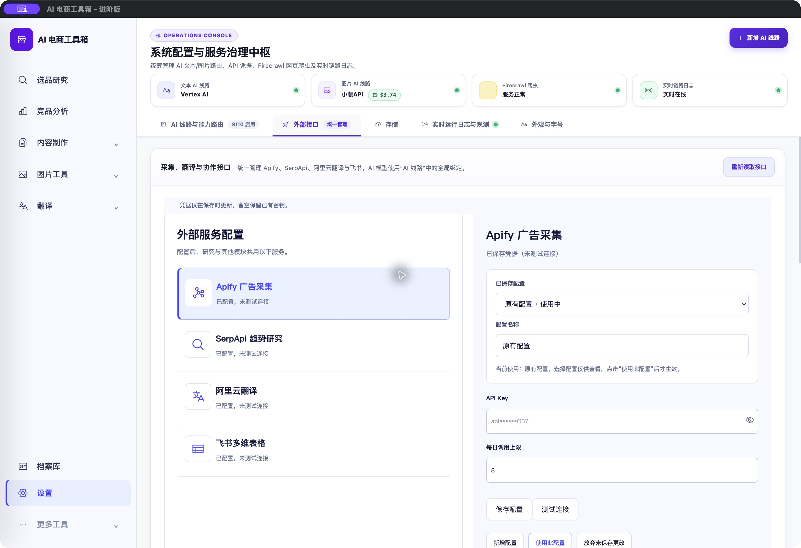
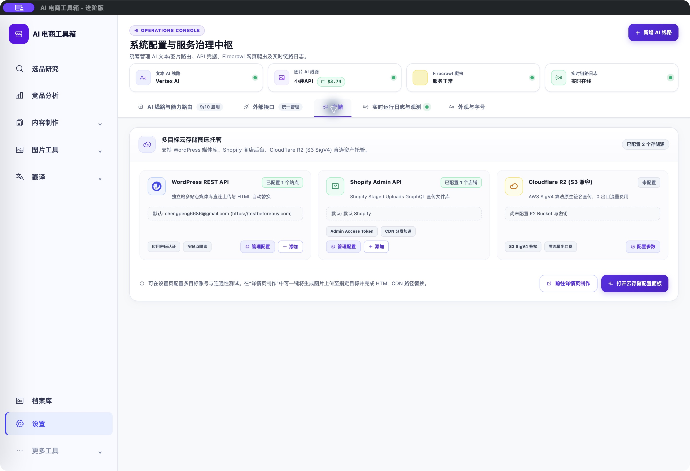

# 设置：外部接口与存储分区修复

<!-- project-doc-status:start -->
> **文档状态同步：2026-10-26 · 分轮审查与验收记录**
> 保留现场问题、截图、测试数量及未验证项；后续修复不抹去原问题记录，本轮同步没有重做该文档的原验收。
> 当前入口与验证范围：[项目当前状态](<../../项目当前状态.md>)；[2026-10-26流程修复与边界](<../2026-10-26-sop-flow-repair/验收记录.md>)。
<!-- project-doc-status:end -->

日期：2026-10-24。范围：设置标签切换、对应内容与客户端资源更新。

## 问题与原因

原“存储”是 `frontend/js/app.js:updateResearchSettingsFrame()` 动态创建的快捷按钮：点击后实际执行 `switchSettingsTab('integrations')` 并滚动到存储卡片。存储卡片也放在外部接口面板内，因此出现“外部接口高亮、下方显示存储”的错位。`settings.js` 的有效标签没有 storage，上传器原有的前往存储设置入口也无法准确定位。

## 修改

- `frontend/index.html`：新增唯一静态 `settingsTabBtnStorage` 和独立 `settingsPaneStorage`，原存储卡片移入该分区，外部接口标签使用“外部接口”名称。原 WordPress、Shopify、R2 元素 ID、编辑器及操作保持不变。
- `frontend/js/settings.js`：storage 纳入有效标签和统一切换映射，按钮选中状态与面板显示同步。
- `frontend/js/app.js`：移除伪存储快捷按钮与其恢复逻辑，沿用静态标签。
- 两个脚本缓存版本更新为 `20261024-storage-tab`。
- 回归测试覆盖连续切换、唯一标签和存储面板归属；缓存版本测试同步接受新版本。

## 验证

1. 原实现下新增回归失败，修复后专项 13 项通过。
2. 完整前端测试 829 项通过，失败/跳过均为 0；桌面测试 15 项通过。
3. app.js、settings.js 语法检查及差异空白检查通过。
4. 实际 Mac 客户端点击外部接口：显示外部服务配置及 Apify，未显示存储卡片；点击存储：仅显示三个存储目标，存储标签选中。
5. 安装包资源签名检查、桌面资源校验通过，源码/安装资源/9502 实际服务的 app.js 与 settings.js 字节一致。

本轮未修改后端、数据库、凭据和业务配置；未提交真实采集、收费连接测试或远程上传。未重跑后端全套测试，未重建客户 DMG。UI 验证不能证明远程服务当前可用。

## 实际客户端截图

外部接口分区：

存储分区：

## 更新与回滚

已更新 `/Users/xiachengpeng/Applications/AI E-commerce Tools.app`，保留自用客户端与源码之间既有的本地图标、引导等差异，仅替换本轮设置相关片段和脚本。

本机私有备份目录：`/Users/xiachengpeng/.local/share/ai-ecommerce-desktop/closeout/20261024-storage-tab/`。`previous.app` 为本轮更新前客户端，`source-before/` 为修改前源码文件，目录内保留红绿测试及完整测试日志和资源摘要。回滚时先正常退出应用、确认服务端口释放，再恢复该应用；源码须按本轮差异恢复，避免覆盖后续修改。不恢复数据库，不回退用户数据。
