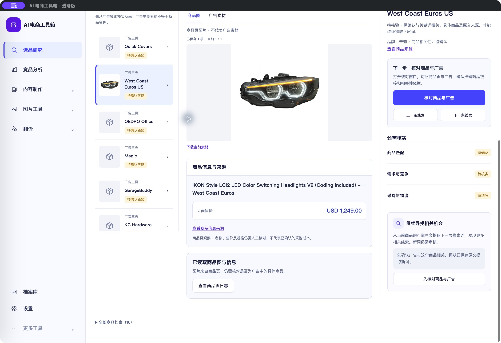

# 商品信息顺序与线索名称说明

<!-- project-doc-status:start -->
> **文档状态同步：2026-10-26 · 分轮审查与验收记录**
> 保留现场问题、截图、测试数量及未验证项；后续修复不抹去原问题记录，本轮同步没有重做该文档的原验收。
> 当前入口与验证范围：[项目当前状态](<../../项目当前状态.md>)；[2026-10-26流程修复与边界](<../2026-10-26-sop-flow-repair/验收记录.md>)。
<!-- project-doc-status:end -->

日期：2026-10-25。

- 商品图下方先显示“商品信息与来源”（商品页标题、USD 1,249.00及来源），其后显示“已读取商品图与信息”与商品页日志。未改变读取、价格或来源绑定。
- 左侧保留原始名称，若名称与已绑定来源记录中的advertiser相同，标注“广告主页”；手动商品名/其他已保存名称显示“商品名称”。列表增加说明：广告主页名称不等于商品名称。没有翻译、猜测或改写商家名称。
- 代码依据：`backend/modules/research/rabbit_hole/domain/project.py` 的广告采集处理使用 `ad["advertiser"]` 创建初始产品线索，同时保存 `candidate_sources[].advertiser`。Quick Covers、West Coast Euros US、OEDRO Office等实际线索据此可追溯。这是账号/主页名，不是AI建议的搜索词，不直接证明它是独立品牌或具体商品。
- 改动仅在 `focused-exploration.mjs`、`presentation.mjs`、`research-polish.css`及HTML缓存标记。原按钮和点击处理保留。

## 验证

新增顺序及名称来源两项回归先失败后通过，完整前端862通过、0失败/跳过；两模块语法和diff检查通过。没有后端修改，未重跑后端/收费服务，后端资源与更新前逐文件哈希相同。

自用Mac客户端已更新，安装资源与实际9502返回一致；打包资源和签名完整性检查通过。实际选择West Coast Euros US后，“广告主页”标注、商品信息先于读取状态、正确售价和原有按钮均可见。截图约1440×986逻辑尺寸、2倍密度。未保存业务修改或提交外部任务；客户旧DMG未重建。

## 回滚

私有备份 `/Users/xiachengpeng/.local/share/ai-ecommerce-desktop/closeout/20261025-candidate-labels/` 下：`source-before/`保留本轮前源码，`previous.app`保留本轮前客户端。先正常退出并确认端口空闲后成套恢复应用；不回滚或覆盖数据库、凭据与用户目录。测试日志留在该私有目录。

复验补充：重新执行完整前端862项通过，安装包签名/资源校验与实际原生显示复核通过。复验时发现上述历史私有备份目录已不在，当前仅重新留存本轮测试日志；`source-before/`和`previous.app`不能再按旧路径使用，回滚前必须重新核对可用备份，不能覆盖用户数据库。
