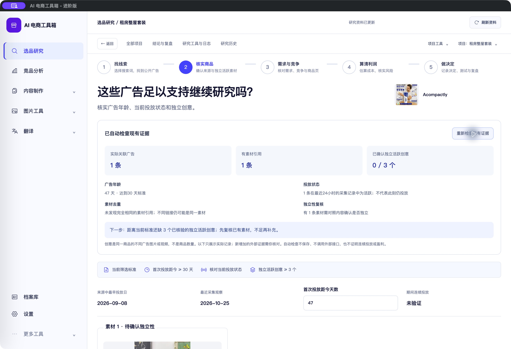
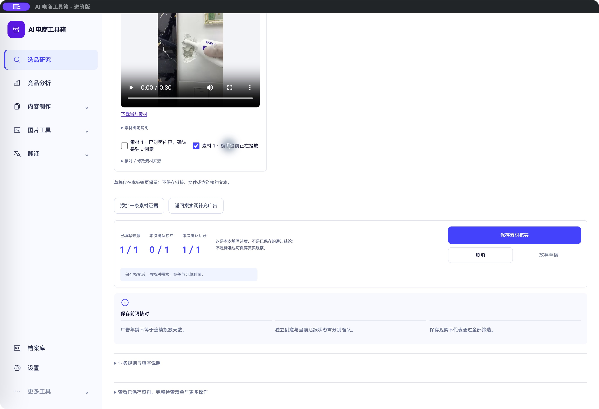

# 广告素材数量与已有证据检查（2026-10-25）

<!-- project-doc-status:start -->
> **文档状态同步：2026-10-26 · 分轮审查与验收记录**
> 保留现场问题、截图、测试数量及未验证项；后续修复不抹去原问题记录，本轮同步没有重做该文档的原验收。
> 当前入口与验证范围：[项目当前状态](<../../项目当前状态.md>)；[2026-10-26流程修复与边界](<../2026-10-26-sop-flow-repair/验收记录.md>)。
<!-- project-doc-status:end -->

## 本轮结果

- 按当前商品的实际绑定广告与已保存创意合并展示，取消固定补足3个空栏。已保存外部证据仍保留，用户可显式添加新证据；已有表单输入与提交身份保留。
- 页面默认显示“已自动检查现有证据”，并可就地重新检查。分别展示关联广告条数、素材引用条数、已确认且有近期来源佐证的独立活跃创意数量，以及年龄/投放/重复引用/待复核事项。
- 30天、3个创意是项目当前规则，按项目配置展示，不是实际已获取数量或广告平台要求。新素材/不同广告编号/不同链接均不自动当作不同创意。
- 自动检查是本地只读辅助：不重新采集、不调用AI/付费接口、不自动保存、不自动通过粗筛；服务端confirm_creatives、版本/身份/审核门槛不变。不确定的独立性仍需要对照素材内容确认。

## 检查边界

日期必须有效，年龄计算以来源观察时间为准；近期活跃统计取24小时内观察（允许原系统5分钟时间偏差），不声称实时投放。过期/未来/缺失观察不能成为近期活跃证明；广告年龄不代表连续投放。

重复检查仅覆盖完全相同的素材引用组合，不剥除不同签名参数、不凭URL差异证明视觉独立。未新增视频抽帧、图像相似度或自动身份识别服务。实际素材引用不保证当前可播放；来源预览继续原有错误/重试机制。

已确认数量只统计当前身份、来源广告ID与链接一致、已保存人工独立/活跃确认且有近期活跃及素材引用的记录；是辅助检查统计，不替代服务端既有历史门槛结果。外部证据保留人工核对/保存路径，不伪造对应的采集观察。

## 源码范围

- 新增 `services/creative-evidence.mjs`：纯函数与绑定广告去重。
- 新增 `components/creative-check.mjs`：只读检查摘要与下一步。
- `pages/product.mjs`：实际行数、外部证据添加、输入保留、原保存命令。
- `components/presentation.mjs`：实际素材说明、复核标题、填写进度。
- `research-polish.css`及`index.html`：局部排版与缓存版本。

## 验证

- 完整前端882项通过，0失败/跳过；本轮新增15项（纯函数10、交互5），另调整旧测试预期为实际数量。
- 新测试先失败后通过；覆盖单条/无记录、不相关来源、相同素材引用、不同ID不能证独立、过期/未来/缺日期、无素材、身份修订、外部记录、自定义门槛、冲突来源、非法日期、动态新增/草稿及已提交身份保护。
- 修改模块语法和`git diff --check`通过。独立只读代码复核无P0/P1/P2；复核指出实际DOM与轻量fixture中页脚位置不同，已修正零记录保存禁用的定位，并额外验证真实DOM零→1→2条记录、原ID/链接/勾选保留，模拟写入次数始终0。
- 实际Mac客户端中打开Acompactly：1条绑定广告、1条素材引用、47天、0/3已确认独立活跃创意，只有1个实际素材卡片；“重新检查”不跳页，未知独立性未自动勾选，视频加载后正常显示。
- 本轮没有点击真实保存、执行广告搜索、收费AI、翻译或飞书写入。原项目数据未因验收修改。隔离演练不接生产API，结束后关闭页面和临时服务。
- 自用客户端前端已更新；5项安装/源码/9502响应字节一致；ad hoc签名及资源验证通过。后端二进制与更新前哈希一致，数据库未迁移，客户DMG未重建；后端/桌面测试本轮未重跑。

## 回滚

`/Users/xiachengpeng/.local/share/ai-ecommerce-desktop/closeout/20261025-creative-evidence/` 保留 `source-before/`、`previous.app`及测试日志。正常退出、确认9502/9503释放后可替换旧客户端；不恢复旧数据库。源码撤回仅针对本轮差异，保留其他修改，新增服务/组件须核对后续引用再撤回。
