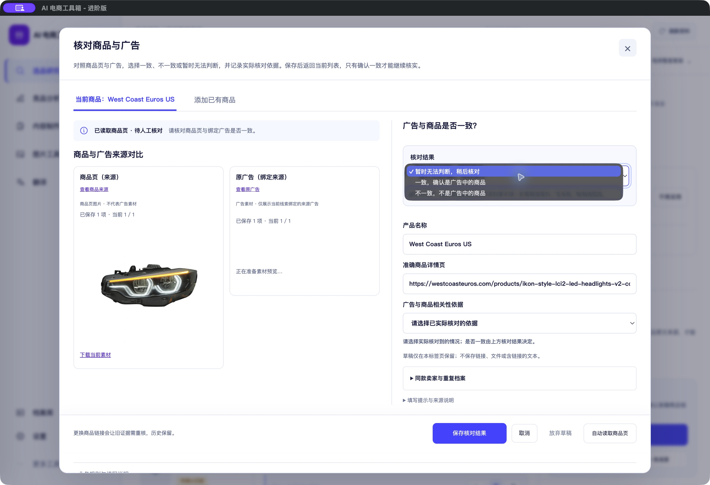
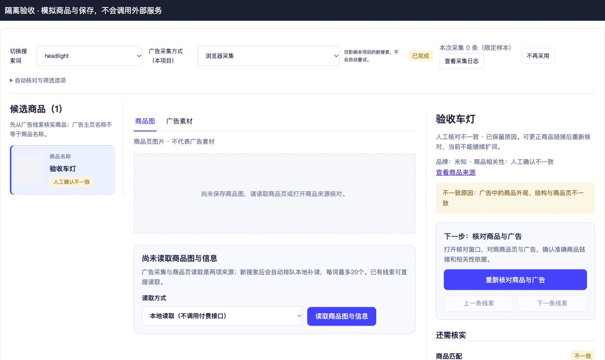

# 商品与广告核对：一致、不一致、暂无法判断

<!-- project-doc-status:start -->
> **文档状态同步：2026-10-26 · 分轮审查与验收记录**
> 保留现场问题、截图、测试数量及未验证项；后续修复不抹去原问题记录，本轮同步没有重做该文档的原验收。
> 当前入口与验证范围：[项目当前状态](<../../项目当前状态.md>)；[2026-10-26流程修复与边界](<../2026-10-26-sop-flow-repair/验收记录.md>)。
<!-- project-doc-status:end -->

日期：2026-10-25。

## 用户操作与行为

弹窗新增“核对结果”：

- 一致：确认广告对应当前商品，并记录实际依据，之后继续核实广告素材。
- 不一致：选择/填写外观、型号等不一致原因后保存。保留线索、原始来源和原因，不自动删除或淘汰；列表显示“人工确认不一致”，当前不可扩词。可通过“重新核对商品与广告”更正准确商品链接后重新确认。
- 暂时无法判断：图片加载失败、链接不明确或证据不足时使用，保持待核对，不作为一致继续。仍需说明当前无法判断的原因。

原界面只有“我已核对相关”复选框，false既可能未核对，也可能已核对但不一致。新结果消除这两种状态混淆，仍由原boolean相关性门槛控制业务。

## 实现与兼容

- `domain/project.py` 的原confirm_product/identify处理新增可选 `relevance_result`（matched/mismatch/unverified）。未传时按旧boolean推导，已有记录和旧调用继续可用；矛盾结果被服务端拒绝。无数据库迁移。
- 新组件 `identity-result.mjs` 用明确结果替代可见复选框；保留原boolean输入和草稿、命令ID、防重复及版本冲突机制。选择一致才设true，不一致/待核对都为false。
- `pages/product.mjs` 保留原名称、链接与依据输入，新增负向/证据不足的常用依据；未确认一致不进入粗筛。
- `presentation.mjs`、`focused-exploration.mjs` 展示不一致状态、原因和重新核对入口；既有扩词门槛未放松。
- 保存按钮统一为“保存核对结果”，弹窗说明不再暗示所有结果都进入下一步。

## 验证

- 完整前端864项通过；桌面15项通过。
- 主后端1325项通过；研究领域专项137项通过（含4项新结果/矛盾校验）。这两组按原命令分别记录，不把历史轮次累加。
- 首轮主后端1324通过/1失败，原因是本机浏览器缓存目录不存在；指定客户端已打包的对应浏览器后，完整主套件通过，未新安装浏览器或降低隔离规则。
- 语法、diff、客户端资源和ad hoc签名完整性检查通过。源码/安装/9502实际返回的7项前端资源相同。
- 隔离页面实际打开核对窗、保存不一致、查看原因/阻止扩词，再重新打开改成暂无法判断并保存，均符合预期，控制台error/warn为空。该页面数据与保存均模拟，不代表真实项目写入验收。
- 实际Mac客户端打开West Coast Euros核对窗，原生下拉菜单确有三个选项。只打开/查看菜单，没有代用户保存真实核对结果，也没有收费AI、Firecrawl、搜索或飞书提交。
- 自用客户端已更新前后端；客户旧DMG未重建。未重验PostgreSQL部署或真实收费链路。

## 回滚

私有目录 `/Users/xiachengpeng/.local/share/ai-ecommerce-desktop/closeout/20261025-identity-outcomes/`：`source-before/`保留修改前源码、`previous.app`保留旧客户端，新增组件和测试须在核对后续改动后再撤回。先正常退出并确认9502/9503释放再替换整套应用，不恢复旧数据库或覆盖用户数据。原状态是嵌入JSON的向后兼容新增字段，不需数据库降级。

本轮测试日志和构建日志留在该私有目录，未加入仓库；只读菜单截图未改变真实商品结论。
