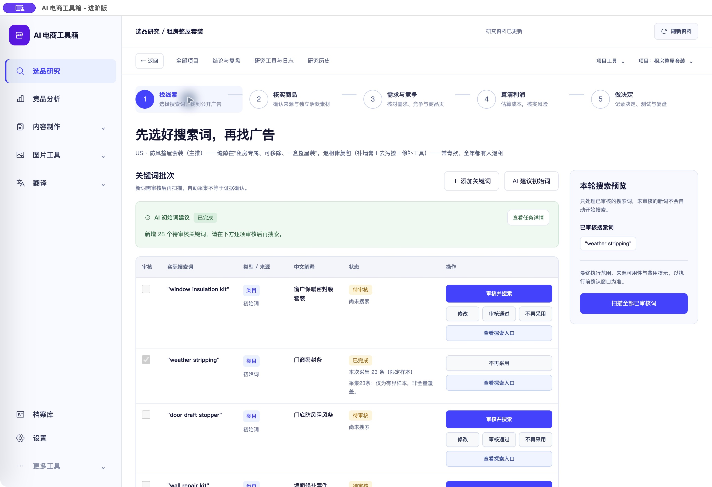
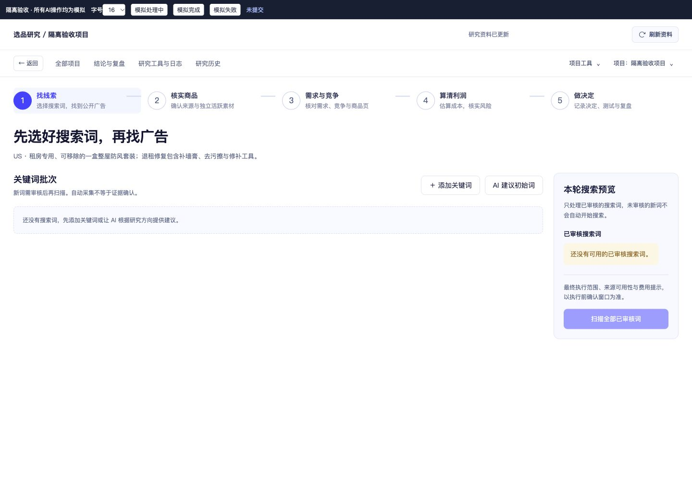
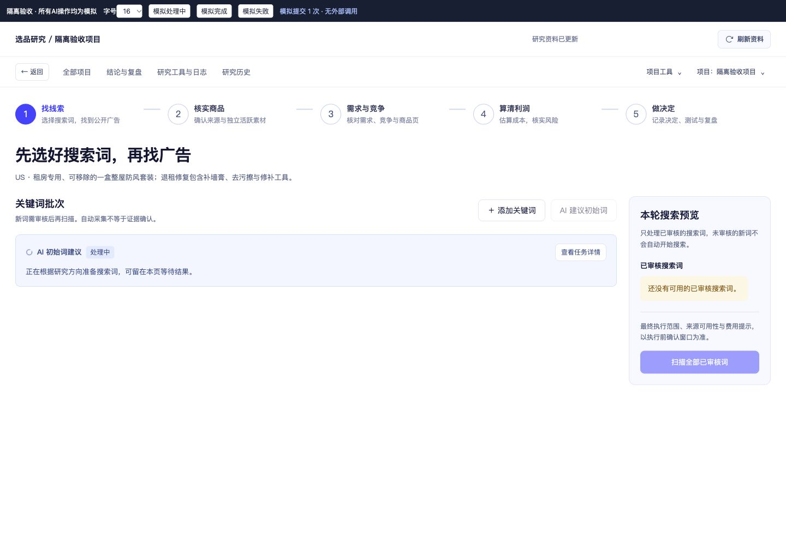
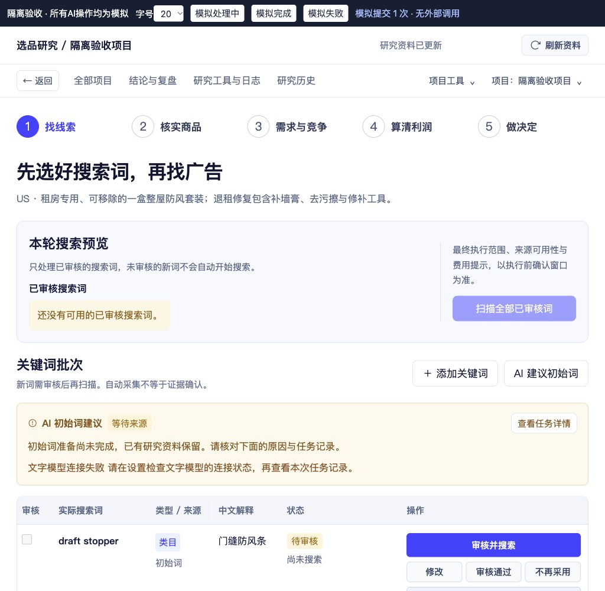

# 关键词区按钮对齐与原地任务反馈

<!-- project-doc-status:start -->
> **文档状态同步：2026-10-26 · 分轮审查与验收记录**
> 保留现场问题、截图、测试数量及未验证项；后续修复不抹去原问题记录，本轮同步没有重做该文档的原验收。
> 当前入口与验证范围：[项目当前状态](<../../项目当前状态.md>)；[2026-10-26流程修复与边界](<../2026-10-26-sop-flow-repair/验收记录.md>)。
<!-- project-doc-status:end -->

日期：2026-10-25。范围：关键词工作区标题/按钮错位，以及AI建议初始词的处理状态只在顶部显示。

## 根因

关键词区原网格按直接子元素h2、p、actions分配行列。上一轮新增的空状态也是p，继承了副标题的第2行规则，因此与操作区并排挤占；单靠间距无法解决。任务状态则由index/snapshot统一调用notify写入全局顶部，原操作区没有状态展示。

## 修改

- `pages/exploration.mjs`：关键词区建立明确的 `rw-keyword-section-header`，内部为标题/说明与按钮组；空状态、任务反馈、表格各占内容行。AI忙碌时禁用重复按钮并隐藏重复的空白引导。
- `components/keyword-progress.mjs`：仅使用现有项目快照，显示最近或正在跟踪的初始词任务。排队/处理中、完成数量、失败原因、状态待核对均在按钮下方；复用后端消息、结果和任务详情入口，不发起额外采集或轮询，不输出虚构百分比。
- `components/action-confirmation.mjs`：增加统一反馈发布方法；关键词页将该任务反馈留在原地，其他流程沿用全局提示。保留模态确认、费用说明和单次提交。
- `index.mjs`、`services/snapshot.mjs`：复用发布方法；保存后读不到状态时，关键词任务的回执也留在本区，避免退回顶部提示。
- `services/actions.mjs`：本地已提交任务标记增加kind，用于状态尚未返回时识别初始词请求；提交DTO、命令身份和版本机制不变。
- `research-polish.css`：标题栏自适应、按钮组垂直居中、状态条、完成/失败颜色及减弱动态效果支持。`index.html`更新该样式缓存标识为 `20261025-keyword-feedback`。

没有更改后端执行、计费、重试、审核或数据模型。未修改现有研究记录、账号和凭据。

## 验证

新增5项前端回归先失败后通过：明确标题结构、运行/完成/失败原地更新、待核对回执防重复、提交到完成单次请求且不占用全局顶部、保存后读取失败仍原地保留回执。原有公开广告搜索的全局完成提示回归同时保留。

- 完整前端：**843通过，0失败，0跳过**。
- 桌面：**15通过，0失败，0跳过**。
- 全部修改mjs语法检查及差异空白检查通过。
- 隔离浏览器实际点击AI确认并模拟提交，记录仅1次模拟POST；处理/完成/失败切换均在关键词区域，未自动审核或搜索。1440/16字号与1024/20字号检查，页面无横向溢出、按钮未裁切，控制台无warn/error。页面工具条明确标注虚构数据，未访问真实AI服务。
- 实际Mac客户端打开原有“租房整屋套装”：按钮与标题处于同一标题栏，内容区显示已有AI任务“已完成，新增28个待审核关键词”；顶部仅保留一般资料状态。28来自用户之前的真实任务记录，并非本轮代理生成。已有关键词审核状态及商品记录保留。
- 安装包7个前端资源与源码、9502实际响应字节一致，签名与桌面资源校验通过。本轮未重跑后端全套，未提交真实AI、采集、飞书或远程写入。

## 实际客户端证据

## 隔离状态证据

## 更新与回滚

已更新 `/Users/xiachengpeng/Applications/AI E-commerce Tools.app`，保留安装HTML的本地图标、自用引导差异，只替换上述前端资源和CSS缓存标识。客户DMG未重建。

私有目录：`/Users/xiachengpeng/.local/share/ai-ecommerce-desktop/closeout/20261025-keyword-feedback/`，其中 `previous.app` 为本轮更新前应用，`source-before/` 为源码前快照，另保留测试日志、隔离验收页和资源摘要。回滚先正常退出、确认9502/9503释放，再恢复应用；源码仅恢复本轮差异，不覆盖其他任务，不回退数据库。新建的keyword-progress.mjs只在本轮差异内处理。
