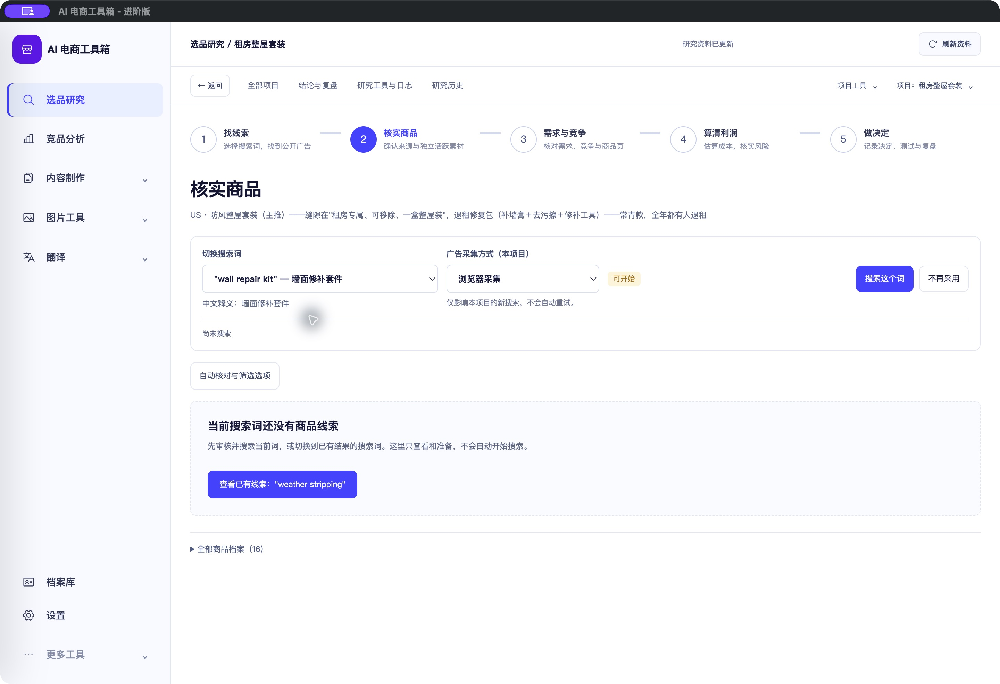
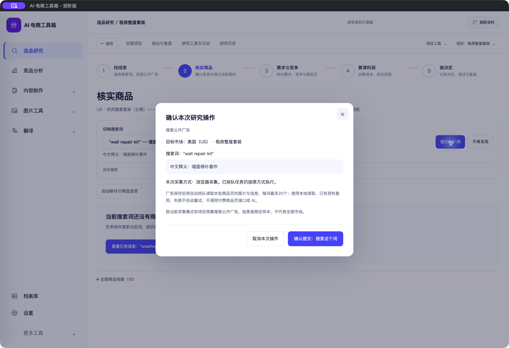

# 搜索词中文释义验收（2026-10-25）

<!-- project-doc-status:start -->
> **文档状态同步：2026-10-26 · 分轮审查与验收记录**
> 保留现场问题、截图、测试数量及未验证项；后续修复不抹去原问题记录，本轮同步没有重做该文档的原验收。
> 当前入口与验证范围：[项目当前状态](<../../项目当前状态.md>)；[2026-10-26流程修复与边界](<../2026-10-26-sop-flow-repair/验收记录.md>)。
<!-- project-doc-status:end -->

## 用户可见变化

“核实商品”的搜索词选项显示英文原词与已保存中文释义，选中后下方也显示中文释义，长释义可换行。搜索确认弹窗在英文原词下面单独显示中文释义。实际客户端已核验 `"wall repair kit" — 墙面修补套件`。

释义来自原关键词的 `meaning` 字段；没有释义时提示到“找线索”修改补充，不调用翻译、不编造解释。实际英文搜索内容、关键词ID、审核、预算和提交逻辑不变。

## 修改范围

- `frontend/js/research-workbench/pages/focused-exploration.mjs`：选项与已选词释义。
- `frontend/js/research-workbench/components/action-confirmation.mjs`：确认窗释义。
- `frontend/css/research-polish.css`：释义字号、换行和确认窗背景。
- `frontend/index.html`：样式缓存版本。
- 原有两个测试文件新增3项回归测试，无后端或数据结构调整。

## 验证结果与边界

- 新增3项测试修改前失败、修改后通过；相关20项通过。
- 完整前端867项通过，0失败/跳过；两个修改模块语法及 diff 检查通过。
- 自用Mac客户端前端已更新，源码、应用内文件和9502实际返回内容一致；ad hoc签名完整性和打包资源验证通过。后端可执行文件哈希与更新前一致，无数据库迁移；客户DMG未重建。
- 原生下拉菜单显示28个已有搜索词的中英对照；切换到墙面修补套件、打开确认窗、取消并返回原页面均通过。未点击确认提交，未采集、翻译、调用收费服务或写入飞书。
- 首次更新启动出现空白窗口，正常退出并重开后恢复；未定位其根因，不能宣称修复了启动空白问题。最终窗口正常，中文释义可见。
- 后端与桌面测试本轮未重跑，不把历史结果计入本轮。

## 回滚

私有备份目录：`/Users/xiachengpeng/.local/share/ai-ecommerce-desktop/closeout/20261025-keyword-meaning/`。

`source-before/`保留4项修改前源码；`previous.app`保留更新前客户端；测试日志位于同目录。正常退出客户端、确认9502/9503释放后可替换应用回滚，勿恢复或覆盖用户数据库。源码回滚须先核对后续改动，仅撤回本轮差异，保留无关修改。
