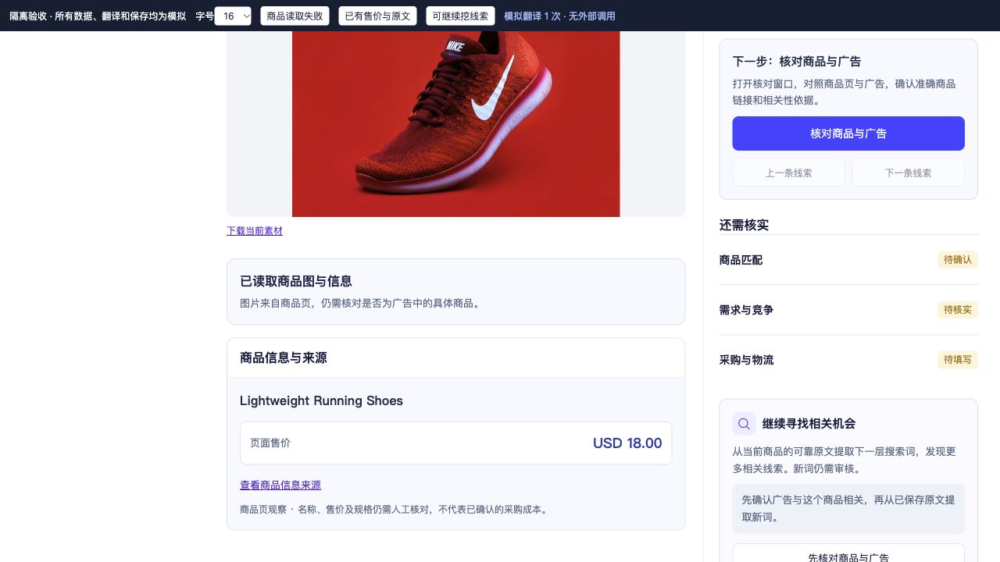
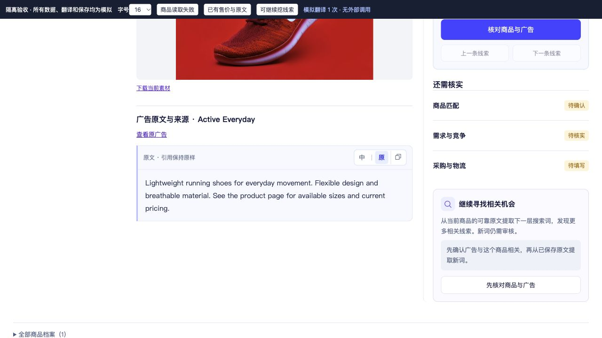
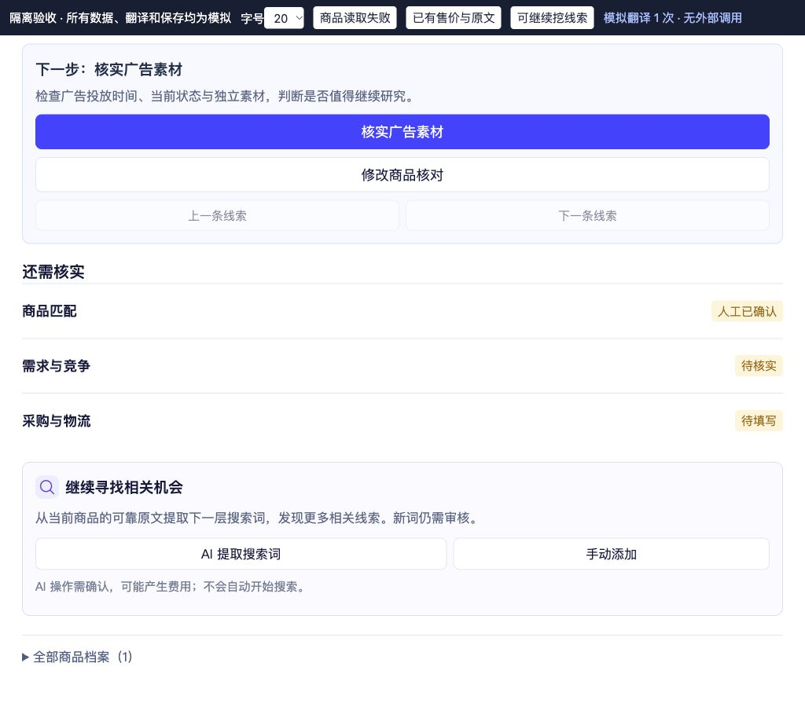
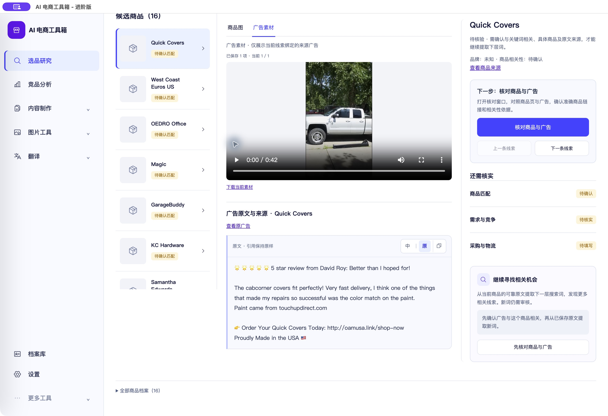
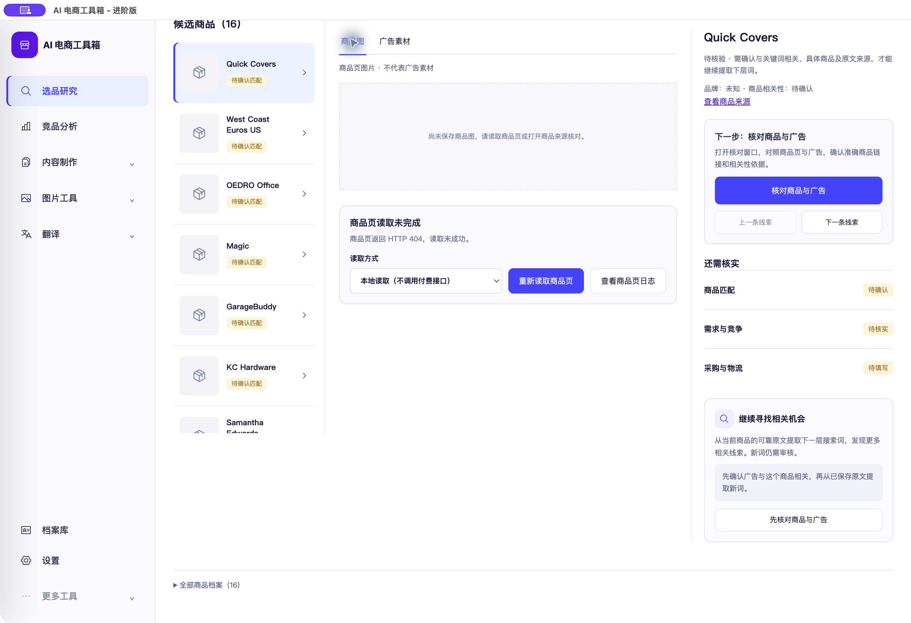

# 核实商品内容分区与阅读工具验收

<!-- project-doc-status:start -->
> **文档状态同步：2026-10-26 · 分轮审查与验收记录**
> 保留现场问题、截图、测试数量及未验证项；后续修复不抹去原问题记录，本轮同步没有重做该文档的原验收。
> 当前入口与验证范围：[项目当前状态](<../../项目当前状态.md>)；[2026-10-26流程修复与边界](<../2026-10-26-sop-flow-repair/验收记录.md>)。
<!-- project-doc-status:end -->

日期：2026-10-25。范围：核实商品的广告阅读工具、商品信息分区、观察售价及线索扩展入口。未改后端、数据库或客户分发 DMG。

## 交付内容

1. 广告原文框内置“中｜原＋复制图标”，以“原”兼容英文之外的原广告语言。点击中文才调用既有翻译接口；已有译文复用，翻译返回不覆盖用户后来选择的原文。复制始终使用保存原文，并就地提示成功或失败。
2. 商品图 Tab 独占商品读取状态、读取方式、重读、日志和商品信息；广告 Tab 只显示精确绑定的广告素材、原文及来源。切换保留媒体缓存和局部阅读状态，不提交采集。
3. 商品页已保存快照的标题、页面售价和来源呈现在商品图下方。售价使用原始观察值，不换算币种、不推测价格，也不将其当作已核实采购成本；未获取时明确说明。
4. “从这个线索继续挖”整理为右侧“继续寻找相关机会”卡片，放在“还需核实”清单后。未确认相关性、缺原文、扩展上限分别说明原因；符合条件时提供 AI 提取及手动添加。原有操作确认、费用提示、原文证据和深度规则保留，新词仍需审核。

## 代码依据

- `frontend/js/research-workbench/components/ad-copy.mjs`：紧凑工具栏、单次翻译、晚返回保护及来源选择通知。
- `frontend/js/research-workbench/components/product-facts.mjs`：仅使用保存的商品页观察值显示标题和售价。
- `frontend/js/research-workbench/components/product-page-status.mjs`：保留读取与日志，支持关闭重复事实显示。
- `frontend/js/research-workbench/pages/focused-exploration.mjs`：商品/广告分区、绑定广告原文及右侧扩展卡片。
- `frontend/css/research-polish.css`：局部样式；`frontend/index.html`：对应缓存标记。
- `frontend/tests/research-workbench/lead-content-tabs.test.mjs`：新增 5 项回归。

## 自动检查

- 完整前端：858 通过，0 失败、0 跳过。
- 桌面：15 通过，0 失败、0 跳过。
- 改动的四个模块语法检查及 `git diff --check` 通过。
- 安装包签名完整性与资源校验通过；只是本机 ad hoc 签名，并非 Apple 公证。
- 5 个功能资源的源码、安装资源、9502 实际返回内容一致；后端资源逐文件哈希与安装前一致。
- 没有重跑后端测试或收费服务，不能由本轮 UI 验收推定这些服务重新通过。

## 浏览器隔离实测

使用真实源码及全部生产样式，模拟项目/翻译/售价/任务；没有连收费接口。

- 中文阅读、返回原文、复制按钮反馈正常；测试确认中文阅读时复制仍提交原文给剪贴板接口。浏览器系统剪贴板读回未取得文本，不将其记作系统读回成功。
- 有售价、无快照/404 状态均核对，错误与售价只在商品 Tab。
- AI 扩词打开原确认弹窗，取消后没有模拟任务提交。
- 1024×900 / 20px：页面宽度与滚动宽度均1024，新增卡片无横向溢出。宽屏截图1280×720 / 16px。
- 控制台 error/warn 为空。
- 自动回归另覆盖两条绑定广告切换、翻译晚返回以及未确认/缺来源/到上限/可扩展四种门槛。

## 实际 Mac 客户端实测

已更新 `/Users/xiachengpeng/Applications/AI E-commerce Tools.app`，保留原生资源与本地图标。实际窗口截图2880×1972，约1440×986逻辑尺寸、2倍密度。

- 租房整屋套装 → 已有 weather stripping 线索 → Quick Covers。
- 视频42秒正常显示；原文新工具栏与右侧核对/继续寻找卡片正常。
- 切到商品 Tab，只显示现有商品图缺失和读取404状态；广告原文隐藏。切回广告视频正常，商品404卡片隐藏。
- 真实商品页尚无成功快照，未伪造图片/售价。当前价格展示只通过隔离样例证明，不能记为真实商品价格读取成功。
- 未点击真实中文翻译、AI扩词、重读、搜索或任何远程写入。

本轮视觉验收通过：工具栏在原文框内，内容归属明确，扩展卡片与当前商品在同一右侧区域。保留既有侧栏、核对弹窗和证据规则。此轮不是全产品逐像素重验。

## 回滚

私有备份根：`/Users/xiachengpeng/.local/share/ai-ecommerce-desktop/closeout/20261025-lead-content-tabs/`。

- `source-before/` 保留本轮修改前源码，包括已有未提交变更。仅恢复本轮涉及文件；新建 `product-facts.mjs` 和新增测试只在确认无后续改动时撤回。
- `previous.app` 是更新前完整客户端。退出当前应用并确认9502/9503空闲，再成套替换；当前应用可另存以便恢复。
- 不覆盖用户数据目录，不恢复旧数据库，不修改密钥或后台授权。
- 前端/桌面日志在该私有根下，未加入仓库。
