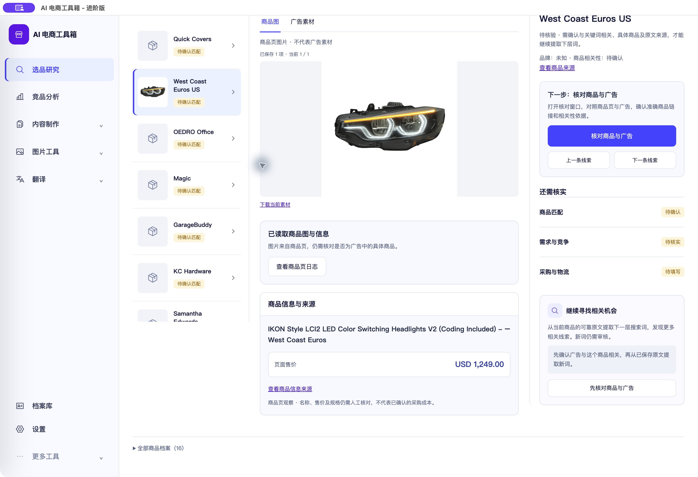

# 商品售价提取与旧快照展示修复

<!-- project-doc-status:start -->
> **文档状态同步：2026-10-26 · 分轮审查与验收记录**
> 保留现场问题、截图、测试数量及未验证项；后续修复不抹去原问题记录，本轮同步没有重做该文档的原验收。
> 当前入口与验证范围：[项目当前状态](<../../项目当前状态.md>)；[2026-10-26流程修复与边界](<../2026-10-26-sop-flow-repair/验收记录.md>)。
<!-- project-doc-status:end -->

日期：2026-10-25。仅针对售价错误；未改变人工核对、成本或决策门槛。

## 根因与实证

用户提供的 West Coast Euros 商品实际售价为 $1,249.00，旧快照记录为 `124`。旧采集器仅识别整数加两位小数，把 `$1,249.00` 部分匹配成 `1,24`，再删除逗号得到124。该页结构化数据是 `ProductGroup/hasVariant`，旧逻辑未识别这种结构，因此落入有缺陷的正文提取。前端之前忠实展示了旧快照值，并非文字被CSS裁切。

本轮读取该公开商品页HTML，页面价格元数据 `og:price:amount=1,249.00`、币种USD；保存的快照正文也有明确 `Sale price $1,249.00`，结构化规格报价可核对币种。新解析对二者均给出1249.00/USD。没有通过乘倍数或固定值修复。

## 修改

- 新增 `backend/modules/research/rabbit_hole/integrations/collectors/landing_price.py`：完整金额token校验，支持千位分隔/小数，优先当前商品报价或页面价格元数据；正文显式促销/当前价优先于原价和分期金额。多规格价不同不默认为第一个；显式variant仅取对应报价。歧义价格保持未获取，不从项目市场猜币种。
- `landing.py` 保留币种、提取来源与解析版本；本地和Firecrawl读取复用同一解析。
- `backend/routes/research_workbench.py` GET项目时，为已有快照增加派生 `price_observation`。只在内存副本计算，不改原 `price`、证据时间、版本或数据库。无可靠依据时不继续展示旧截断值。
- `product-facts.mjs` 优先显示派生观察，已知币种加币种代码、千位分隔及两位小数。保持旧格式兼容，缺失不回退到错误值。
- 新增价格解析及只读接口回归，扩充前端售价测试；缓存标记更新。

## 实际验收

更新本机 `/Users/xiachengpeng/Applications/AI E-commerce Tools.app` 后，在租房整屋套装 → weather stripping → West Coast Euros US → 商品图看到 **USD 1,249.00**，不是124。商品图、商品原始来源和人工核对入口保留。

真实GET响应已验证：除新增派生字段外，完整快照逐字段与安装前备份相等；原始记录没有被覆盖。用户无需重读才能修正这条记录的显示。截图是实际客户端，不是演示样例。

本轮只读访问公开原商品页并读取已保存快照；未提交新采集任务、收费AI/Firecrawl请求、购物或飞书写入。未来网页或规格变化仍需重新观察，不能把本次价格当作固定保证。

## 构建与回滚

后端在私有新目录冻结、复用现有构建工具，未安装/升级依赖。前端资源与9502实际返回一致，客户端资源校验、ad hoc签名完整性检查通过；这不等于Apple公证。客户分发DMG未重建。

私有备份：`/Users/xiachengpeng/.local/share/ai-ecommerce-desktop/closeout/20261025-price-extraction/`。

- `source-before/` 是本轮源码修改前备份。
- `original-snapshot.json` 是原证据只读备份，`runtime-price-proof.json` 保存无敏感字段的对比结果；原HTML也留在私有目录，未提交仓库。
- `previous.app` 是更新前完整客户端。回滚先正常退出并确认9502/9503释放，再替换整套应用；不要恢复旧数据库或覆盖用户数据目录。
- 本轮新增解析模块和测试若需撤回，应先检查后续改动，只恢复本轮涉及文件。

## 测试结果与环境边界

- 主后端完整套件：1325通过，0失败；保留3项既有依赖警告。
- 价格/商品页/工作台接口专项：87通过（与主套件有重叠，不相加）；包含10项价格解析用例。
- 完整前端：860通过，0失败、0跳过；桌面15通过。
- 语法与 `git diff --check` 通过。
- 首轮主后端收集遇到本机旧切换配置屏障，改用隔离配置后重跑；随后一项浏览器隔离检查因默认路径无浏览器失败，指定本机已安装浏览器后专项及完整套件均通过。未改生产配置、未关闭安全屏障、未新装浏览器。
- 测试使用临时数据库；没有重跑收费服务、真实自动采集或PostgreSQL部署验收。
