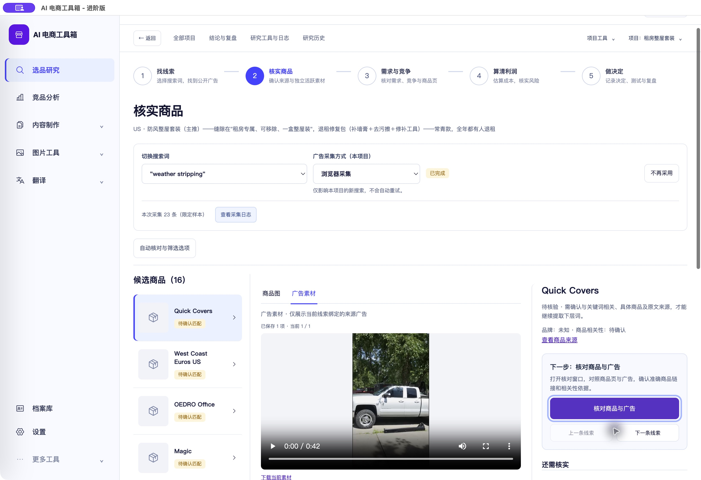

# 核实商品操作区位置调整

<!-- project-doc-status:start -->
> **文档状态同步：2026-10-26 · 分轮审查与验收记录**
> 保留现场问题、截图、测试数量及未验证项；后续修复不抹去原问题记录，本轮同步没有重做该文档的原验收。
> 当前入口与验证范围：[项目当前状态](<../../项目当前状态.md>)；[2026-10-26流程修复与边界](<../2026-10-26-sop-flow-repair/验收记录.md>)。
<!-- project-doc-status:end -->

2026-10-25：按用户指示，将“核对商品与广告”主按钮、下一步说明、上一条/下一条线索移到右侧商品摘要内，位于“还需核实”清单上方；底部不再重复放置。人工确认后同一位置显示“核实广告素材”及修改入口。

仅调整 `focused-exploration.mjs` 的节点位置及 `research-polish.css` 的局部排版，更新 `index.html` CSS版本。沿用原按钮、禁用状态、事件及核对弹窗；没有后端、业务规则或数据修改。

完整前端 **853项通过**，现有弹窗回归补充验证操作区在清单前、按钮与分页仅一组且底部无副本。修改脚本语法及 `git diff --check` 通过。源码、安装资源与9502实际响应逐字节一致，签名及包资源检查通过。

自用Mac客户端已更新；原生确认位置、打开核对弹窗、Esc关闭返回均通过。未提交真实修改、采集或收费调用。客户旧DMG未重建。

私有回滚目录：`/Users/xiachengpeng/.local/share/ai-ecommerce-desktop/closeout/20261025-product-controls-position/`，含 `previous.app`、`source-before/`、测试及资源校验记录。回滚时正常退出空闲客户端后恢复应用，不回退数据库。
