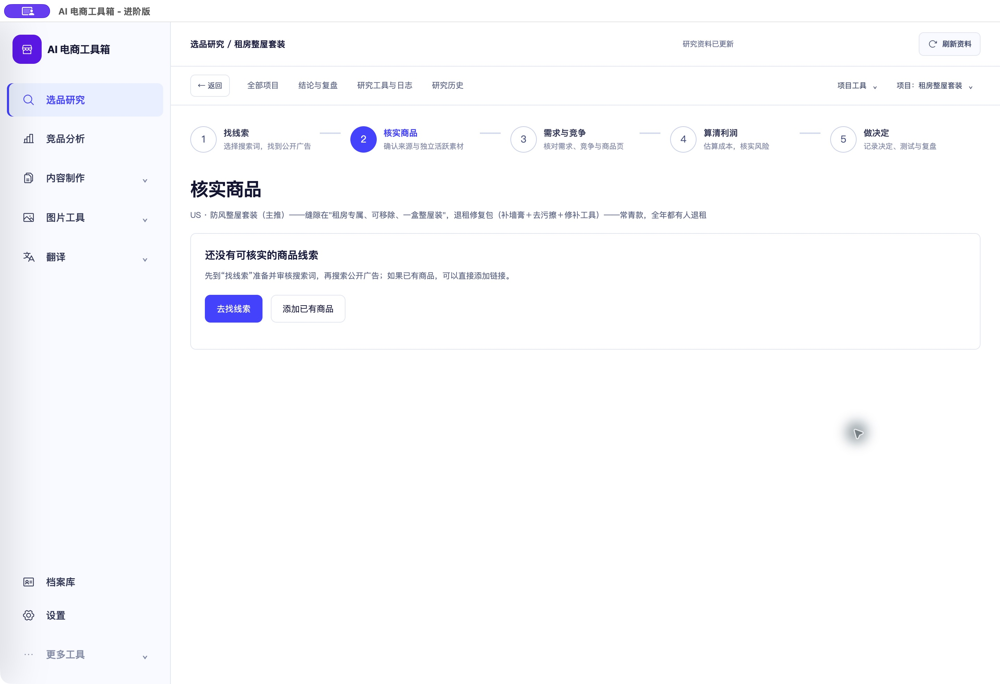
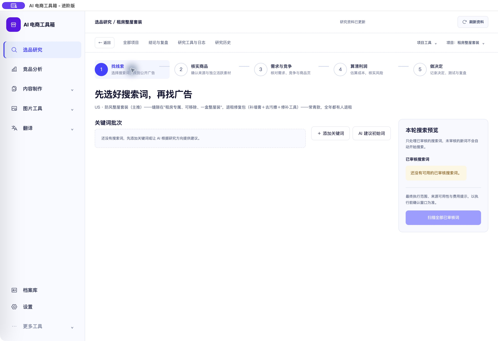
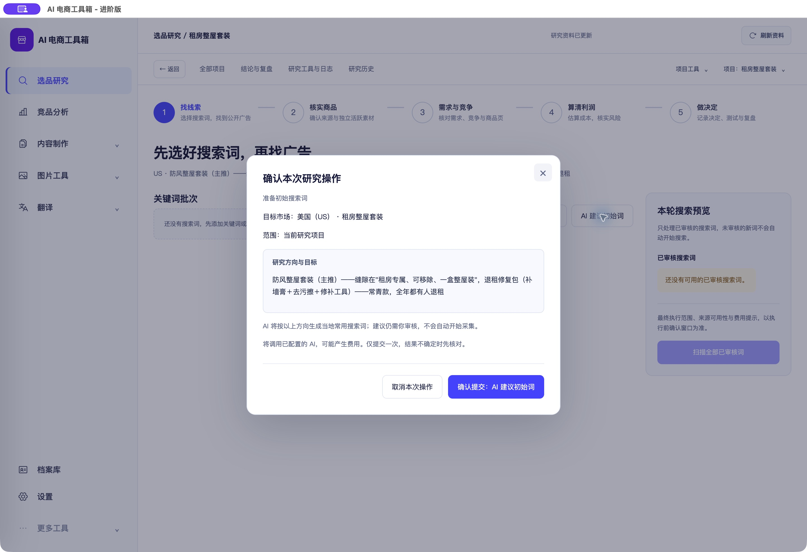

# 选品研究：起点步骤、按钮间距与初始词依据

<!-- project-doc-status:start -->
> **文档状态同步：2026-10-26 · 分轮审查与验收记录**
> 保留现场问题、截图、测试数量及未验证项；后续修复不抹去原问题记录，本轮同步没有重做该文档的原验收。
> 当前入口与验证范围：[项目当前状态](<../../项目当前状态.md>)；[2026-10-26流程修复与边界](<../2026-10-26-sop-flow-repair/验收记录.md>)。
<!-- project-doc-status:end -->

日期：2026-10-25。范围：用户报告的按钮粘连、初始词研究方向可见性、第1/2步内容重复。

## 根因与已修复行为

1. 原无关键词/无商品时，不论 `projectSection` 都渲染同一张“先选一个起点”卡片，设计装饰只改变标题；三个按钮又直接相邻追加，没有间距容器。
2. `backend/modules/research/rabbit_hole/application/runner.py` 的初始词请求已把完整保存的 `project.direction` 放入 `ResearchAIRequest.untrusted_data`，提示要求与研究方向相关；`ResearchAIAdapter` 将其作为不可信业务数据传入主模型，而非仅使用项目标题。原确认窗口只显示市场和项目名，无法让用户核对这项依据。本轮没有改动后端提示或伪称新增了方向传参。
3. 原页面把关键词工作区和商品线索工作区同时挂载，依靠CSS隐藏。现在从渲染逻辑区分两个步骤，空项目也有真实不同内容。

### 第1步：找线索

始终显示关键词批次、手动添加、AI建议及已审核词预览；没有关键词时显示对应空白提示。无可用的已审核词时批量扫描禁用；出现已审核且未归档词后恢复，服务端仍校验实际执行条件。

### 第2步：核实商品

有记录时显示原商品/广告线索与档案；无关键词/商品时显示“还没有可核实的商品线索”，提供“去找线索”和“添加已有商品”。按钮使用flex换行和12px间距，不再粘连。关键词和商品记录未迁移、删除或重写。

### AI确认

初始词确认弹窗展示完整“研究方向与目标”，原样文本显示，较长内容在有界区域滚动；说明会按该方向提供当地搜索词，结果仍需审核。确认期间研究方向、项目ID或版本改变时，阻止旧确认提交，要求重新核对，避免展示依据与实际输入不一致。原单次提交和收费确认保留。

## 修改文件

- `frontend/js/research-workbench/pages/exploration.mjs`：按步骤挂载工作区、空白状态和批量扫描最小前置条件。
- `frontend/js/research-workbench/components/action-confirmation.mjs`：展示方向和关键词确认快照校验。
- `frontend/css/research-polish.css`：起点按钮间距、关键词空状态、方向阅读区。
- `frontend/index.html`：仅将上述样式缓存版本更新到 `20261025-research-start`。
- 前端 projects/confirmation-dialog 回归；后端仅新增初始词方向链路测试，无后端生产代码变更。

## 验证

- 五项新增前端回归先在旧实现下失败，再修复通过。覆盖空项目第2→1步真实内容变化、有数据时分区独立与记录保留、完整方向显示、确认期间资料更新阻止提交、空词不批量扫描。
- 完整前端 **838通过、0失败、0跳过**；桌面 **15通过、0失败、0跳过**。
- 按项目既有隔离环境执行 `test_initial_keyword_policy.py`：**5通过**，包含真实runner→主AI适配器的完整方向传递检查；传输替身返回虚构建议，无收费外呼。测试保留2项既有依赖/模型命名警告。本轮未重跑整个后端套件。
- 修改的mjs语法检查、差异空白检查通过。源码、安装包与9502实际服务的3个前端资源字节一致，签名和桌面资源校验通过。
- 实际Mac客户端打开用户已有“租房整屋套装”：第2步显示缺少商品线索及有间距的两个操作，第1步显示关键词工作区；确认窗口完整显示防风/退租修复方向。Esc取消后回到原按钮，未提交AI或采集。
- 最终版本再次确认无关键词时批量扫描为disabled，未对生产账号、项目资料或凭据进行保存。

## 实际客户端截图

第2步：

第1步：

完整方向确认：

## 安装、边界与回滚

已更新 `/Users/xiachengpeng/Applications/AI E-commerce Tools.app`，只更新本轮前端资源和样式缓存标识，保留已安装HTML中的本地图标及自用引导差异。后端二进制、数据库和用户数据目录未更改，客户DMG未重建。

私有备份：`/Users/xiachengpeng/.local/share/ai-ecommerce-desktop/closeout/20261025-research-start/`。`previous.app` 是本轮任务开始前客户端，`source-before/` 是源码前快照，测试日志及资源摘要也在同目录。`initial-fix-before-empty-guard.app` 仅为本轮中间版本，回滚应使用 `previous.app`。正常退出、端口释放后恢复应用；源码按本轮差异恢复，不覆盖后续修改，不恢复数据库。

本轮验证了输入传递和操作行为，不保证模型输出必然符合所有目标，也未用收费调用评价建议质量；后续生成建议仍需人工核对。
