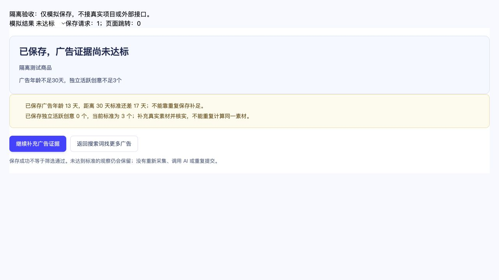

# 广告证据保存闭环修复（2026-10-26）

<!-- project-doc-status:start -->
> **文档状态同步：2026-10-26 · 分轮审查与验收记录**
> 保留现场问题、截图、测试数量及未验证项；后续修复不抹去原问题记录，本轮同步没有重做该文档的原验收。
> 当前入口与验证范围：[项目当前状态](<../../项目当前状态.md>)；[2026-10-26流程修复与边界](<../2026-10-26-sop-flow-repair/验收记录.md>)。
<!-- project-doc-status:end -->

## 根因

通用createForm保存成功后navigate(product)，而direct editor在提交时设置productOverview，下一次render显示广告粗筛概览。概览“自动检查广告证据”仅调用confirmCreatives打开同一编辑器，因此形成表单→概览→同一表单的循环，且“保存成功”与“筛选通过”没有分开说明。

## 改后流程

仅广告证据表单使用新的成功回调：保存成功后就地替换为结果区，不进行页面导航。使用服务端返回的coarse步骤状态决定是否通过；未通过列出已保存年龄与差额、独立活跃创意数量等缺项。13天不通过30天标准时明确还差17天，不能重复保存补足。

未达标提供“继续补充广告证据”“返回搜索词找更多广告”；通过后才提供“继续核对需求与竞争”，需主动点击，不自动推进。重新编辑只有用户再次保存才发出新命令；保存失败保留表单输入、草稿及提交身份。概览原“自动检查广告证据”改名“查看与补充广告证据”，避免把打开编辑器误认为执行检查。

保存结果仅展示已保存服务端结论；不再次展开辅助采集检查，以免近期采集统计与人工保存口径混淆。原只读检查仍在编辑器中可用。

## 文件范围

- `components/forms.mjs`：新增可选onSaved，其他表单保留默认导航。
- `pages/product.mjs`：只为confirm_creatives接线，更新项目列表中的返回DTO，成功后就地渲染结果。
- 新增`components/creative-result.mjs`：保存/通过区分、缺项、主动编辑/返回/下一步。
- `components/presentation.mjs`：纠正无条件继续下一阶段的页脚说明。
- 局部CSS、缓存版本及产品流程测试。后端、DTO、粗筛门槛和数据库未变。

## 验证与边界

- 新增4项回归测试先失败后通过；另强化已通过结果不能重复显示辅助检查统计的断言。专项44、完整前端888、桌面15项通过，语法与diff检查通过。
- 独立只读复核未发现新增P0/P1/P2。
- 真实浏览器DOM隔离演练：保存未达标观察显示请求1次/导航0次；继续编辑未发新请求；模拟422保存失败仍保留表单与输入；模拟服务端通过后等待主动下一步。未达标结果最终截图来自隔离数据，未提交真实项目或假称真实商品通过。
- 自用Mac客户端前端已更新、正常加载。5项源码/安装/9502实际响应字节一致；签名与资源检查通过，后端可执行文件与更新前哈希相同。原生真实项目只查看，不代用户再次保存证据、不调用收费服务。
- 后端/数据库没有变化，本轮未重跑后端套件或重建客户DMG。没有广告采集、收费AI/翻译或飞书写入。

## 回滚

私有目录 `/Users/xiachengpeng/.local/share/ai-ecommerce-desktop/closeout/20261026-coarse-save-flow/` 包含source-before、previous.app和测试日志。正常退出并确认9502/9503释放后可替换旧客户端；不回滚数据库。源码只撤回本轮差异并检查新增组件引用，保留其他修改。
