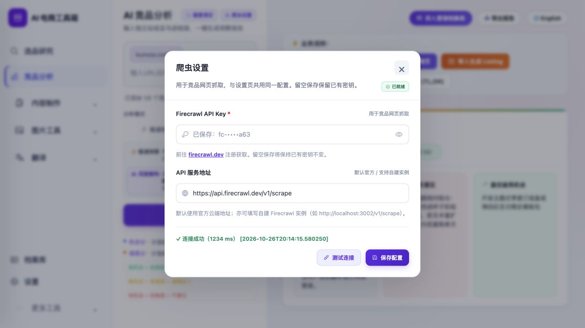

# 竞品分析爬虫设置弹窗

日期：2026-10-26。用户要求：点击竞品分析的“爬虫设置”后打开小弹窗，避免切换页面。

## 实现

`frontend/js/analysis.js:xp_openCrawlerSettings`改为调用`frontend/js/settings.js:openCrawlerSettingsDialog`。不再调用`switchMainTab('settings')`、延时滚动卡片或聚焦设置页输入。

弹窗是原生`dialog.showModal()`，宽度上限560px、窄窗口适配、内容超高可滚动。样式限定在`frontend/css/settings.css`的`.settings-crawler-dialog`，不重做全局设置。

- 将既有`settingsCrawlerCompetitorBody`和状态徽标临时移入弹窗，关闭后恢复原父节点和原hidden状态；全页仍只有一个密钥输入，不复制表单、配置或接口调用逻辑。
- 保留密钥小眼睛、地址、连接测试和保存。复用既有`testCrawlerConnection`与`saveCrawlerSettings`，空密钥保留规则及成功/失败判断不变。
- 首次需要时只读GET配置；读取中禁用编辑，失败不允许误保存或测试，但仍可关闭重开。关闭后迟到结果不更新表单。
- X或Esc关闭，焦点回到原入口；测试、保存或完整密钥读取进行中防止误关闭，避免请求完成后写入已关闭窗口。关闭时恢复密钥掩码显示，调用原有隐藏逻辑处理按需读取的完整密钥。
- 现有分析链接、输入、模式、报告及滚动位置不因打开弹窗而改变。保存配置后不自动发起分析或采集。

入口JS/CSS缓存版本均更新为`20261026-crawler-dialog`。后端及数据库结构未改，客户旧DMG未重建。

## 验证

新增`frontend/tests/crawler_dialog.test.js`4项回归，先失败后修复：同一表单/无页面切换与恢复；测试保存密钥读取期间防误关闭；读取失败保护；关闭期间迟到读取隔离。另将`settings_balance.test.js`中的历史版本白名单改为检查有效缓存版本，不再写死某轮发布日期。

- 完整前端908通过，0失败/跳过。
- 桌面15通过，0失败/跳过。
- settings.js和analysis.js语法检查、`git diff --check`通过。
- 第一次全套运行有两处失败：缓存版本白名单，以及既有商品核对测试的`reject is not a function`时序问题。白名单已修正；未修改商品核对业务或该测试，单独相关18项和之后完整908项均通过。单次时序失败仍保留在本记录，不宣称它被本轮弹窗修复解决。
- Mac候选与安装包ad hoc签名严格校验、资源验证通过，安装的三个JS/CSS文件与源码字节一致。此校验不代表正式公证。

真实Mac窗口：竞品分析按钮直接打开弹窗；按Esc关闭后仍为AI竞品分析，焦点返回爬虫设置入口。原生截图接口本轮输出了282×314的局部低分辨率图，保留`native-dialog.png`为原始材料，不作为完整视觉验收图。

实际9502页面（安装应用提供的资源）验证：弹窗为560×497.46px，1280×720视口下居中，无需离开分析页。已有报告19895字符；打开/关闭后比较报告、链接容器和原输入全文完全一致。Esc及X均可返回，表单归还设置卡片，密钥输入ID仅1个；再次打开正常，控制台error/warn为空。

未点击真实测试或保存，未读取完整密钥，未触发分析、AI、采集或飞书写入。模拟测试覆盖处理器保护，但不将模拟成功当作新的外部连接测试。

## 安装与回滚

本机 `/Users/xiachengpeng/Applications/AI E-commerce Tools.app`已更新并重新启动，保持竞品分析页面。私有备份目录：`/Users/xiachengpeng/.local/share/ai-ecommerce-desktop/closeout/20261026-crawler-dialog/`。`previous.app`为本轮前应用；`source-before/`含四个原文件及调整前缓存版本测试；测试日志在同目录。

回滚先正常退出并确认9502/9503空闲，再恢复旧应用；源码只恢复本轮差异，不覆盖数据库、密钥、分析结果或无关工作区改动。
