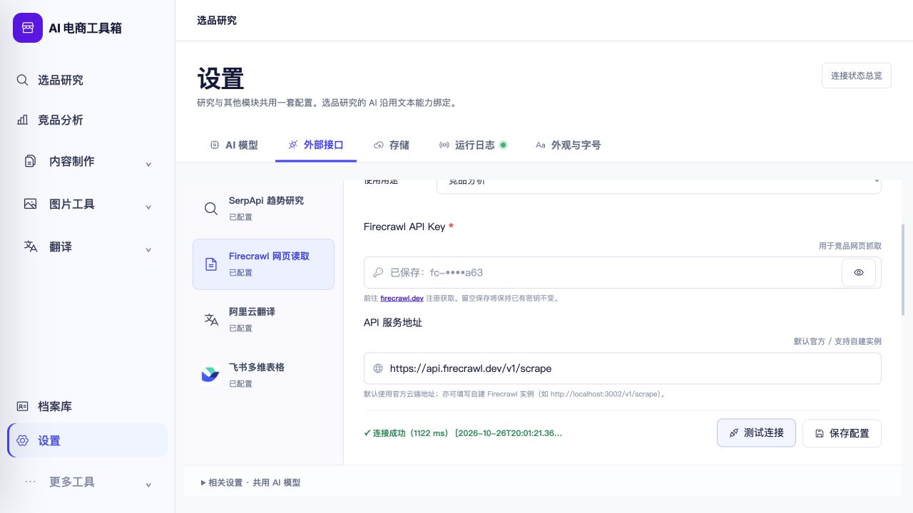

# Firecrawl连接测试状态显示修复

日期：2026-10-26。问题：测试文字为“连接成功”，但前方叉号、红色消息和卡片“连接异常”同时出现。

## 根因与调整

`backend/main.py:api_test_crawler_connection`返回`FirecrawlConnectionTestResult(status="success"|"error", duration_ms, message)`；模型在`backend/models/settings.py`。`frontend/js/settings.js:testCrawlerConnection`却读取`result.ok`，导致正确的成功响应落入错误分支，并将浏览器内状态覆盖为error。后端保存的真实记录仍为success；本轮只读GET确认，不输出或修改密钥。

前端改为严格判断`result.status === "success"`，并在收到测试结果后调用`updateSettingsOverviewKpis()`，让消息、卡片徽标及概览使用同一个状态。真正的error继续红色展示，不通过“连接成功”等文本猜测结果，不修改后端协议或测试请求。`frontend/index.html`更新设置脚本缓存版本为`20261026-firecrawl-status`。

## 验证与安装

新增`frontend/tests/crawler_connection_status.test.js`两项真实处理器回归：成功响应无ok字段，消息/徽标/KPI一致为成功；error响应即使带无关ok:true，也保持失败。两项先复现失败，再修复通过。测试使用隔离VM、模拟网络响应，执行真实settings处理函数，不向实际Firecrawl发送请求。

- 完整前端904通过，0失败/跳过。
- 桌面15通过，0失败/跳过。
- JS语法与`git diff --check`通过。
- 候选包及安装包ad hoc签名严格验证、资源检查通过，安装JS字节匹配源码。
- 本机Mac客户端正常退出、保留旧应用并更新后重新启动。后端、数据库结构、凭据与客户DMG未修改。
- 实际9502页面读取已有成功记录：徽标“已就绪”、消息class为`is-success`、内容“✓ 连接成功（1122 ms）”，概览“服务正常”；控制台error/warn为空。未点击真实测试连接、未消费采集/AI额度、未进行飞书写入。原生窗口概览已读到“服务正常”；外部卡片最终证据来自客户端提供的实际浏览器页面，未把原生自动操作未能稳定切换标签记为成功。

## 回滚

私有备份：`/Users/xiachengpeng/.local/share/ai-ecommerce-desktop/closeout/20261026-firecrawl-status/`。`source-before/`保存修改前settings.js和index.html，`previous.app`为本轮前客户端，两份测试日志亦在此目录。

回滚先正常退出并确认9502/9503空闲，再恢复旧应用；仅恢复本轮源码差异。不要回滚数据库、清除密钥或覆盖其他工作区改动。本轮不宣称重新验证外部服务此刻的可用性，保留已保存测试的时间与结果。
