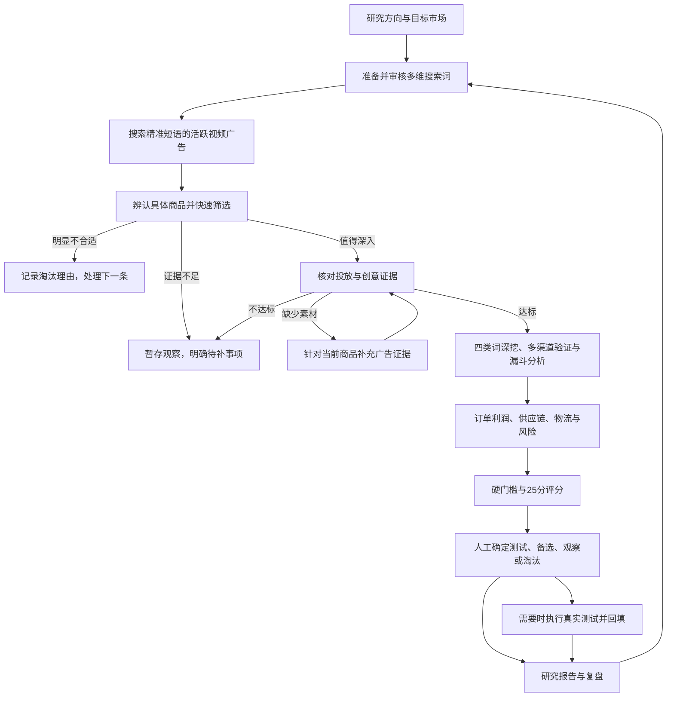

# 原始 SOP 对照与选品流程断点审查

<!-- project-doc-status:start -->
> **文档状态同步：2026-10-26 · 分轮审查与验收记录**
> 保留现场问题、截图、测试数量及未验证项；后续修复不抹去原问题记录，本轮同步没有重做该文档的原验收。
> 当前入口与验证范围：[项目当前状态](<../../项目当前状态.md>)；[2026-10-26流程修复与边界](<../2026-10-26-sop-flow-repair/验收记录.md>)。
<!-- project-doc-status:end -->

日期：2026-10-26。范围：当前 Mac 客户端使用的选品研究前端、原项目保留资料、原始业务笔记、当前真实项目数据。结论为审查结果，不是修复完成或全链路验收通过。

## 1. 结论

**当前系统保留了多数业务指标和功能，但没有完整实现原始 SOP 的操作闭环，不能称为“已按原 SOP 顺畅走通”。**

问题主要在业务编排：找线索后的快速取舍不明显；缺广告证据时，返回路径没有实际补充入口；五个大步骤隐藏了必要的小步骤；已不满足条件与尚不知道是否满足都表现为“待补充”。用户需要猜下一步、记住隐蔽入口，反复补表。

这不等于必须让所有商品通过筛选。正确的闭环应当同时支持：合格商品深入研究、不合格商品有理由地退出、证据不足商品暂存观察。当前项目没有符合完整标准的商品，不能通过虚构证据、随意勾选或降低门槛来制造成功结果。

前面的局部排版、按钮及保存回跳修复没有解决整体流程问题，局部测试通过不能证明真实选品闭环已经可用。

## 2. 对照依据及证据边界

| 依据 | 本轮核查结果 | 用途与限制 |
| --- | --- | --- |
| [原始业务笔记：兔子洞选品.md](</Users/xiachengpeng/Desktop/跨境选品 SOP/兔子洞选品.md>) | 已实际读取 | 原始业务意图。该目录设计规格第 5 行也把它声明为最高业务依据；未取得远端原提交，因此不能声称这份本地笔记与远端原文逐字相同。 |
| [原导入来源说明](../../../backend/modules/research/SOURCE.md) | 导入基线 `b749491c29fce8ac5bdad613f1ef569cb6df186b`，归档 SHA256 为 `45f2311698da4d9fa6a2c0f59829bb362a4ca3ea2d448204396f6fc1cef269eb` | 来源标识不证明当前领域代码未改变。 |
| [保留的原项目操作文档](../../../backend/modules/research/compat/docs/operations/rabbit-hole-runbook.md)与[原前端](../../../backend/modules/research/compat/frontend/) | 已读取关键流程 | 区分原项目已有的人工证据规则和融合后界面造成的障碍。未修改兼容资料。 |
| 当前运行服务及页面 | 已只读检查 | 9502 正在提供的 `focused-exploration.mjs`、`product.mjs`、`presentation.mjs`、`exploration.mjs` 与本地源码逐字节相同。 |
| [Obsidian 中的 SOP 自动化操作指南](</Users/xiachengpeng/Library/Mobile Documents/iCloud~md~obsidian/Documents/notebook/跨境/AI 工具/兔子洞选品 SOP 自动化.md>) | 另有旧版五步指南 | 描述旧 8000 端口、Mock、自动打分和分池等；与当前客户端不一致，不能作为当前验收依据。 |

远端 `192.168.31.112` 本轮 SSH 连接超时，主仓库也没有原提交对象。本报告没有假装完成远端逐文件比对；原项目代码对照限于本地保留的兼容源码。判断“当前页面有断点”不依赖远端在线。

本轮没有修改业务代码、规则、数据库、配置或安装包，没有提交采集、AI、翻译、趋势查询、评分、人工核实或飞书写入。只新增审查文档和截图。Mac 客户端可读取界面，但原生点击自动检查未可靠生效；操作复现使用同一 9502 服务的浏览器页面，不能把原生自动操作限制认定为客户端按钮故障。

## 3. 原始 SOP 实际要求的流程

原始笔记主要位置：第 22–35 行为搜索入口；第 37–48 行为广告粗筛；第 50–61 行为四类词深挖；第 63–83 行为多渠道与销量估算；第 85–110 行为评分和漏斗分析；第 112–122 行为每日、每周与每月节奏。

“每天记录 3–5 个潜力商品、每周选 1 个深入研究”意味着宽进、快速取舍、少量深挖；不意味着每条广告都必须完成所有表单。四类扩词是寻找新机会的循环，不应该强制每个最终商品无限扩词。

## 4. 当前真实项目状态

只读查询项目“租房整屋套装”，项目版本 **48**，开始与结束核验相同：

| 项目事实 | 数量 / 状态 |
| --- | --- |
| 搜索词 | 28：26 待审核、1 不再采用、1 已完成 |
| 已保存广告 | `weather stripping` 23 条；`wall repair kit` 3 条；合计 26 条限定样本 |
| 候选商品档案 | 19 |
| 商品相关性人工确认 | 2：Acompactly、Romiantic%6 |
| 广告粗筛通过 | 0；19 个步骤状态均为 `needs_input` |
| 初筛取舍 | 19 个 `pending`；保留、观察、淘汰均为 0 |
| 最终决定 | 19 个均未保存 |
| 2 个已确认商品的渠道、经济模型和评分 | 均无已保存完整记录 |

14 个商品仅绑定 1 条广告，4 个绑定 2 条，1 个绑定 4 条。绑定广告数量不代表已确认独立创意数量，也不能把三个不同商品各一条广告凑成一个商品的三个创意。

| 商品 | 已保存广告年龄 | 当前活跃记录 | 已保存独立活跃创意 | 广告粗筛门槛 / 页面步骤 |
| --- | --- | --- | --- | --- |
| Acompactly | 47 天 | true | 0 | `fail` / `needs_input` |
| Romiantic%6 | 13 天 | true | 0 | `fail` / `needs_input` |

这些是保存观察，不证明此刻仍投放、连续投放或盈利。没有商品通过，不足以单独证明程序有 Bug；下面的无法补充、无法顺畅退出及状态误导才是可复现问题。

## 5. 逐步实际操作与健康度

健康度含义：可进入不代表业务通过；“待验证”表示本轮没有提交会改变资料或产生外部调用的动作。

1. **进入项目：有缺陷。** 点击“继续选品”，进入第 2 步，默认选中尚未搜索的 `window insulation kit`，未续接用户最近研究的商品或已有结果。[截图](02-continue-opens-unsearched.png)。
2. **返回找线索：当前可用。** 点击第 1 步后确实显示关键词批次，内容不再只有标题变化。[截图](12-keyword-stage.png)。
3. **继续搜索：有断点。** 已完成的 `wall repair kit` 只有“不再采用”和查看入口；缺少继续补充采集。批量搜索预览也没有列出实际可执行词。[截图](13-batch-no-eligible-list.png)。
4. **查看广告与商品：可查看，完成度不足。** 真实三条线索可切换，商品和广告预览已分区；这些广告主页名仍需辨认具体商品。来源绑定正确性与自动匹配成功不能仅以能显示素材判断。
5. **核实广告：有关键断点。** Acompactly 显示 1 条关联广告、0/3 个已确认创意；“返回搜索词补充广告”回到同一已完成批次，没有接上针对这个商品的采集任务。[核实页](04-coarse-one-creative.png)、[返回后](05-return-has-no-collect-more.png)。
6. **需求与竞争：可进入，证据待补。** 不受第 2 步页面访问硬锁；可查看 Trends 和其他渠道，但没有完整已确认数据。界面未把漏斗分析作为当前阶段清晰的下一个任务。[截图](06-channels.png)。
7. **漏斗分析：存在，但入口隐蔽。** 从“已保存资料、完整检查清单与更多操作”继续展开十项清单才发现必要的分析页；不是顶层第 3 步点击后自然完成的动作。[清单截图](09-hidden-required-steps.png)、[分析页](10-funnel.png)。
8. **利润与评分：页面可进入，业务未通过。** 成本必须有真实报价；评分缺必要证据时不生成假分数是正确的。但评分作为必要动作藏在完整清单内，第 4 步默认只打开成本表。[利润页](07-economics.png)、[评分页](11-scoring-blockers.png)。
9. **做决定：部分可用。** 实际页面允许观察或淘汰，测试和备选因缺证据、评分而不可选。并非所有去向都被服务器封死，但前面页面没有清楚带用户到这里。本轮未保存决定。[截图](08-decision-without-full-evidence.png)。
10. **测试、报告、复盘：实现存在，完整业务闭环待验证。** 已从源码确认入口与规则；本项目无有效测试池决定，不能声称真实测试回填已走通。当前报告支持缺口与未知项，不应被理解为只对通过商品才能生成的“成功证明”。本轮未创建报告快照或测试记录。

截图：01 为实际客户端；02–13 为同一运行服务的浏览器，1280×720 视口。页面有内部滚动，部分截图只显示所在可见区域；配合实际展开后的页面文本和源码判断，不把截图未拍到等同于功能不存在。[截图总览](contact-sheet.jpg)。

## 6. 主要问题、来源与修复建议

### P1-01：补充广告路径不闭环

事实：`creative-result.mjs:19`、`product.mjs:276` 将用户送回来源词；`exploration.mjs:14` 排除 `complete` 的单词搜索按钮。`focused-exploration.mjs:13` 起复用这一套控件。真实操作已复现。

后果：用户即使理解“需要更多素材”，也没有清楚的下一步；只反复打开同一份表单。手动添加来源仍存在，但不能代替系统承诺的补充路径。

建议：区分“首次发现商品”和“给当前商品补证”。提供显式的重新观察/补充入口，展示对象、范围、采集方式、API 配置名称与预算，提交后跟踪同一任务。完整支持多个 API 配置，不自动更换密钥或收费重试；新增证据仍绑定当前商品与来源。仅重新搜原来的宽泛词不能保证得到同一商品的额外创意。

### P1-02：原项目已有的快速取舍从主操作中退场

原项目 `compat/frontend/pages/focused-exploration.js:258` 有“快速判断这条线索”；`compat/frontend/pages/triage.js:23` 明确提供“保留并深挖 / 暂时观察 / 淘汰”。当前 `focused-exploration.mjs:30–40` 的主要操作变成商品核对和广告核实，快速取舍没有同等可见的入口；底层 triage 功能仍在。

最新保存结果 `creative-result.mjs:18–20` 未达标时只有“继续补充”和“返回搜索词”。“证据不足，先记录决定”还在 `product.mjs:166` 的概览资料里，但被直接表单及折叠层遮住。

建议：在当前线索上恢复初筛三去向，给不达标保存结果直接提供“暂存观察 / 不再研究 / 补充证据”。保留理由和恢复操作；明确初筛取舍与最终测试池决定是两个层次。不要把功能仍在隐藏菜单里当作主流程可用。

### P1-03：五步导航与十步业务没有完成衔接

`presentation.mjs:66–69` 的五个入口直接指向 identification、channels、economics、decision。`product.mjs:342–344` 自动打开表单，将原有概览放进折叠；`presentation.mjs:189、194` 又折叠完整清单与相关任务。`requirements.py:49–55` 却要求粗筛、渠道、漏斗和经济模型等证据齐备后才允许评分。

后果：用户按顶层 1→5 操作会漏掉漏斗与评分，到了最后才面对一串缺口。入口数字看起来像完成进度，实际只是当前浏览位置。

建议：保留五组业务导航，在第 3 组明确展示“需求与竞争 → 广告与页面分析”，第 4 组展示“利润与风险 → 检查证据并评分”，第 5 组展示“决定 → 测试/研究复盘 → 报告”。每次保存都给当前结果和一个合理下一步，不让人翻两层清单找必做任务。

### P1-04：已知不达标也被表现为无限待补

`project.py:582–592` 将所有未通过的粗筛步骤置为 `needs_input`，下一步统一要求补证；但同文件 `:503–535` 会输出门槛 `fail`。真实两个已确认商品正是这种组合。Romiantic%6 的已保存广告年龄只有 13 天，重复确认不能补成 30 天。

建议：清楚区分“缺数据，待确认”“已知未达标，建议观察/淘汰”“已达标，可以深入”。有新增历史广告证据时允许重新核查；不能简单让用户等待 17 天就自动认定连续投放通过。深挖和最终分池门槛保持有效，记录退出结论无需把无关表单补齐。

### P1-05：连续投放与广告年龄的规则口径不同

原笔记第 39 行明确“连续投放 ≥30 天”，第 65–67 行再次要求同域名/落地页投放验证。当前 `project.py:489–494` 只使用广告年龄、当前活跃、相关性和创意数量；连续性不参与通过判定。采集投影 `application/actions.py:199` 明确保留 `continuity_status='unknown'`。

本轮额外做了纯内存反例：复制 Acompactly 数据，只在副本中把独立创意计数设成 3，连续性仍 unknown，调用 `_refresh_identification` 得到 gate=pass。**未保存副本，未改变真实记录。** 这证明当前判定并不等于原文的连续投放要求。

原兼容前端 `pages/product.js:65` 与 `focused-exploration.js:256` 已采用“年龄不等于连续投放”的口径。因此不能断言这是最近融合才引入的问题；应记为继承的实现与原业务笔记的差异。

建议：先明确并记录业务口径，不能只换文案。若严格执行原文，连续性未知就不能标成“已验证连续30天”；可观测的“年龄＋当前状态”单独显示。具体连续性证据的获取方式、来源能力及验收应单列设计，不能凭一次采集推断中间历史。

### P2-01：“自动检查”主要在重算已保存记录，自动化链路不足

`components/creative-check.mjs:6–18` 按本地保存记录重算；`services/creative-evidence.mjs` 主要识别相同媒体引用，不执行视觉去重、实时状态查询或额外广告采集。页面有相关说明，计算本身不算失效，但用户很容易把“自动检查”理解为已查询新证据。

采集模块 `integrations/collectors/meta.py:265、323` 虽有指纹/感知相似度算法，当前 `application/actions.py:188–211`、`domain/project.py:3529–3545` 的广告投影没有携带对应指纹字段，不能因为仓库存在算法便宣称主工作流已自动判定创意独立。

建议：展示“已完成哪些自动核对 / 哪些因缺少证据无法确定”，将可靠、可解释的自动结果预填供复核。素材不可访问或证据有歧义时再请求人工。保留必要的判断，不要求用户重复填写系统已经可靠掌握的来源、日期和素材 ID。

### P2-02：批量搜索按钮、预览与实际范围不一致

`exploration.mjs:78` 只要有已审核未归档词就启用批量扫描；本轮实际预览显示 `wall repair kit`。后端 `application/actions.py:647–653` 却只选 ready/blocked 的已审核词；当前符合条件数量为 **0**。确认框只说“符合执行条件”，没有列出这次实际会执行什么。

未点击最终提交；“当前会筛出零个词”来自只读数据与执行分支核对，不是一次真实批量调用的运行结果。

建议：前后端共用资格解释，确认前展示准确的待执行词数、跳过词与原因。没有可执行项就说明如何准备下一批；已完成词的重新观察走独立、显式的动作。

### P2-03：用户操作指南存在互不兼容的版本

Obsidian 的旧指南描绘一键自动评分分池和 Mock 演练，当前融合代码与原运维文档则要求证据、成本与人工最终决定。两份说明不应同时被当成当前产品承诺。

建议：统一一份当前用户手册，区分可自动采集、可自动计算、需实际业务确认三个部分；标记旧指南历史用途，不继续按旧页面名称指导用户。当前评估不修改用户笔记。

## 7. 哪些规则保留了，哪些不能混为“原 SOP 要求”

| 原文规则 | 当前实现 | 判定 |
| --- | --- | --- |
| 精准短语、目标市场、活跃视频 | 浏览器采集有对应筛选设置；API 分支另行执行 | 代码有支持；本轮未重新采集验证来源读回 |
| 至少 3 个创意变体 | 项目 min_creatives=3，有同商品绑定及确认计数 | 数量规则保留；自动收集与独立性核验不完整 |
| 连续投放至少 30 天 | 以广告年龄30天＋当前活跃判断，连续性另存unknown | 不完全等价，见 P1-05 |
| 人群、痛点、场景、卖点扩词 | 有来源约束的扩词与待审核词 | 能力保留；不应作为每个商品必做的无限循环 |
| 12个月与5年趋势、辅助渠道 | 当前有证据表与查询一致性要求 | 方向一致；哪些字段必须确认是工程规则，不能全部说是原文逐字规定 |
| 含广告费的贡献毛利≥60%、AOV50–100美元 | 当前最终门槛保留 | 一致；页面售价不能当作已确认订单收入或利润 |
| 轻小、低风险 | 加入2kg、报价14天等具体参数 | 属工程落地参数，原文没有给出全部数值 |
| 25分；≥18测试、15–17备选、<15放弃 | 评分与分池门槛保留，最终由人工决定 | 核心阈值一致；缺证据不能假打分 |
| 日常筛选少量潜力品、每周深挖一个 | 功能存在但快速取舍与深挖主路径脱节 | 工作方式未良好落地 |
| 测品与月度复盘反哺 | 测试记录、报告及描述性复盘存在 | 未验证真实测试闭环；不要宣称权重会自行优化 |

原项目运维文档已经要求人工确认关键证据并把自动结果停在待复核，所以“存在人工确认”本身不等于偏离。问题是把可靠数据预填、必要判断、快速退出与下一步任务分清，而不是全自动勾选通过或继续叠加人工表单。

## 8. 建议的修复顺序及完成标准

本轮仅审查，不直接开始实施。

| 顺序 | 最小范围 | 必须达到的验收结果 |
| --- | --- | --- |
| 1. 恢复可前进、可退出的流程 | focused-exploration、creative-result、triage、项目续接逻辑 | 当前商品能保留/观察/淘汰；保存结果不循环；继续项目返回合理工作位置；理由与历史不丢 |
| 2. 接通补证与真实任务 | exploration、action-confirmation、actions、采集投影及任务日志 | 已完成词可显式重新观察；清楚区分补当前商品和找新商品；多 API 配置选择可追溯；重复点击不产生重复收费任务 |
| 3. 五组导航承接十项业务 | presentation、product、journey、表单保存后的下一步 | 不展开“更多”也能发现必要的漏斗与评分动作；未知与不达标的处理不同；其他步骤正常浏览 |
| 4. 规则与证据口径归一 | project、requirements、广告观察/去重及规则说明 | 连续性不再被年龄冒充；自动结果有依据；不影响既有版本、历史和最终测试池门槛 |
| 5. 端到端验收并更新手册 | 完整前端/后端回归、隔离流程案例、客户端、用户手册 | 以下三条业务路线完整成立后，再声明“流程走通” |

最终验收至少三条路线：

- **明显不合适**：采集后辨认商品 → 记录原因淘汰 → 自动定位下一条 → 报告保留来源及理由；无需把采购、趋势等无关表单全部补完。
- **证据不足**：真实一条广告 → 明确缺口 → 补证或暂存观察 → 后续从原位置恢复；找不到更多证据也是合法结果，不能卡成无限补表。
- **值得深入**：足够且可审计的同商品广告证据 → 多渠道与漏斗 → 完整订单成本/报价 → 硬门槛与25分 → 人工决定 → 必要时真实测试回填 → 报告与复盘。缺证据、证据过期、来源失败、重复提交、不同 API 配置都要覆盖。

优先用隔离数据验证状态与业务分支；真实外部调用单独记录范围、结果和限制。不能拿模拟成功替代真实采集和真实报价，不把“当前没有合格品”当成修复失败，更不能为了演示而编造合格品。

## 9. 本轮验证记录

- 实际点击：进入项目、切换来源词、打开广告核实、返回补充入口、切换第1/3/4/5组、打开Meta证据表后取消、展开十项检查清单、进入漏斗与评分、打开批量确认框后取消。
- 只读接口：会话、本项目详情；查询前后项目版本均48。
- 源码核对：原始业务笔记、兼容前端/运维文档、当前导航/表单/采集/证据/评分/决定关键路径。
- 纯内存反例：连续性unknown仍能通过当前年龄型粗筛；不保存、不联网调用供应商。
- 四个关键前端文件与运行服务逐字节一致。
- 新增截图均已检查；没有声称修复完成，没有运行会写入真实业务数据的全链路测试。

仍待验证：远端原提交的完整差异、真实来源能否补足同商品广告、可靠视觉去重/连续投放证据的采集能力、完整合格商品路径、真实测试回填及报告导出实际交付。
