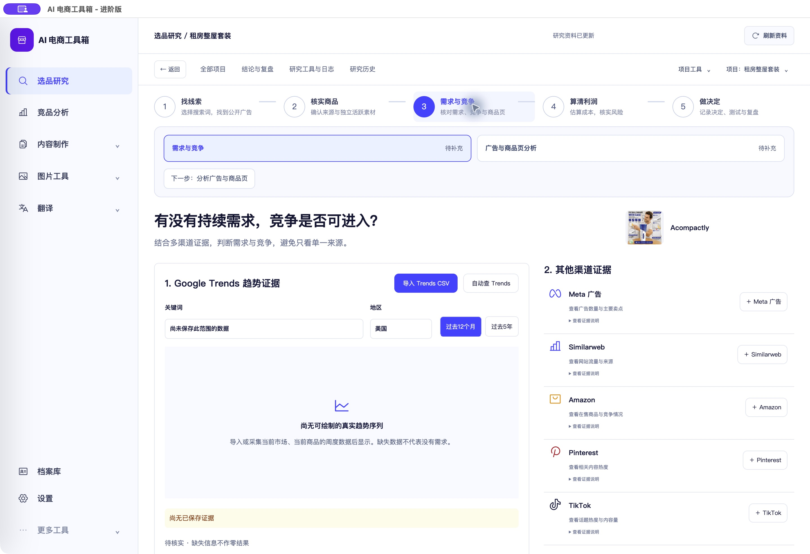

# 选品研究流程断点修复验收记录

<!-- project-doc-status:start -->
> **文档状态同步：2026-10-26 · 分轮审查与验收记录**
> 保留现场问题、截图、测试数量及未验证项；后续修复不抹去原问题记录，本轮同步没有重做该文档的原验收。
> 当前入口与验证范围：[项目当前状态](<../../项目当前状态.md>)；[2026-10-26流程修复与边界](<验收记录.md>)。
<!-- project-doc-status:end -->

日期：2026-10-26。范围：落实[原始SOP对照与流程断点审查](../2026-10-26-sop-flow-audit/原始SOP对照与流程断点审查.md)中的快速取舍、继续入口、显式补采和主流程子任务。不是全面重写，不代表自动产出达标商品。

## 已完成的变化

| 原问题 | 本轮处理 | 核心实现 |
|---|---|---|
| 继续项目回到未搜索的第一个词 | “继续选品”优先使用有效的项目焦点；无焦点时回到最近有广告/商品结果的来源词；只有无结果才准备关键词 | `services/journey.mjs:projectResume`、`pages/projects.mjs`、`index.mjs` |
| 不合适的线索也被迫继续填表 | 候选商品右侧和商品阶段提供保留、观察、淘汰，打开原有原因表单，显式保存；观察/淘汰保留恢复入口 | `components/workflow-controls.mjs`、`pages/focused-exploration.mjs`、`pages/triage.mjs` |
| 未达标保存后不知道下一步 | 保留原地保存结果，提供继续补证、返回搜索、观察或淘汰；已知失败显示“当前未达标”，未知仍为待补充 | `components/creative-result.mjs`、`pages/product.mjs`、`services/journey.mjs` |
| 完成搜索的词不能再次搜索 | 显式“重新搜索并补充”，绑定原完成任务；旧广告和任务保留，同一意图重复提交不创建额外任务 | `pages/exploration.mjs`、`components/action-confirmation.mjs`、后端 `application/actions.py` |
| 批次预览与真实任务不一致 | 只列已审核且ready/blocked的词，遵守项目批次上限；空批次禁止提交 | `services/journey.mjs:scanCandidates`、`components/presentation.mjs` |
| 必要子步骤藏在折叠列表 | 第2阶段显示商品核对/广告证据，第3阶段显示需求/漏斗分析，第4阶段显示利润/评分，第5阶段显示决定/测试/复盘 | `components/workflow-controls.mjs`、`index.mjs` |
| 焦点商品已有有效非测试决定，继续又回到补证 | 对已有有效观察/淘汰/备选决定的焦点商品进入复盘；过期决定仍需核对 | `services/journey.mjs:projectResume` |

以上前端路径均相对于 `frontend/js/research-workbench/`；后端路径为 `backend/modules/research/rabbit_hole/application/actions.py`。样式在 `frontend/css/research-polish.css`；入口缓存版本为 `20261026-sop-flow`。不修改既有数据库结构、评分阈值、来源绑定及证据通过条件。

## 推荐操作

1. 首页点“继续选品”，查看已有结果；选择一条线索。
2. 用右侧“保留并深挖 / 暂存观察 / 淘汰这条线索”先作初筛，填写真实理由；观察和淘汰可恢复。初筛保留不等于证据通过。
3. 核对商品与广告，再核实广告证据。未达标可以保存真实观察；根据缺项补证或观察，不必重复保存同一份证据。
4. 搜索已完成但需要更多广告时，点“重新搜索并补充”，核对市场、词、采集方式及所选接口配置，再确认。新搜索可能收费，不保证一定找到同一商品的3个独立创意。
5. 第3阶段依次完成“需求与竞争”和“广告与商品页分析”；第4阶段完成“订单利润与风险”和“检查证据与评分”。可切换页面查看，保存和计算仍由原服务端规则校验。
6. 第5阶段记录测试/备选/观察/淘汰决定；测试候选再填写测试计划与真实结果，最后复盘。不会自动投放或把未知成本写成零。

## 自动化验证

| 检查 | 结果 | 说明 |
|---|---:|---|
| 完整前端测试 | 898通过，0失败/跳过 | `node --test frontend/tests/*.test.js frontend/tests/research-workbench/*.test.mjs`，包含新增10项流程回归 |
| 主后端隔离测试 | 1326通过 | 独立复制代码、隔离数据库；需指定已打包的浏览器路径 |
| 研究采集专项 | 43通过 | 包含新增9项显式补采、去重、错误引用、预算和失败恢复案例，不与主后端结果简单相加 |
| 桌面测试 | 15通过 | 启动、生命周期、客户隔离等原有用例 |
| JS语法、CSS构建、差异检查 | 通过 | 最后两处修补后重新运行完整前端与语法检查 |
| 应用签名/资源验证 | 通过 | ad hoc签名、`codesign --verify --deep --strict`、`verify_bundle.py`；不是Developer ID公证 |

测试先行：新增用例先复现失败再实施修复。独立代码复核发现“批量恢复误指原完成任务”和“焦点商品非测试决定恢复错误”两处问题，均修复并增加回归测试。

隔离聚合测试脚本存在独立限制：其 `--test-isolation=none` 合并运行全部前端文件时，会触发既有 `interface_typography.test.js` 全局状态污染；没有修改无关字号逻辑或放宽隔离保护。相同文件改为逐文件隔离执行，110个文件共896项通过；最后两项新增用例之后，标准完整前端命令898项通过。此项属于测试启动器边界，不能声称该聚合脚本整体成功。

## 浏览器与客户端验收

隔离页面使用真实源码组件、模拟项目与内存接口，明确标注隔离，不连接生产写入或外部服务。实际点击验证：

- 继续进入已有完成来源词；观察→填写理由→保存→恢复→保留深挖。
- 不满足素材标准时保存，显示实际缺项及观察/淘汰入口。
- 已完成词打开重新搜索确认框，确认后生成模拟新任务，旧结果仍在。
- 第3阶段进入广告与商品页分析；第4阶段进入评分，缺证据保持未评估。
- 合成达标资料进入第5阶段，显示决定/测试/复盘入口，并保存模拟观察决定。此合成数据仅验证页面分支，不是实际选品结果；无项目焦点的继续行为仍按来源词恢复，不宣称所有决定都会成为全项目继续目标。

模拟页面没有正式客户端完整外壳，以下截图仅作行为证据，不能作为正式视觉完成证明：

- [观察已保存](fixture-observing-saved.png)
- [未达标保存后的处理入口](fixture-incomplete-next-actions.png)
- [显式补采确认](fixture-rescan-confirmation.png)

真实Mac客户端正常退出、替换、重新启动后，只读验证：首页继续→已完成的wall repair kit及3条候选；显示补采及快速取舍；打开广告证据显示“当前未达标”和连续性未验证；第3阶段显示两个必要任务及下一步。页面布局和入口截图已查看：

读取真实项目确认版本仍为48，19个商品、原证据保留。本轮未保存真实商品判断、未提交真实补采、未调用收费AI/Firecrawl/翻译、未写飞书。媒体源是否能稳定播放不在本轮修复范围；真实广告预览曾显示无法播放，不能据此宣称素材源可用性已修复。

## 原始SOP尚需区分的边界

原笔记“连续投放≥30天”与现有实现“广告年龄≥30天且观察时活跃”并不等价。本轮明示连续性未验证，不用日期差证明不中断投放，不倒改历史规则。要严格自动核实连续投放，需要来源提供足够历史记录并设计版本化规则；仍是后续能力缺口。

自动检查只整理已有年龄、近期状态、完全相同的素材引用和缺项；视觉独立性、来源与具体商品对应、连续投放及真实成本，不能无证据自动批准。完整真实收费采集→新素材核实→测试结果的线上链路本轮未重跑；回归测试和模拟流程通过不能替代这项外部服务验收。

## 安装与回滚

已更新本机 `/Users/xiachengpeng/Applications/AI E-commerce Tools.app`，保留原应用和用户数据。最终安装的流程JS、缓存入口、限定样式、CSS构建产物与源码一致，后端二进制与本轮冻结产物一致。客户纯净版旧DMG未重新构建，不包含本轮更新。

私有备份目录：`/Users/xiachengpeng/.local/share/ai-ecommerce-desktop/closeout/20261026-sop-flow-repair/`。

- `previous.app`：本轮之前的稳定应用；`source-before/`：涉及原文件的修改前副本。
- `installed-before-final-patch.app`：本轮中间构建，仅用于技术排查，不作为首选回滚。
- `build/`：后端冻结产物；测试日志和隔离验证资料保存在同一私有目录。
- 回滚时正常退出客户端，确认9502/9503空闲，用`previous.app`恢复应用；不要删除或恢复旧用户数据库。未做数据库迁移。源码仅按本轮差异恢复，禁止对整个脏工作区执行reset或覆盖无关改动。
