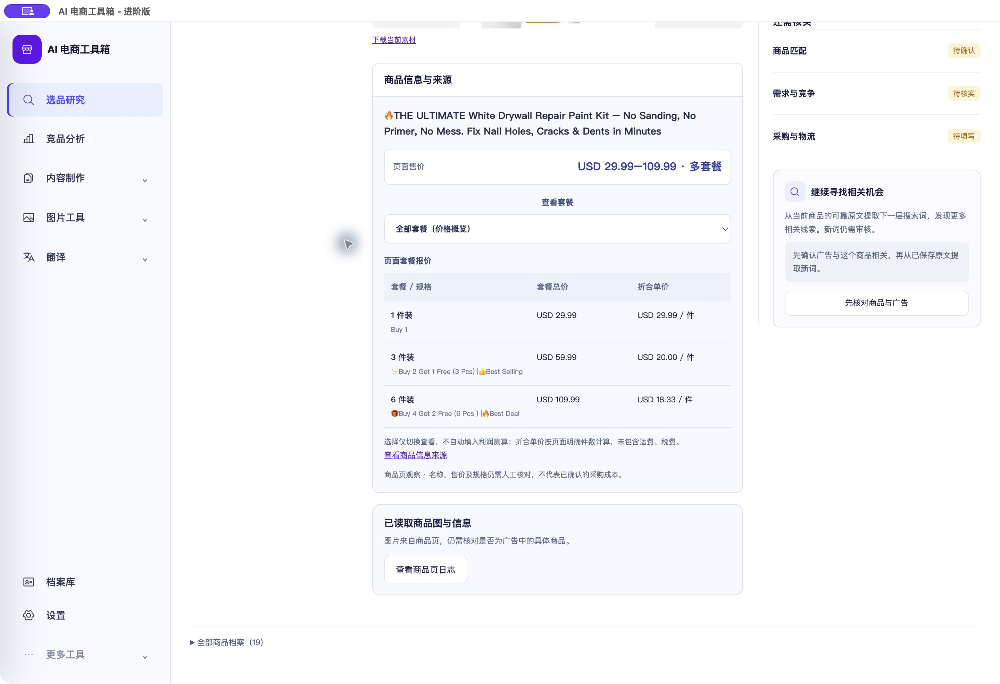
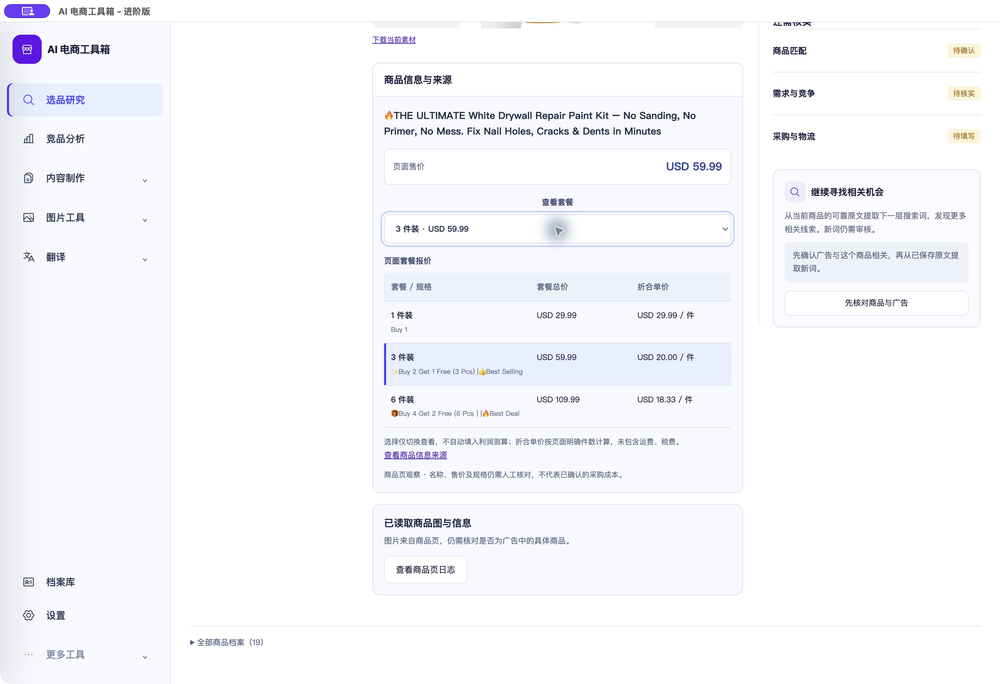

# 多套餐价格展示验收（2026-10-26）

<!-- project-doc-status:start -->
> **文档状态同步：2026-10-26 · 分轮审查与验收记录**
> 保留现场问题、截图、测试数量及未验证项；后续修复不抹去原问题记录，本轮同步没有重做该文档的原验收。
> 当前入口与验证范围：[项目当前状态](<../../项目当前状态.md>)；[2026-10-26流程修复与边界](<../2026-10-26-sop-flow-repair/验收记录.md>)。
<!-- project-doc-status:end -->

## 问题与结果

原页面已保存HTTP200商品内容和JSON-LD，但存在1/3/6件套餐的不同总价，原单价解析为避免误选返回空值，界面只显示“未获取售价”。

现在已保存证据的只读响应同时返回套餐选项及按币种拆分的区间。商品图Tab下显示区间、规格/套餐总价/折合单价明细和“查看套餐”选择；选中后更新当前查看价格与对应行高亮，不写入商品核对、采购成本或利润测算。

实际Romiantic（界面名Romiantic%6）与Proemptli.PR01均有：1件USD29.99，3件USD59.99，6件USD109.99；折合分别29.99、20.00、18.33/件（四舍五入）。仅表示已保存商品页面观察，不代表当前实时售价、含税到岸成本或已核实商品匹配。

## 数据规则

- 保留原scalar price与price_observation.amount语义：不强选最低价，不把区间写成单价，无数据库迁移；旧快照不修改，GET响应只读投影。
- 只读取当前商品的ProductGroup.hasVariant报价；variant与offer的链接均须指向同一商品路径，保留来源链接，忽略其他商品/站点。
- 只接受明确正数件数或不矛盾的Buy/Get赠品表达；不从重量、尺寸猜件数。多处件数、组合表达、包/套/袋/盒、乘法组合或件数/买赠冲突，保留总价而将件数及折合单价留空。
- 币种来自保存报价，不从目标市场推断；不同币种不合并成一个价格范围，无币种明确提示。0价格保留。
- 选择仅为面板局部查看状态，切换商品或重新渲染可重置；不是测算套餐保存功能。

## 实现文件

- `backend/modules/research/rabbit_hole/integrations/collectors/landing_price.py`：variant_prices/_package_quantity与saved_price_observation增强。
- `frontend/js/research-workbench/components/product-facts.mjs`：区间、表格、查看选择、单价提示。
- `frontend/css/research-polish.css`及`frontend/index.html`：局部样式及缓存版本。
- 对应后端解析、路由只读响应及前端组件回归测试。无新增依赖。

## 验证

- 新增测试先失败后通过；最终专项53通过（包含20项价格解析及原路由测试），覆盖不变性、套餐与币种、来源排除、去重、0价、无数量、买赠冲突、包/套/组合歧义；接口返回不修改存储对象。
- 完整前端884通过、桌面15通过；完整主后端在源码隔离目录最终1326通过，未访问真实数据库/外部付费服务。保留既有依赖弃用/模型命名警告。研究PostgreSQL全套本轮未运行。
- 独立只读代码复核发现两项件数语义P2（重复数字被去重、pack/set误算piece），已新增失败测试并修正；未用包数冒充件数。
- 使用现有私有PyInstaller6.16工具重新构建后端，未安装/升级项目依赖。首次最终构建输出到根目录生成的build/dist后，已将本轮生成产物移到私有final-build，空根目录已移除，未改用户业务文件。
- 自用客户端前后端已更新；安装可执行文件与最终构建哈希一致，2项前端源码/安装/9502响应字节一致，ad hoc签名与资源检查通过。客户DMG未重建。
- 实际客户端Romiantic商品图Tab显示USD29.99–109.99与3行套餐；原生选择6件装→显示109.99，再切3件装→59.99并高亮。未提交真实商品修改、未重新采集/翻译/调用收费AI/写飞书。客户端最终停在3件装查看状态。

## 回滚

私有目录 `/Users/xiachengpeng/.local/share/ai-ecommerce-desktop/closeout/20261025-variant-prices/` 保留source-before、previous.app、final-build及测试/构建日志。正常退出并确认9502/9503释放后可替换旧客户端；不恢复旧数据库。源码仅撤回本轮差异，保留无关变更。
